# Automatic Prefix Caching: Hashing, Reuse, and LRU Eviction

> The hash and cache behavior below is tied to [`vllm-project/vllm@6cf7b26bd`](https://github.com/vllm-project/vllm/tree/6cf7b26bd4bff60bf378e1af14044280ac0d214c). Code citations point into that revision. Where an excerpt skips unrelated code, the gap is shown as `...`; anything synthesized is called out explicitly.

## 1. What Prefix Caching Is, and the Reuse Win

Automatic Prefix Caching (APC) lets vLLM reuse resident KV blocks for a matching prompt prefix and begin fresh computation at the request-specific suffix. It pays off when a long document, system prompt, or conversation history stays fixed across requests ([APC feature guide](https://docs.vllm.ai/en/stable/features/automatic_prefix_caching/)).

What has to match is not the raw prompt bytes but the *token* prefix plus the context that changes KV semantics: the block key is `hash(parent_block_hash, tuple(block_token_ids), extra_keys)` ([`kv_cache_utils.py:579-604`](https://github.com/vllm-project/vllm/blob/6cf7b26bd4bff60bf378e1af14044280ac0d214c/vllm/v1/core/kv_cache_utils.py#L579-L604)), so two requests share KV when their prefixes tokenize to the same token IDs, their extra-key context (LoRA adapter, multimodal inputs, prompt embeds, cache salt — [Section 3](#3-extra-keys-multimodal-cache-salt-and-lora)) is consistent, and they run under the same per-process root seed (`NONE_HASH`, which enters through the parent-hash field, not `extra_keys`). Byte-identical prompts are the common case of that condition, not its definition.

The reuse win is worth stating precisely because it bounds everything downstream. Prefill cost is roughly linear in the number of prompt tokens the model must attend to. If a request of `N` tokens shares a `P`-token prefix with a cached entry, APC turns an `N`-token prefill into an `(N − P)`-token one; the KV for the first `P` tokens is read from HBM rather than regenerated. On a 4 000-token shared document with a 50-token question, the repeat request runs only ~2% of the prompt tokens through a fresh forward pass (50 of 4,050) — with no change to the tokens the model ultimately conditions on; its 50-token suffix still attends over the full cached prefix, whose KV is read from HBM, so wall-clock prefill time falls by somewhat less than that.

APC hashes full token blocks as a chain rather than reducing the prompt to one map key; [Section 2](#2-the-block-hash-chaining-tokens-into-a-fingerprint) develops the consequences.

**The gate: when hashing is even wired**

APC is not merely a runtime flag checked on the hot path; the per-request hasher is only *constructed* when it is needed, so a run with the feature off pays nothing — not even the object.

Source anchor — [`vllm/v1/engine/core.py:210-219`](https://github.com/vllm-project/vllm/blob/6cf7b26bd4bff60bf378e1af14044280ac0d214c/vllm/v1/engine/core.py#L210-L219):

```python
        self.request_block_hasher: Callable[[Request], list[BlockHash]] | None = None
        if vllm_config.cache_config.enable_prefix_caching or kv_connector is not None:
            caching_hash_fn = get_hash_fn_by_name(
                vllm_config.cache_config.prefix_caching_hash_algo
            )
            init_none_hash(caching_hash_fn)

            self.request_block_hasher = get_request_block_hasher(
                hash_block_size, caching_hash_fn
            )
```

`request_block_hasher` defaults to `None`; it is only replaced by a real closure when `enable_prefix_caching` is set *or* a `kv_connector` is present. The second disjunct matters: KV-transfer connectors (P/D disaggregation, KV offload) need block hashes as their transfer keys even when the local engine would not otherwise cache, so the hasher is wired for them too. Inside the branch, three things are bound *once* at engine construction and never renegotiated per request: the hash function is resolved from the configured `prefix_caching_hash_algo` ([Section 4](#4-the-hash-algorithm-sha256-vs-builtin-collisions-pythonhashseed)), `init_none_hash` seeds the chain's root sentinel with that same function ([Section 2](#2-the-block-hash-chaining-tokens-into-a-fingerprint), [Section 4](#4-the-hash-algorithm-sha256-vs-builtin-collisions-pythonhashseed)), and `get_request_block_hasher` captures the `hash_block_size` and the function into the closure stored on the request.

The closure binds one algorithm, root seed, and block size for the engine. If it remains `None`, the request never grows a `block_hashes` list, leaving nothing for lookup or publication.

There is a second, quieter gate that is a genuine *correctness* seam, not a performance one, and article 06 does not cover it. Prefix caching (and chunked prefill) assume causal attention; a layer that runs non-causally would have its KV corrupted by either. The engine detects such layers and force-disables the feature.

Source anchor — [`vllm/v1/engine/core.py:265-269`](https://github.com/vllm-project/vllm/blob/6cf7b26bd4bff60bf378e1af14044280ac0d214c/vllm/v1/engine/core.py#L265-L269):

```python
            if vllm_config.cache_config.enable_prefix_caching:
                logger.info(
                    "Disabling prefix caching: model has non-causal attention layers."
                )
                vllm_config.cache_config.enable_prefix_caching = False
```

<a href='images/vllm-07-11-hasher-gate.svg' target='_blank'>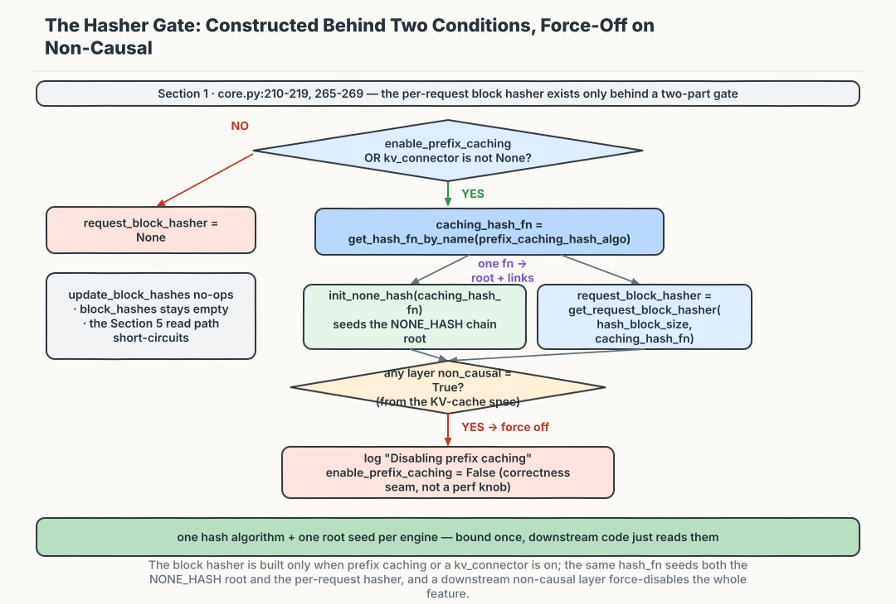</a>

<p class='figure-caption'>Gate deciding whether a per-request block hasher exists: constructed only when enable_prefix_caching or a kv_connector is set, then force-disabled downstream if any layer is non-causal.</p>

Non-causal layers tag their KV spec with `non_causal=True`; engine core translates that signal into scheduling policy and disables caching ([`core.py:249-269`](https://github.com/vllm-project/vllm/blob/6cf7b26bd4bff60bf378e1af14044280ac0d214c/vllm/v1/engine/core.py#L249-L269)). Reusing causal-prefix KV would not be valid for such a layer.

<a href='images/vllm-07-02-cache-hit.svg' target='_blank'>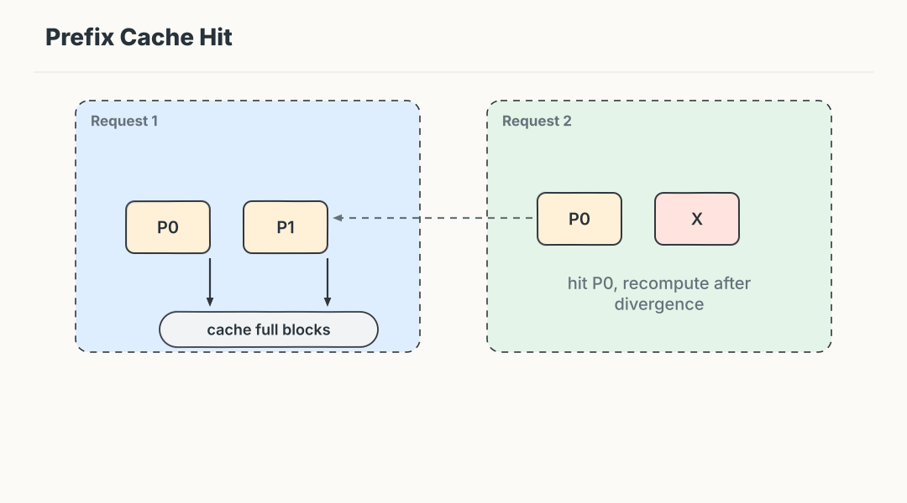</a>

<p class='figure-caption'>Prefix-cache lookup: matching leading block hashes are found in the pool and reference-counted before allocation proceeds.</p>

### Why V1 rebuilt prefix caching for near-zero overhead

V0 did not enable APC by default because misses could cost more bookkeeping than they saved. V1 reduced that overhead enough to target near-zero cost at low hit rates ([V1 alpha release](https://vllm.ai/blog/2025-01-27-v1-alpha-release)). Its intrusive free queue doubles as the LRU structure: a free block can remain a valid cached prefix until allocation reuses it, with O(1) removal and no background scan (article 06).

In practice, a cache is only worth enabling by default if it is cheap when it *misses*, and the token-weighted hit-rate accounting in [Section 8](#8-hit-rate-and-stats) is how vLLM lets an operator confirm the cache is actually paying off on their traffic rather than merely running.

**A hit is a shortcut, not a semantic change**

The design has one non-negotiable property: a prefix-cache hit changes *how fast* the model reaches an output, never *what* it computes. The clearest place this shows up is the head of the read path, which both guards against requests whose semantics forbid reuse and refuses to ever claim a 100% hit.

Source anchor — [`vllm/v1/core/kv_cache_manager.py:218-227`](https://github.com/vllm-project/vllm/blob/6cf7b26bd4bff60bf378e1af14044280ac0d214c/vllm/v1/core/kv_cache_manager.py#L218-L227):

```python
        if not self.enable_caching or request.skip_reading_prefix_cache:
            return self.empty_kv_cache_blocks, 0
        ...
        max_cache_hit_length = request.num_tokens - 1
```

<a href='images/vllm-07-12-reuse-win.svg' target='_blank'>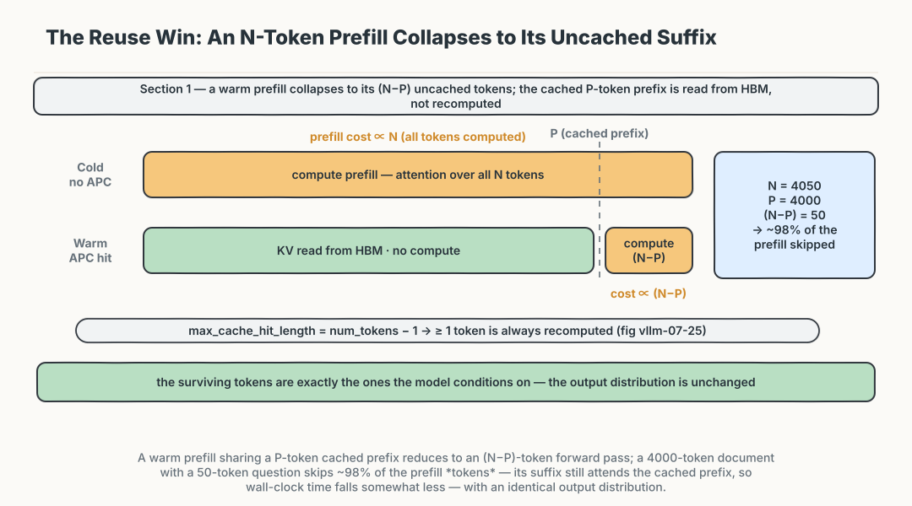</a>

<p class='figure-caption'>The reuse win: an N-token prefill sharing a P-token cached prefix leaves only N−P new token positions to prefill, while the first P tokens' KV is read from HBM. With a 4000-token cached document and a 50-token question, roughly 98% of the prompt positions are reused; latency and FLOPs fall by less because the new suffix still attends to the cached prefix.</p>

The guard rejects requests whose outputs require recomputing every prompt position. The `num_tokens - 1` cap also leaves a position from which to produce next-token logits; block alignment may consequently recompute the trailing block. Sections [5](#5-finding-the-longest-cache-hit) and [10](#10-when-caching-is-skipped) trace both cases.

## 2. The Block Hash: Chaining Tokens into a Fingerprint

APC identifies cached prefixes with per-block hashes. Unlike an independent digest of each block, vLLM computes `H(parent_block_hash, this_block_tokens, extra_keys)`. Including the parent turns the hashes into a chain: a match at block *i* represents the prefix through that block, subject to the hash and extra-key assumptions discussed below. Article 06 uses the resulting chain through `get_computed_blocks`, `allocate_slots`, and `touch`; here we examine how the keys are formed.

That one design choice turns each block hash into a rolling commitment to its entire prefix — a linear hash chain (a degenerate Merkle chain, fan-in 1) rooted at a per-process seed. Break-on-first-miss lookup ([Section 5](#5-finding-the-longest-cache-hit)), block-0-only cache salting ([Section 9](#9-cross-tenant-isolation-and-cache-salt)), and key reconstruction on the KV-event wire ([Section 11](#11-kv-cache-events-for-external-routers)) are all corollaries of this chaining, not independent features.

**The link type: opaque bytes, not an int**

A block hash is the raw digest, given a distinct type so it cannot be confused with an ordinary byte string or, worse, with the group-qualified lookup key.

Source: [`vllm/v1/core/kv_cache_utils.py:41-44`](https://github.com/vllm-project/vllm/blob/6cf7b26bd4bff60bf378e1af14044280ac0d214c/vllm/v1/core/kv_cache_utils.py#L41-L44)

```python
# BlockHash represents the hash of a single KV-cache block used for
# prefix caching.  Treating it as a distinct type from `bytes` helps
# catch accidental misuse when passing around raw byte strings.
BlockHash = NewType("BlockHash", bytes)
```

<a href='images/vllm-07-13-blockhash-type.svg' target='_blank'>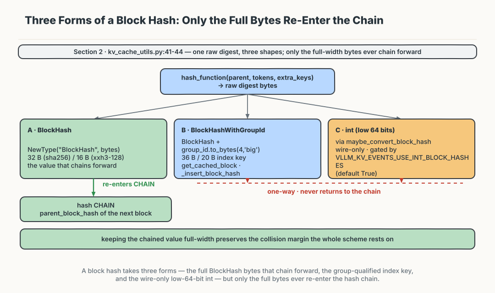</a>

<p class='figure-caption'>The three forms a block hash takes: the full-width BlockHash digest bytes that chain forward, the group-qualified BlockHashWithGroupId index key, and the wire-only low-64-bit int — only the full bytes ever re-enter the chain.</p>

`BlockHash` is a `NewType` over `bytes`; at runtime it *is* the digest — 32 bytes for SHA-256, 16 for xxh3-128 (the algorithm axis is [Section 4](#4-the-hash-algorithm-sha256-vs-builtin-collisions-pythonhashseed)'s subject). It is deliberately not an int. The only int form of a block hash is `maybe_convert_block_hash` (`:79-82`), a low-64-bit fold used exclusively for the KV-event wire ([Section 11](#11-kv-cache-events-for-external-routers)) and never fed back into the chain. Keeping the chained value as full-width bytes is what preserves the collision margin the whole scheme rests on.

### The recurrence: one link is `H(parent, tokens, extra_keys)`

A single function computes one link. Its pre-image is a fixed-order 3-tuple, and its base case anchors the chain to a root seed.

Source: [`kv_cache_utils.py:598-604`](https://github.com/vllm-project/vllm/blob/6cf7b26bd4bff60bf378e1af14044280ac0d214c/vllm/v1/core/kv_cache_utils.py#L598-L604) (from `hash_block_tokens`, sig at `:577`)

```python
    if not parent_block_hash:
        parent_block_hash = NONE_HASH

    curr_block_token_ids_tuple = tuple(curr_block_token_ids)
    return BlockHash(
        hash_function((parent_block_hash, curr_block_token_ids_tuple, extra_keys))
    )
```

<a href='images/vllm-07-14-link-preimage.svg' target='_blank'>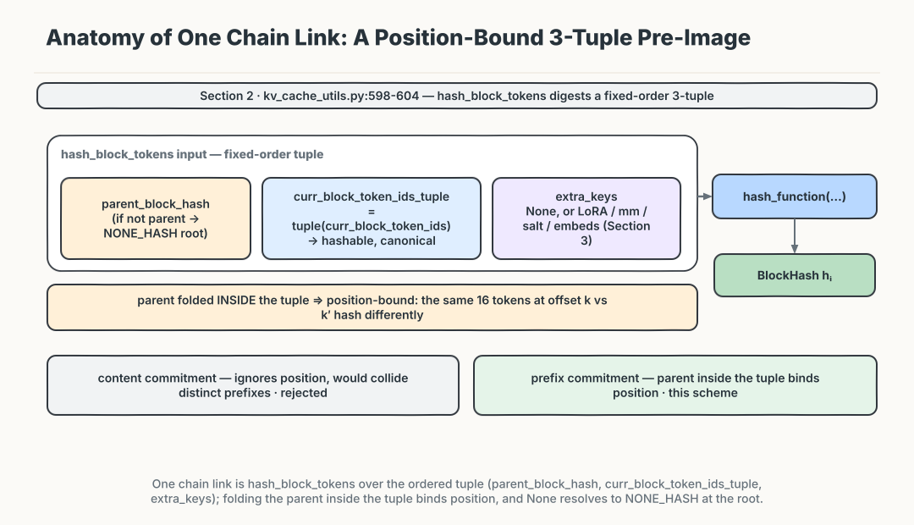</a>

<p class='figure-caption'>Anatomy of one chain link: hash_block_tokens digests the fixed-order 3-tuple (parent_block_hash, curr_block_token_ids_tuple, extra_keys), with the parent hash folded inside the tuple so position is bound and None resolves to NONE_HASH at the root.</p>

1. `if not parent_block_hash: parent_block_hash = NONE_HASH` is the base case. The driver passes `None` for the first block; the recurrence substitutes the module-global `NONE_HASH` root (its construction and the `PYTHONHASHSEED` seam belong to [Section 4](#4-the-hash-algorithm-sha256-vs-builtin-collisions-pythonhashseed)). A subtlety worth one line: `not parent_block_hash` is truthy for `None` *and* for empty bytes `b""`; an all-empty digest is effectively impossible for SHA-256/xxh3, so this is benign, not a bug.
2. The hashed pre-image is the 3-tuple `(parent_block_hash, curr_block_token_ids_tuple, extra_keys)`, in that fixed order, hashed atomically. Three fields: the recursive link to the whole prefix before this block; this block's own token ids (converted to a `tuple` so it is hashable and canonically serializable); and `extra_keys` — `None`, or the multimodal / LoRA / cache-salt / prompt-embeds side channel assembled by `generate_block_hash_extra_keys` (the entire subject of [Section 3](#3-extra-keys-multimodal-cache-salt-and-lora)).
3. `hash_function` serializes that tuple (pickle or canonical CBOR) and digests it; the docstring notes the whole tuple "is used as the hash key of the block" (`:595-596`).

A block hash commits to three inputs: the parent hash, this block's tokens, and this block's extra keys. Because `parent_block_hash` sits *inside* the tuple, position is bound through the preceding chain: the same 16-token block at prefix offset `k` versus `k'` normally yields a different hash because its parent differs. This is the difference between a *content* commitment and a *prefix* commitment. As with any hash-based index, the statement is subject to hash collisions.

**Driving the chain: full blocks only, append-only, carried forward**

A per-request closure materializes the chain one link per full block, resuming where the last call stopped and carrying each output into the next link's parent slot.

Source: [`kv_cache_utils.py:687-728`](https://github.com/vllm-project/vllm/blob/6cf7b26bd4bff60bf378e1af14044280ac0d214c/vllm/v1/core/kv_cache_utils.py#L687-L728) (elided), returned by `get_request_block_hasher`

```python
    def request_block_hasher(request: Request) -> list[BlockHash]:
        start_token_idx = len(request.block_hashes) * hash_block_size
        num_tokens = request.num_tokens
        ...
        prev_block_hash_value = (
            request.block_hashes[-1] if request.block_hashes else None
        )
        new_block_hashes: list[BlockHash] = []
        while True:
            end_token_idx = start_token_idx + hash_block_size
            if end_token_idx > num_tokens:
                # We only hash full blocks
                break
            ...
            block_tokens = request.all_token_ids[start_token_idx:end_token_idx]
            block_hash = hash_block_tokens(
                caching_hash_fn, prev_block_hash_value, block_tokens, extra_keys
            )

            new_block_hashes.append(block_hash)
            start_token_idx += hash_block_size
            prev_block_hash_value = block_hash

        return new_block_hashes
```

1. **Resumption.** `start_token_idx = len(request.block_hashes) * hash_block_size` — the already-committed hashes define exactly how many aligned tokens are already fingerprinted; new work begins at that boundary. The chain is incremental and never re-hashes an earlier link.
2. **Carry seed.** `prev_block_hash_value = request.block_hashes[-1] if request.block_hashes else None`. A brand-new request seeds `None` (→ `NONE_HASH`); a decoding request seeds the last committed hash, so generated blocks chain seamlessly onto the prompt's chain: one continuous chain across prefill and decode.
3. **Full-block-only loop.** `end_token_idx = start_token_idx + hash_block_size; if end_token_idx > num_tokens: break` (`:708-711`). A trailing partial block is left un-hashed until it fills, so a given `BlockHash` always corresponds to an exact, aligned token count. This is the reason a partial tail can never be looked up, shared, or evicted through the hash map ([Section 5](#5-finding-the-longest-cache-hit), [Section 10](#10-when-caching-is-skipped)).
4. **The chaining step.** After computing `block_hash`, the loop does `prev_block_hash_value = block_hash` (`:726`). *That single assignment is the chain*: this iteration's output becomes the next iteration's `parent_block_hash`. Remove it and you have independent per-block digests with none of the prefix-commitment properties below.
5. **Granularity.** Hashing runs at `hash_block_size`, the GCD-derived hashing granularity, which can be finer than a group's physical `block_size` (the "e.g. 16" figure is an example, not a constant). Coarser consumers reuse these same links via `BlockHashListWithBlockSize` rather than re-hashing (docstring `:681-684`; article 06 covers how those coarse keys ride into `cache_full_blocks`), so there is exactly one canonical chain per request.

The chain is append-only and monotone. `request.block_hashes[-1]` is always the live head, `len(block_hashes) * hash_block_size` is the exact committed token count, and earlier links are immutable once their tokens are fixed. Preemption and speculative-token rejection never truncate it (article 06's write-funnel section).

### Where the chain lives: append-only on the Request

Source: [`vllm/v1/request.py:184-189`](https://github.com/vllm-project/vllm/blob/6cf7b26bd4bff60bf378e1af14044280ac0d214c/vllm/v1/request.py#L184-L189) (init) and `:242-245` (extend)

```python
    def update_block_hashes(self) -> None:
        """Compute block hashes for any new full blocks and append them."""
        if self._block_hasher is not None:
            self.block_hashes.extend(self._block_hasher(self))
```

`request.block_hashes` persists the chain. `update_block_hashes` runs after construction and each token append, adding only newly completed links; entry `i` covers `[0, (i+1)·hash_block_size)`. `_block_hasher` is stored without binding `self` to avoid a `Request → partial → Request` reference cycle (`:185-188`).

### Why block *i* certifies its entire prefix

Unroll the recurrence back to the root, for hashing granularity `B = hash_block_size`:

<a href='images/vllm-07-01-block-hash-chain.svg' target='_blank'>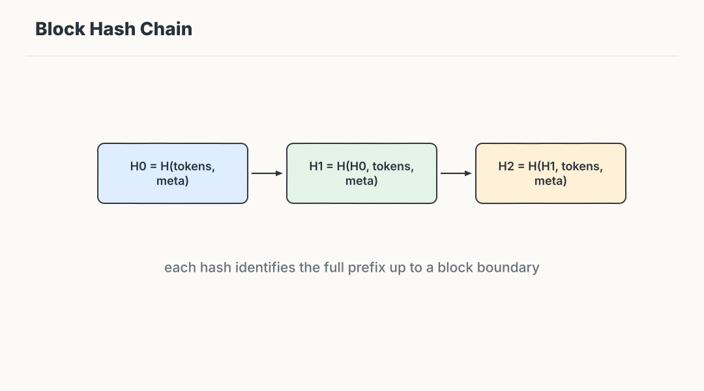</a>

<p class='figure-caption'>Each block hash folds in its parent, so h_i transitively commits to every token and extra key in tokens[0:(i+1)·B] and the root seed.</p>

```
h_0 = H(NONE_HASH, tokens[0:B],          e_0)
h_1 = H(h_0,       tokens[B:2B],         e_1)
h_2 = H(h_1,       tokens[2B:3B],        e_2)
...
h_i = H(h_{i-1},   tokens[i*B:(i+1)*B],  e_i)
```

Substituting transitively, `h_i` is a function of `NONE_HASH` **and** every token in `tokens[0:(i+1)*B]` **and** every extra key `e_0..e_i`. Three properties follow, and each underwrites a feature elsewhere in the article:

- **Soundness (forward certification).** Two requests that agree on `h_i` agree — up to hash collision for the cryptographic algorithms ([Section 4](#4-the-hash-algorithm-sha256-vs-builtin-collisions-pythonhashseed)) — on the entire prefix `[0,(i+1)*B)`, its extra-key context, and the root seed. This is *exactly* why lookup can trust a matching `h_i` to mean a matching prefix, and why `find_longest_cache_hit` can scan left-to-right and **break on the first miss** ([Section 5](#5-finding-the-longest-cache-hit)): a miss at block *k* means blocks `≥ k` differ, because the chain is downward-closed.
- **Avalanche (tamper propagation).** Changing a token at position `p` (block `j = p // B`) or an `e_j` changes the preimage at link `j`. With a collision-resistant digest, `h_j` and the downstream hashes are expected to change as that new parent value propagates through the chain. As with any hash-based commitment, this statement is subject to the digest's collision properties.
- **Position binding.** Identical content at a different offset yields a different `h_i`, because the parent differs. A hash commits to content *at its prefix position*.

Structurally this is a **hash chain**, not a Merkle *tree*: linear, fan-in 1, no sibling branches and no membership-proof machinery. A link certifies its *entire prefix*, not an individual element within it. The "Merkle-style" framing is apt only in that each link is `H(parent ‖ new-data)` and integrity propagates transitively to the root — the same mental model the "Inside vLLM" write-up uses when it describes hashing the previous block's hash together with the current tokens and metadata ([Inside vLLM](https://vllm.ai/blog/2025-09-05-anatomy-of-vllm)).

### The root seed as a domain-separation input

The base case binds block 0 to `NONE_HASH`, so separate processes need the same root to reproduce the chain; portable reconstruction also needs canonical CBOR. The default random root prevents offline reconstruction without that value. Per-tenant `cache_salt` instead enters block 0 through `extra_keys`, as Sections [3](#3-extra-keys-multimodal-cache-salt-and-lora) and [9](#9-cross-tenant-isolation-and-cache-salt) detail.

## 3. Extra Keys: Multimodal, Cache Salt, and LoRA

Token ids alone cannot identify KV semantics: the same ids may stand for different images, adapters, prompt embeddings, or tenant namespaces. `extra_keys` concatenates those sources in the fixed order `lora + mm + cache_salt + prompt_embeds` ([`kv_cache_utils.py:539-574`](https://github.com/vllm-project/vllm/blob/6cf7b26bd4bff60bf378e1af14044280ac0d214c/vllm/v1/core/kv_cache_utils.py#L539-L574)). Because the encoding has no source tags, its isolation guarantee assumes values from different source domains do not alias.

<a href='images/vllm-07-03-extra-keys.svg' target='_blank'>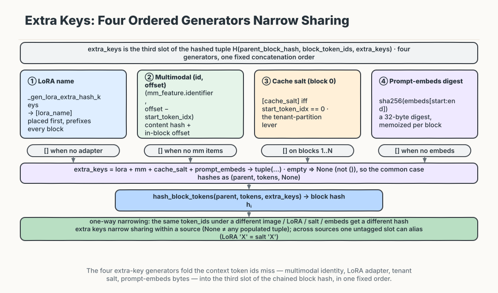</a>

<p class='figure-caption'>Four ordered generators (LoRA name, multimodal (id, offset), block-0 salt, prompt-embeds digest) fold into the `extra_keys` slot of the chained block hash.</p>

**The assembly point: generate_block_hash_extra_keys**

One function collects all four context sources for a `[start_token_idx, end_token_idx)` block and returns them as one ordered tuple, or `None`.

Source: [`vllm/v1/core/kv_cache_utils.py:555-574`](https://github.com/vllm-project/vllm/blob/6cf7b26bd4bff60bf378e1af14044280ac0d214c/vllm/v1/core/kv_cache_utils.py#L555-L574)

```python
    mm_extra_keys: list[Any]
    mm_extra_keys, new_start_mm_idx = _gen_mm_extra_hash_keys(
        request, start_token_idx, end_token_idx, start_mm_idx
    )
    lora_extra_keys: list[str] = _gen_lora_extra_hash_keys(request)
    cache_salt_keys: list[str] = (
        [request.cache_salt] if (start_token_idx == 0 and request.cache_salt) else []
    )
    prompt_embeds_keys = _gen_prompt_embeds_extra_hash_keys(
        request, start_token_idx, end_token_idx
    )

    extra_keys: list[Any] = (
        lora_extra_keys + mm_extra_keys + cache_salt_keys + prompt_embeds_keys
    )

    if not extra_keys:
        return None, new_start_mm_idx

    return tuple(extra_keys), new_start_mm_idx
```

The source order is fixed: `lora + mm + cache_salt + prompt_embeds`. An empty result becomes `None`, while any populated result is a positional tuple with no source tags. Operational types make most cross-source aliases unlikely, but the encoding does not prove domain separation. The chain driver calls the function once per full block; absent sources return `[]` cheaply.

The declarative predicate `need_extra_keys` ([`kv_cache_utils.py:411-428`](https://github.com/vllm-project/vllm/blob/6cf7b26bd4bff60bf378e1af14044280ac0d214c/vllm/v1/core/kv_cache_utils.py#L411-L428), "Multimodal requests need to include the MM hash … LoRA requests … cache salt") states the same three arming conditions but has **no in-tree caller at this commit** — the actual gating is that each of the four generators short-circuits to `[]` when its source is absent, so the cost of the common case is four cheap early returns, not a skipped call.

### Multimodal keys: (content-hash, in-block offset)

The token ids that represent an image, audio clip, or video frame are interchangeable dummy placeholders; the real content lives outside the token stream. So a multimodal block must be keyed by *what* the item is and *where* it sits inside the block.

The identity field is defined at [`vllm/multimodal/inputs.py:322-323`](https://github.com/vllm-project/vllm/blob/6cf7b26bd4bff60bf378e1af14044280ac0d214c/vllm/multimodal/inputs.py#L322-L323):

```python
    identifier: str
    """The hash for caching encoder outputs (with LoRA prefix if applicable)."""
```

The corresponding key emission is at [`vllm/v1/core/kv_cache_utils.py:466-495`](https://github.com/vllm-project/vllm/blob/6cf7b26bd4bff60bf378e1af14044280ac0d214c/vllm/v1/core/kv_cache_utils.py#L466-L495):

```python
    curr_mm_idx = start_mm_idx
    while mm_features and curr_mm_idx < len(mm_features):
        mm_feature = mm_features[curr_mm_idx]
        assert mm_feature.identifier is not None
        offset = mm_feature.mm_position.offset
        length = mm_feature.mm_position.length
        if end_token_idx > offset:
            if start_token_idx >= offset + length:
                # This block has passed the current mm input.
                curr_mm_idx += 1
                continue

            # The block contains the current mm input. Include its offset
            # relative to the start of the block so prefix-cache keys stay
            # distinct when the same MM item appears at different positions
            # within otherwise-identical placeholder blocks.
            extra_keys.append((mm_feature.identifier, offset - start_token_idx))

            if end_token_idx >= offset + length:
                # If this block contains the end of the current mm input,
                # move to the next mm input as this block may also contain
                # the next mm input.
                curr_mm_idx += 1
            else:
                # Otherwise this block is done with mm inputs.
                break
        else:
            # This block has not reached the current mm input.
            break
    return extra_keys, curr_mm_idx
```

<a href='images/vllm-07-15-mm-key-scan.svg' target='_blank'>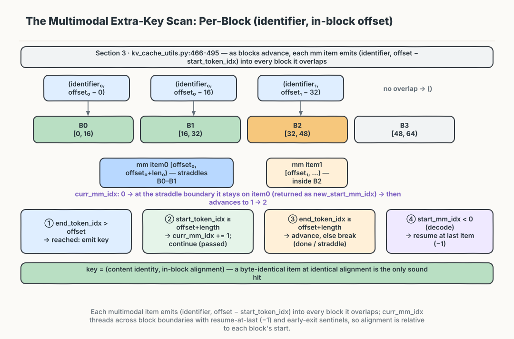</a>

<p class='figure-caption'>The multimodal extra-key scan: as blocks advance, each mm item [offset, length) emits (identifier, offset − start_token_idx) into blocks it overlaps, threading curr_mm_idx across block boundaries with resume-at-last (−1) and early-exit sentinels.</p>

The emitted key is the pair `(mm_feature.identifier, offset - start_token_idx)`. The first element is a content hash of the multimodal item, and per its docstring it already bakes in the LoRA prefix — so different images (or the same image under a different adapter) produce different identifiers even though their placeholder token ids are identical. The second element is the item's offset **relative to the block start**, not the absolute prompt offset. The inline comment names the reason precisely: keep keys distinct "when the same MM item appears at different positions within otherwise-identical placeholder blocks." Two blocks holding the same image at a different in-block alignment must not alias, because the KV they produce depends on that alignment.

The loop is a stateful scan, not a per-block lookup. Multiple items can fall in one block, so it `append`s several `(id, off)` pairs before breaking; a block that straddles an item boundary leaves `curr_mm_idx` on the unfinished item and returns it, so the *next* block's call resumes there — this is the `new_start_mm_idx` threaded back through `generate_block_hash_extra_keys`. Two early exits keep decode-phase blocks cheap: `_gen_mm_extra_hash_keys` returns immediately if `not mm_features` (`:451-452`) or if the last item ends before this block starts (`last_pos.offset + last_pos.length <= start_token_idx`, `:457-459`). And `start_mm_idx < 0` is a "resume at the last mm input" sentinel (`:461-464`): the chain driver sets `curr_mm_idx = -1` when `start_token_idx > 0` (`:695-701`), because a block being completed by *generated* tokens can only overlap the final multimodal item.

**LoRA key: adapter name isolates adapters**

The same token ids produce different KV under different LoRA adapters, so adapter identity must enter the hash.

Source: [`vllm/v1/core/kv_cache_utils.py:498-510`](https://github.com/vllm-project/vllm/blob/6cf7b26bd4bff60bf378e1af14044280ac0d214c/vllm/v1/core/kv_cache_utils.py#L498-L510)

```python
def _gen_lora_extra_hash_keys(request: Request) -> list[str]:
    ...
    if not request.lora_request:
        return []
    return [request.lora_request.lora_name]
```

A non-LoRA request contributes `[]`; a LoRA request contributes a single string, `lora_name`, placed **first** in the concatenation (`:567-568`) so it prefixes every block's extra-key content. The design keys on the adapter *name*, not its tensors — an operational contract that name↔weights is a stable 1:1 mapping. Two distinct adapters served under the same name would alias (unsound); the cost of hashing full weight bytes per block is traded for the assumption that names are unique per weight set. Note the redundancy with the multimodal path: the mm `identifier` already carries a LoRA prefix, so a LoRA-conditioned image is isolated twice over.

### Cache salt: the block-0 tenant partition

The cache salt is a caller-supplied opaque string that forces isolation even when tokens are identical — the explicit multi-tenant privacy lever, in contrast to the mm/LoRA keys which isolate on *implicit* content differences.

Source: [`vllm/v1/core/kv_cache_utils.py:560-562`](https://github.com/vllm-project/vllm/blob/6cf7b26bd4bff60bf378e1af14044280ac0d214c/vllm/v1/core/kv_cache_utils.py#L560-L562)

```python
    cache_salt_keys: list[str] = (
        [request.cache_salt] if (start_token_idx == 0 and request.cache_salt) else []
    )
```

The salt enters only block 0 (`start_token_idx == 0`). Since each later link includes its parent, differing salts separate the descendant chains as well; requests that intend to share must present the same salt. [Section 9](#9-cross-tenant-isolation-and-cache-salt) covers the threat model, entropy requirement, and event-stream exposure.

**Prompt-embeds key: hash the embedding bytes**

When a request supplies raw prompt *embeddings* instead of token ids, the token ids no longer fingerprint the content, so the embedding bytes themselves must be hashed in.

Source: [`vllm/v1/core/kv_cache_utils.py:527-536`](https://github.com/vllm-project/vllm/blob/6cf7b26bd4bff60bf378e1af14044280ac0d214c/vllm/v1/core/kv_cache_utils.py#L527-L536)

```python
    if request.prompt_embeds is None:
        return []
    block_range = (start_token_idx, end_token_idx)
    embeds_hash = request._prompt_embeds_per_block_hashes.get(block_range)
    if embeds_hash is None:
        block_prompt_embeds = request.prompt_embeds[start_token_idx:end_token_idx]
        # Hash prompt embeds once per block and cache on request
        embeds_hash = hashlib.sha256(tensor_data(block_prompt_embeds)).digest()
        request._prompt_embeds_per_block_hashes[block_range] = embeds_hash
    return [embeds_hash]
```

<a href='images/vllm-07-16-extra-key-matrix.svg' target='_blank'>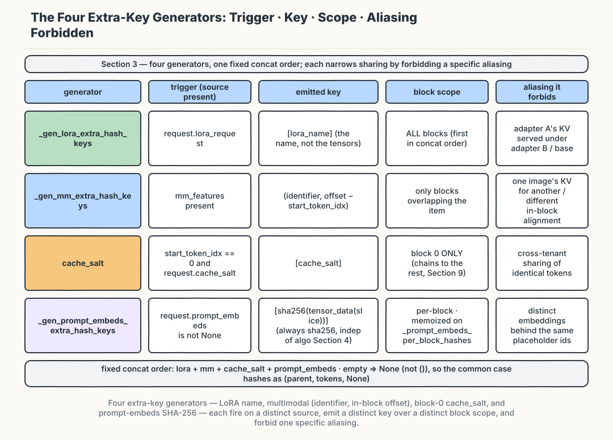</a>

<p class='figure-caption'>Comparison matrix of the four extra-key generators — LoRA name, multimodal (identifier, in-block offset), block-0 cache_salt, prompt-embeds SHA-256 — showing each one's trigger, emitted key, block scope, and the aliasing it forbids.</p>

Absent prompt embeds, the generator returns `[]`. Otherwise the per-block embedding slice is reduced to a 32-byte digest and that digest becomes the extra key, memoized per `(start, end)` on `request._prompt_embeds_per_block_hashes` ([`request.py:129`](https://github.com/vllm-project/vllm/blob/6cf7b26bd4bff60bf378e1af14044280ac0d214c/vllm/v1/request.py#L129)) to avoid rehashing a slice across decode steps. One detail matters for [Section 4](#4-the-hash-algorithm-sha256-vs-builtin-collisions-pythonhashseed): this inner reduction is **always `hashlib.sha256`**, independent of `prefix_caching_hash_algo`. The configurable algorithm governs only the *outer* block hash; the embedding bytes are pre-reduced to a stable SHA-256 digest here so the outer hasher only ever sees a fixed-width key, never a variable-length tensor.

Identical embedding bytes produce the same per-block SHA-256 key. Different bytes produce different keys except in the event of a SHA-256 collision, so placeholder token ids alone cannot make distinct embeddings share a block under that assumption.

## 4. The Hash Algorithm: sha256 vs builtin, Collisions, PYTHONHASHSEED

The configured hash function determines the collision risk and whether another process can reproduce the chain from the same inputs. The available choices also differ in serialization and their dependence on `PYTHONHASHSEED`. The following path traces those differences from configuration to the bytes stored in each `BlockHash`.

One correction up front on the section title. There is **no `builtin` option in this source version.** The historical "builtin" name referred to CPython's native `hash()` — a randomized, per-process integer hash that older prefix-caching code used directly. At commit `6cf7b26bd` the block hash is never Python's builtin `hash()`; the only vestige of that world is `NONE_HASH`, which *mimics* builtin `hash()`'s randomized-seed behavior for the chain root (below), not for the links. The real axis is **sha256 (cryptographic, default) versus xxhash (xxh3-128, fast, non-cryptographic)**, crossed with a serializer choice.

### The option set: two orthogonal axes

The algorithm is a `Literal` of four names, selected by the `prefix_caching_hash_algo` config field.

Source: [`vllm/config/cache.py:39`](https://github.com/vllm-project/vllm/blob/6cf7b26bd4bff60bf378e1af14044280ac0d214c/vllm/config/cache.py#L39):

```python
PrefixCachingHashAlgo = Literal["sha256", "sha256_cbor", "xxhash", "xxhash_cbor"]
```

Source: the field and its docstring, [`vllm/config/cache.py:95-110`](https://github.com/vllm-project/vllm/blob/6cf7b26bd4bff60bf378e1af14044280ac0d214c/vllm/config/cache.py#L95-L110):

```python
    prefix_caching_hash_algo: PrefixCachingHashAlgo = "sha256"
    """Set the hash algorithm for prefix caching:

    - "sha256" uses Pickle for object serialization before hashing. This is the current
      default, as SHA256 is the most secure choice to avoid potential hash collisions.
    - "sha256_cbor" provides a reproducible, cross-language compatible hash. It
      serializes objects using canonical CBOR and hashes them with SHA-256.
    - "xxhash" uses Pickle serialization with xxHash (128-bit) for faster,
      non-cryptographic hashing. Requires the optional ``xxhash`` package.
      IMPORTANT: Use of a hashing algorithm that is not considered  cryptographically
      secure theoretically increases the risk of hash collisions, which can cause
      undefined behavior or even leak private information in multi-tenant environments.
      Even if collisions are still very unlikely, it is important to consider your
      security risk tolerance against the performance benefits before turning this on.
    - "xxhash_cbor" combines canonical CBOR serialization with xxHash for
      reproducible hashing. Requires the optional ``xxhash`` package."""
```

The four names are the product of two independent binary choices, not four unrelated algorithms:

- **Serializer** — how the pre-image 3-tuple `(parent_block_hash, tokens, extra_keys)` ([Section 2](#2-the-block-hash-chaining-tokens-into-a-fingerprint)) becomes bytes. `pickle` (the un-suffixed names) is fast and Python-native but *not* byte-stable across Python versions or object layouts. `canonical CBOR` (the `_cbor` names) is a deterministic, language-independent wire encoding.
- **Digest** — how those bytes become a fixed-width fingerprint. `SHA-256` (32 bytes, cryptographic collision resistance) versus `xxh3-128` (16 bytes, a fast non-cryptographic hash).

The default is `"sha256"`: pickle plus SHA-256. Note the docstring's own framing — SHA-256 is "the most secure choice to avoid potential hash collisions," and the xxhash branch carries an explicit, verbatim security warning that its non-cryptographic digest "theoretically increases the risk of hash collisions, which can cause undefined behavior or even leak private information in multi-tenant environments." That last clause is the config author's wording, not a demonstrated exploit; the mechanism it points at is real and is exactly the cross-tenant isolation argument in [Section 9](#9-cross-tenant-isolation-and-cache-salt).

<a href='images/vllm-07-04-hash-algo.svg' target='_blank'>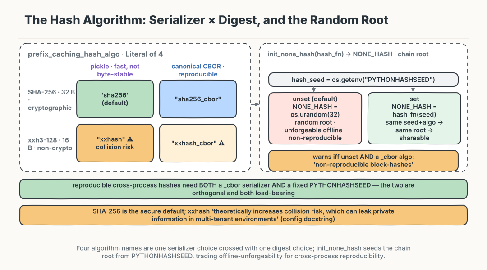</a>

<p class='figure-caption'>The four hash-algo names as a serializer (pickle vs canonical CBOR) crossed with digest (SHA-256 vs xxh3-128) matrix, with the PYTHONHASHSEED branch feeding NONE_HASH.</p>

**The implementations**

Each name resolves to a one-line function: serialize, then digest.

Source: [`vllm/utils/hashing.py:26-100`](https://github.com/vllm-project/vllm/blob/6cf7b26bd4bff60bf378e1af14044280ac0d214c/vllm/utils/hashing.py#L26-L100) (excerpted):

```python
def sha256(input: Any) -> bytes:
    ...
    input_bytes = pickle.dumps(input, protocol=pickle.HIGHEST_PROTOCOL)
    return hashlib.sha256(input_bytes).digest()


def sha256_cbor(input: Any) -> bytes:
    ...
    input_bytes = cbor2.dumps(input, canonical=True)
    return hashlib.sha256(input_bytes).digest()


def _xxhash_digest(input_bytes: bytes) -> bytes:
    if _xxhash is None:
        raise ModuleNotFoundError(...)
    return _xxhash.xxh3_128_digest(input_bytes)


def xxhash(input: Any) -> bytes:
    """Hash picklable objects using xxHash."""
    input_bytes = pickle.dumps(input, protocol=pickle.HIGHEST_PROTOCOL)
    return _xxhash_digest(input_bytes)


def xxhash_cbor(input: Any) -> bytes:
    """Hash objects serialized with CBOR using xxHash."""
    input_bytes = cbor2.dumps(input, canonical=True)
    return _xxhash_digest(input_bytes)


def get_hash_fn_by_name(hash_fn_name: str) -> Callable[[Any], bytes]:
    ...
    if hash_fn_name == "sha256":
        return sha256
    if hash_fn_name == "sha256_cbor":
        return sha256_cbor
    if hash_fn_name == "xxhash":
        return xxhash
    if hash_fn_name == "xxhash_cbor":
        return xxhash_cbor
    raise ValueError(f"Unsupported hash function: {hash_fn_name}")
```

Every variant returns raw `bytes`: the digest, never an int. This matters because the chain type `BlockHash = NewType("BlockHash", bytes)` ([`vllm/v1/core/kv_cache_utils.py:41-44`](https://github.com/vllm-project/vllm/blob/6cf7b26bd4bff60bf378e1af14044280ac0d214c/vllm/v1/core/kv_cache_utils.py#L41-L44)) is `bytes`, and the chained value fed back as the next block's parent is that raw digest: 32 bytes for the SHA-256 variants, 16 bytes for the xxh3-128 variants. The `xxhash` import is deliberately optional ([`hashing.py:14-23`](https://github.com/vllm-project/vllm/blob/6cf7b26bd4bff60bf378e1af14044280ac0d214c/vllm/utils/hashing.py#L14-L23) gates on `hasattr(_xxhash, "xxh3_128_digest")` and `_xxhash_digest` raises `ModuleNotFoundError` if it is absent) — a security-hardened deployment can simply not install it, and the default path never touches it.

Do **not** conflate the 128-bit chain digest with the 64-bit integer that appears on the KV-events wire. `maybe_convert_block_hash` ([`kv_cache_utils.py:79-82`](https://github.com/vllm-project/vllm/blob/6cf7b26bd4bff60bf378e1af14044280ac0d214c/vllm/v1/core/kv_cache_utils.py#L79-L82)) folds the digest to a low-64-bit int only for external emission when `VLLM_KV_EVENTS_USE_INT_BLOCK_HASHES` is set (default `True`, [`vllm/envs.py:249`](https://github.com/vllm-project/vllm/blob/6cf7b26bd4bff60bf378e1af14044280ac0d214c/vllm/envs.py#L249)); that truncated int is never fed back into the chain. The chain always carries the full-width digest. Events are [Section 11](#11-kv-cache-events-for-external-routers)'s concern.

The digest width and the raw-bytes type are what make the chain a chain: `parent_block_hash` is fed verbatim into the next link's pre-image ([Section 2](#2-the-block-hash-chaining-tokens-into-a-fingerprint)), so the collision resistance of one link *is* the collision resistance of the whole prefix commitment. Choosing `xxhash` weakens every downstream assertion, not just the last block's.

### Why CBOR exists: reproducibility

Pickle is fast but produces bytes that can differ across Python versions and object representations; canonical CBOR is a fixed, cross-language encoding. The `_cbor` variants exist so that two *different processes* can compute the *same* block hash for the same logical prefix.

That reproducibility is the enabling condition for everything that crosses an environment boundary: prefill/decode (P/D) disaggregation, KV offload to a second tier, warm restart of an engine against a persisted cache, and external KV routers that reconstruct block hashes from `(parent, tokens, extra_keys)` off the events stream ([Section 11](#11-kv-cache-events-for-external-routers)). Pickle bytes depend on Python and object-serialization details, so they are not a portable cross-version or cross-language contract. Compatible processes can still agree on pickle output, but deployments that require a stable, interoperable encoding should use canonical CBOR.

Portable hash agreement requires a byte-stable serializer. Canonical CBOR supplies that serialization contract but, as the next part shows, does not by itself make the chain reproducible: the root must also agree.

**The determinism seam: NONE_HASH and PYTHONHASHSEED**

Every chain is rooted at `NONE_HASH`, the stand-in parent for the first block ([Section 2](#2-the-block-hash-chaining-tokens-into-a-fingerprint)). If the root differs between two processes, every downstream hash differs — so reproducibility of the *serializer* is moot unless the *root* is also reproducible. `NONE_HASH` is initialized from `PYTHONHASHSEED`.

Source: declaration and rationale, [`vllm/v1/core/kv_cache_utils.py:87-96`](https://github.com/vllm-project/vllm/blob/6cf7b26bd4bff60bf378e1af14044280ac0d214c/vllm/v1/core/kv_cache_utils.py#L87-L96):

```python
# The hash seed for the first block of any prefix block sequence.
#
# We use a random value to avoid hash collisions or PYTHONHASHSEED environment
# variable if set such that processes can share the seed if needed. This aligns
# with the behavior of Python's hash() function, which also uses a random seed
# if PYTHONHASHSEED is not set.
#
# The function `init_none_hash` initializes this variable globally.
NONE_HASH: BlockHash
_CBOR_HASH_FUNCTIONS = frozenset({sha256_cbor, xxhash_cbor})
```

<a href='images/vllm-07-17-none-hash-determinism.svg' target='_blank'>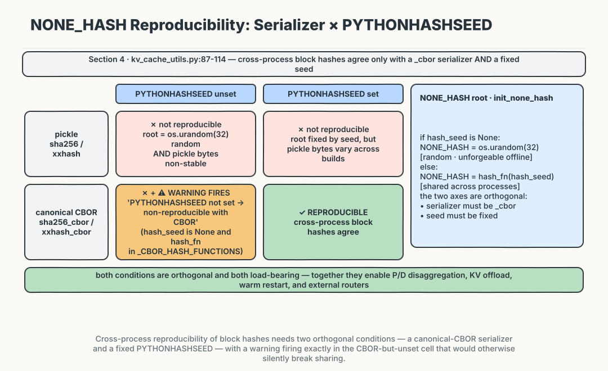</a>

<p class='figure-caption'>Reproducibility decision matrix for NONE_HASH: PYTHONHASHSEED unset → per-process os.urandom(32) root; set → hash_fn(seed) root — crossed with pickle versus canonical CBOR. Portable, cross-version reconstruction needs a _cbor algorithm and a fixed seed; compatible pickle-based processes may also agree, but that byte representation is not the interoperability contract.</p>

Source: the initializer, [`vllm/v1/core/kv_cache_utils.py:99-114`](https://github.com/vllm-project/vllm/blob/6cf7b26bd4bff60bf378e1af14044280ac0d214c/vllm/v1/core/kv_cache_utils.py#L99-L114):

```python
def init_none_hash(hash_fn: Callable[[Any], bytes]):
    global NONE_HASH

    hash_seed = os.getenv("PYTHONHASHSEED")
    if hash_seed is None and hash_fn in _CBOR_HASH_FUNCTIONS:
        logger.warning(
            "PYTHONHASHSEED is not set. This will lead to non-reproducible "
            "block-hashes when using CBOR-based hash functions such as "
            "sha256_cbor or xxhash_cbor. Consider setting PYTHONHASHSEED to a "
            "fixed value for reproducibility."
        )

    if hash_seed is None:
        NONE_HASH = BlockHash(os.urandom(32))
    else:
        NONE_HASH = BlockHash(hash_fn(hash_seed))
```

Two regimes, chosen by whether `PYTHONHASHSEED` is present in the environment:

1. **Unset → `NONE_HASH = os.urandom(32)`.** Thirty-two fresh random bytes per process. The chain root is unpredictable to an observer who cannot read process state, which makes offline reproduction or precomputation impractical and causes independently initialized processes to derive different roots with overwhelming probability. It matches CPython's randomized `hash()` behavior in spirit, but only for the root, not the links. The cost is that independently initialized block hashes are non-reproducible across processes.

2. **Set → `NONE_HASH = hash_fn(hash_seed)`.** The seed string is run through the *same* configured hash function, so every process configured with the same seed and the same algorithm derives the same root, and (given a canonical serializer) the same chains. This is the opt-in for reproducible, shareable caches.

The warning is the tell. It fires **only** when `hash_seed is None` *and* `hash_fn in {sha256_cbor, xxhash_cbor}` (i.e. for the variants that expose a portable serializer). Selecting a CBOR algorithm but leaving `PYTHONHASHSEED` unset still randomizes the root, so independently initialized chains will differ. For the pickle variants, the warning would not establish portable reproducibility: a fixed root does not make pickle a cross-version serialization contract. Compatible processes may nevertheless produce the same bytes.

### One algorithm per engine, chosen once

The algorithm is not a per-request knob; it is resolved once at engine construction and the same function object threads through both the root and every link.

Source: the resolution body inside the engine gate, [`vllm/v1/engine/core.py:212-219`](https://github.com/vllm-project/vllm/blob/6cf7b26bd4bff60bf378e1af14044280ac0d214c/vllm/v1/engine/core.py#L212-L219) ([Section 1](#1-what-prefix-caching-is-and-the-reuse-win) shows the full `if ... enable_prefix_caching or kv_connector` gate; here we read only what it resolves):

```python
            caching_hash_fn = get_hash_fn_by_name(
                vllm_config.cache_config.prefix_caching_hash_algo
            )
            init_none_hash(caching_hash_fn)

            self.request_block_hasher = get_request_block_hasher(
                hash_block_size, caching_hash_fn
            )
```

The resolved function seeds `NONE_HASH` and computes every later link, so one engine uses one `(serializer, digest, root)` triple. Engines that reconstruct the same keys need compatible serialization, digest selection, and root seed; tenant salt is a separate input to the keyed chain.

## 5. Finding the Longest Cache Hit

At admission time, the scheduler needs the resident prefix length. `get_computed_blocks` answers by comparing the request's hash chain ([Section 2](#2-the-block-hash-chaining-tokens-into-a-fingerprint)) with the block pool's `hash → block` index. The scan stops at the first miss because later hashes include the missing link as an ancestor. Article 06 follows the returned blocks into `allocate_slots`; article 05 consumes the resulting `num_computed_tokens` value.

<a href='images/vllm-07-05-longest-hit.svg' target='_blank'>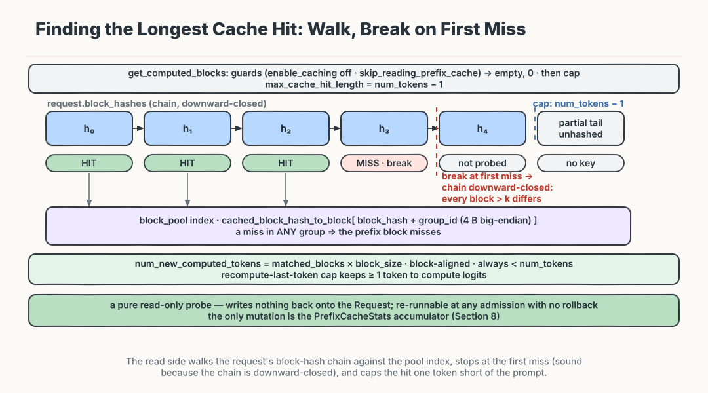</a>

<p class='figure-caption'>Prefix walk of the request block-hash chain against the pool index, stopping at the first miss and capped one token short of the prompt.</p>

**The manager entry: two guards and the recompute-last-token cap**

Before any lookup runs, `get_computed_blocks` short-circuits, then caps the search below the prompt end.

[`vllm/v1/core/kv_cache_manager.py:214-232`](https://github.com/vllm-project/vllm/blob/6cf7b26bd4bff60bf378e1af14044280ac0d214c/vllm/v1/core/kv_cache_manager.py#L214-L232):

```python
        # We skip finding the prefix cache hit when prefix caching is
        # disabled or the request is marked as skipping kv cache read
        # (which happens when the request requires prompt logprobs
        # or calls a pooling model with all pooling).
        if not self.enable_caching or request.skip_reading_prefix_cache:
            return self.empty_kv_cache_blocks, 0

        # NOTE: When all tokens hit the cache, we must recompute the last token
        # to obtain logits. Thus, set max_cache_hit_length to prompt_length - 1.
        # This can trigger recomputation of an entire block, rather than just
        # the single last token, because allocate_slots() requires
        # num_computed_tokens to be block-size aligned. Removing this limitation
        # could slightly improve performance in the future.
        max_cache_hit_length = request.num_tokens - 1
        computed_blocks, num_new_computed_tokens = (
            self.coordinator.find_longest_cache_hit(
                request.block_hashes, max_cache_hit_length
            )
        )
```

The two guards (global `enable_caching` off, or the per-request `skip_reading_prefix_cache` flag) return the pre-constructed immutable `empty_kv_cache_blocks` singleton ([`kv_cache_manager.py:177-179`](https://github.com/vllm-project/vllm/blob/6cf7b26bd4bff60bf378e1af14044280ac0d214c/vllm/v1/core/kv_cache_manager.py#L177-L179)) with `0` computed tokens, forcing the scheduler to treat the whole prompt as uncomputed. The skip flag is set once at request construction for requests that need prompt logprobs (which require the real forward pass over every prompt position) or an all-pooling model; [Section 10](#10-when-caching-is-skipped) enumerates the full skip taxonomy including the write-side skips. Then `max_cache_hit_length = request.num_tokens - 1`. `request.num_tokens` is `len(_all_token_ids)`, so this subtracts exactly one token from the prompt length.

The cap ensures that **the forward pass always has at least one token to compute**. If lookup could report a 100% hit, `allocate_slots` would schedule zero new tokens and the first decode step would have no position at which to produce logits. Note the second-order effect flagged in the comment: because hits are block-aligned, dropping below `num_tokens` can force recompute of an *entire* last block, not just one token — a fully-cached prompt of exactly `2 * block_size` tokens yields `(2*block_size - 1) // block_size = 1` block of hit, so the whole second block is recomputed. That is the price of keeping `num_computed_tokens` block-aligned for `allocate_slots` (article 06 covers that alignment requirement). The `record` call right below this ([`kv_cache_manager.py:234-240`](https://github.com/vllm-project/vllm/blob/6cf7b26bd4bff60bf378e1af14044280ac0d214c/vllm/v1/core/kv_cache_manager.py#L234-L240)) feeds the hit into `PrefixCacheStats`; [Section 8](#8-hit-rate-and-stats) details that accounting.

### The hit logic: break on first miss

The manager delegates to `coordinator.find_longest_cache_hit`, which for full attention lands in `FullAttentionManager.find_longest_cache_hit`: the concrete scan.

[`vllm/v1/core/single_type_kv_cache_manager.py:585-613`](https://github.com/vllm-project/vllm/blob/6cf7b26bd4bff60bf378e1af14044280ac0d214c/vllm/v1/core/single_type_kv_cache_manager.py#L585-L613):

```python
        computed_blocks: tuple[list[KVCacheBlock], ...] = tuple(
            [] for _ in range(len(kv_cache_group_ids))
        )
        block_size = kv_cache_spec.block_size
        if dcp_world_size * pcp_world_size > 1:
            block_size *= dcp_world_size * pcp_world_size
        max_num_blocks = max_length // block_size
        for block_hash in itertools.islice(block_hashes, max_num_blocks):
            # block_hashes is a chain of block hashes. If a block hash is not
            # in the cached_block_hash_to_id, the following block hashes are
            # not computed yet for sure.
            if cached_block := block_pool.get_cached_block(
                block_hash, kv_cache_group_ids
            ):
                for computed, cached in zip(computed_blocks, cached_block):
                    computed.append(cached)
            else:
                break
        if drop_eagle_block and computed_blocks[0]:
            # Need to drop the last matched block if eagle is enabled.
            for computed in computed_blocks:
                computed.pop()
        while (
            block_size != alignment_tokens  # Faster for common case.
            and len(computed_blocks[0]) * block_size % alignment_tokens != 0
        ):
            for computed in computed_blocks:
                computed.pop()
        return computed_blocks
```

The cap arrives in tokens, but `max_num_blocks = max_length // block_size` limits the scan to full blocks. The loop walks left to right and stops at its first miss. Since every later hash includes that missing link as an ancestor ([Section 2](#2-the-block-hash-chaining-tokens-into-a-fingerprint)), probing farther cannot extend the resident prefix.

Two trims follow the scan. `drop_eagle_block` pops the last matched block: EAGLE/MTP speculative decoding must recompute the last matched block to obtain the hidden states its draft head consumes, so that block cannot be served from cache. Then the final `while` pops blocks until the hit length is a multiple of `alignment_tokens` (the coordinator passes `scheduler_block_size`); this guarantees the returned length is scheduler-block aligned even when the group's own `block_size` is finer, and the `block_size != alignment_tokens` short-circuit skips the loop entirely in the common single-granularity case.

The result is that **hits are always full-block, block-aligned, monotone prefixes**. A trailing partial block has no hash, cannot be looked up, and cannot be shared. Combined with the cap above, `num_new_computed_tokens` is always a block-aligned count strictly below `num_tokens`.

**The hit predicate: all groups must agree**

`get_cached_block` is what "in the cache" actually means. It is not a raw content-hash lookup: the real index key folds in the KV-cache group id.

[`vllm/v1/core/block_pool.py:213-224`](https://github.com/vllm-project/vllm/blob/6cf7b26bd4bff60bf378e1af14044280ac0d214c/vllm/v1/core/block_pool.py#L213-L224):

```python
        cached_blocks = []
        for group_id in kv_cache_group_ids:
            block_hash_with_group_id = make_block_hash_with_group_id(
                block_hash, group_id
            )
            block = self.cached_block_hash_to_block.get_one_block(
                block_hash_with_group_id
            )
            if not block:
                return None
            cached_blocks.append(block)
        return cached_blocks
```

The key is packed by `make_block_hash_with_group_id` — the raw content digest with the group id appended as four big-endian bytes ([`vllm/v1/core/kv_cache_utils.py:57-66`](https://github.com/vllm-project/vllm/blob/6cf7b26bd4bff60bf378e1af14044280ac0d214c/vllm/v1/core/kv_cache_utils.py#L57-L66)):

```python
    return BlockHashWithGroupId(block_hash + group_id.to_bytes(4, "big", signed=False))
```

<a href='images/vllm-07-18-group-agreement-key.svg' target='_blank'>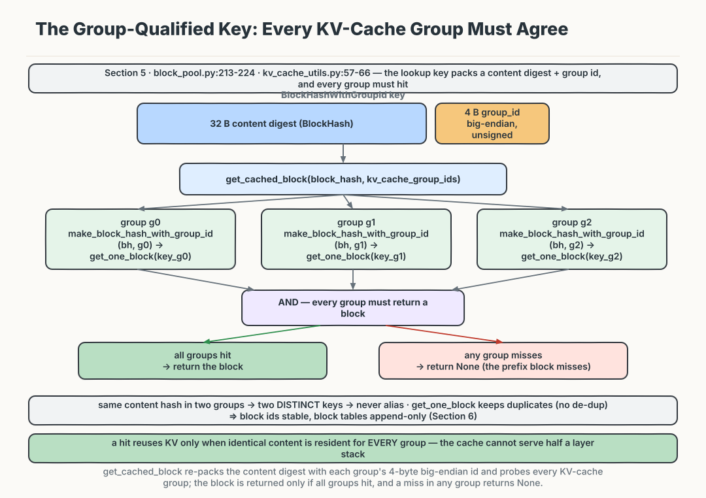</a>

<p class='figure-caption'>The group-qualified lookup key: get_cached_block re-packs the 32/16-byte content digest with each group's 4-byte big-endian id via make_block_hash_with_group_id and demands a hit in every KV-cache group — a miss in any group returns None.</p>

For every group id in the spec's group list, the content hash is re-packed with that group's id and probed against `cached_block_hash_to_block`. A miss in *any* group returns `None`: the whole prefix block misses. `get_one_block` ([`block_pool.py:62-73`](https://github.com/vllm-project/vllm/blob/6cf7b26bd4bff60bf378e1af14044280ac0d214c/vllm/v1/core/block_pool.py#L62-L73)) returns the first block when several physical blocks share a key (duplicates arise when concurrent requests cache identical content — the index does not de-duplicate, so block ids stay stable and block tables stay append-only; [Section 6](#6-caching-finalized-blocks) details that `BlockHashToBlockMap` promotion). The group id in the key is what prevents two groups that happen to hash identical tokens but hold different KV (different attention type, different layer grouping) from aliasing each other's blocks.

A hit reuses KV only when identical content is resident **for every KV-cache group** that shares the spec — you cannot serve half a layer stack from cache. This is why the write side ([Section 6](#6-caching-finalized-blocks)) publishes a block into every group's key, and why the read side demands agreement across all of them.

### Coordinator dispatch: three variants of "longest hit"

`get_computed_blocks` calls `self.coordinator.find_longest_cache_hit`, and which coordinator is instantiated fixes the semantics. All three return the same shape (a per-group block tuple plus a token count) but reach it differently.

**No-cache.** For a disabled or unsupported cache, the coordinator returns a structural miss ([`vllm/v1/core/kv_cache_coordinator.py:417-425`](https://github.com/vllm-project/vllm/blob/6cf7b26bd4bff60bf378e1af14044280ac0d214c/vllm/v1/core/kv_cache_coordinator.py#L417-L425)): empty per-manager lists and `0`. The manager-level guard usually short-circuits before this, but it makes "no hits" total for the non-caching path.

**Unitary** (a single KV-cache group — all layers full attention, or all sliding window). It delegates once to the single manager and returns `len(hit_blocks[0]) * self.block_size` ([`kv_cache_coordinator.py:481-497`](https://github.com/vllm-project/vllm/blob/6cf7b26bd4bff60bf378e1af14044280ac0d214c/vllm/v1/core/kv_cache_coordinator.py#L481-L497)), asserting `hash_block_size == block_size` so `alignment_tokens` is the group's own block size and the final `while` trim is a no-op.

**Hybrid** (multiple specs, e.g. full attention interleaved with sliding-window). Here "longest hit" is the *intersection* of every spec-group's hit, computed as a monotone-decreasing fixed point ([`kv_cache_coordinator.py:677-726`](https://github.com/vllm-project/vllm/blob/6cf7b26bd4bff60bf378e1af14044280ac0d214c/vllm/v1/core/kv_cache_coordinator.py#L677-L726)):

```python
        while True:
            curr_hit_length = hit_length

            for idx, (spec, group_ids, manager_cls, use_eagle) in enumerate(
                self.attention_groups
            ):
                cached_blocks = hit_blocks_by_group[group_ids[0]]
                if isinstance(spec, FullAttentionSpec) and cached_blocks is not None:
                    # Full attention is downward-closed: we only need to look
                    # up cached blocks once; on subsequent iterations just trim
                    # to the (reduced) current hit length.
                    curr_hit_length = (
                        curr_hit_length // spec.block_size * spec.block_size
                    )
                    continue
                ...
            if curr_hit_length >= hit_length:
                break
            hit_length = curr_hit_length
            if is_simple_hybrid:
                break
```

<a href='images/vllm-07-19-coordinator-dispatch.svg' target='_blank'>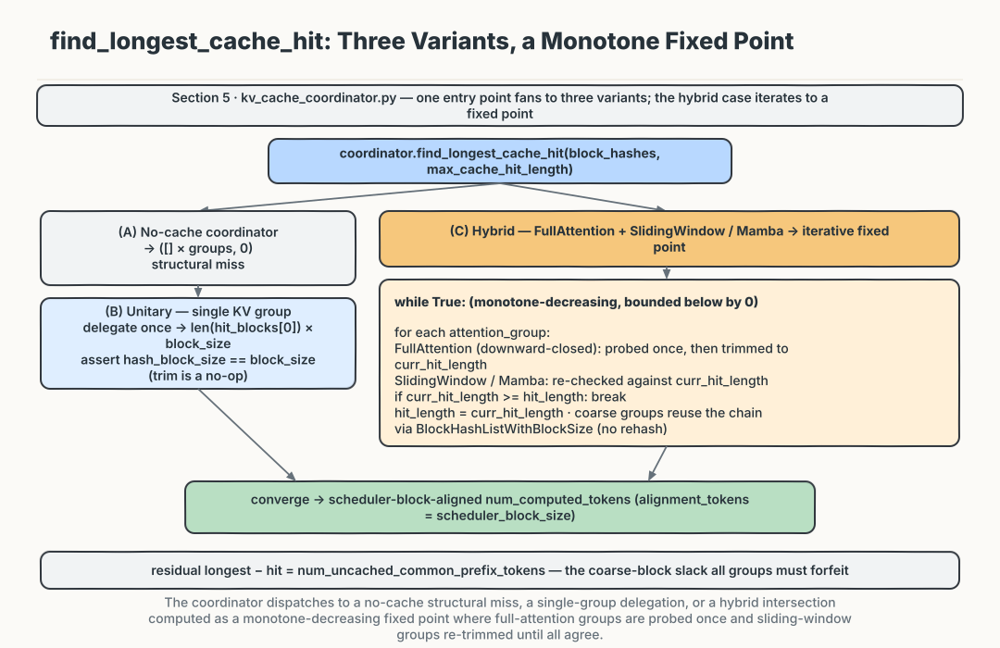</a>

<p class='figure-caption'>The three find_longest_cache_hit variants: no-cache structural miss, unitary single-group delegation, and hybrid intersection computed as a monotone-decreasing fixed point where full-attention groups are probed once and sliding-window groups re-trimmed until all agree.</p>

Each attention group either accepts the current candidate `curr_hit_length` or shrinks it; any shrink drives another sweep. It converges because the length monotonically decreases and is bounded below by 0 (docstring `:636-642`). Full-attention groups are placed first and are downward-closed — they are probed once and thereafter only trimmed to the reduced length (`:684-691`), while a sliding-window group may need re-checking because its resident window shifts. `alignment_tokens=self.scheduler_block_size` forces every group's contribution onto the coarse scheduler block so the final `hit_length` is one all groups agree on. The residual `longest_hit_length - hit_length` is recorded as `num_uncached_common_prefix_tokens` (`:738`): if one group cached a longer prefix than the agreed intersection, that gap is a common prefix worth caching that some group has not yet materialized.

When a group's `block_size` exceeds `hash_block_size`, `_get_block_hashes` wraps the same chain in `BlockHashListWithBlockSize` (`:654-659`), which returns the hash at the last `hash_block_size` boundary inside each coarse block — that hash already chains the whole prefix, so no rehashing is needed; the single append-only `block_hashes` serves every group.

For a hybrid model the returned prefix is a hit **for every spec group simultaneously**, scheduler-block aligned — a single `num_computed_tokens` cursor that `allocate_slots` can treat as valid across heterogeneous KV layouts.

## 6. Caching Finalized Blocks

Lookup can return only blocks the write path has published. Publication is bounded by finalized tokens, delayed for P/D receives, restricted to full blocks, and skipped for null or masked blocks. `_insert_block_hash` assigns a primary identity and records later aliases in `BlockHashToBlockMap` when one key resolves to several physical blocks.

The write path protects one thing: **only full blocks of finalized (non-draft) tokens, filled with valid KV, at a boundary a future lookup could actually land on, are ever published.** Each layer clamps one slice of that sentence.

**Layer 1: which tokens are finalized (the draft-excluding cap)**

Publishing KV for a token that might be rolled back would leave a stale alias in the index. Speculative draft tokens are exactly those tokens. The cap sits at the tail of `allocate_slots`.

[`vllm/v1/core/kv_cache_manager.py:449-461`](https://github.com/vllm-project/vllm/blob/6cf7b26bd4bff60bf378e1af14044280ac0d214c/vllm/v1/core/kv_cache_manager.py#L449-L461):

```python
        if not self.enable_caching or delay_cache_blocks:
            return self.create_kv_cache_blocks(new_blocks)

        # NOTE(woosuk): We want to commit (cache) up to num_local_computed_tokens
        # + num_external_computed_tokens + num_new_tokens, but must exclude
        # "non-committable" tokens (e.g., draft tokens that could be rejected).
        # Therefore, we cap the number at `request.num_tokens`, ensuring only
        # "finalized" tokens are cached.
        num_tokens_to_cache = min(
            total_computed_tokens + num_new_tokens,
            request.num_tokens,
        )
        self.coordinator.cache_blocks(request, num_tokens_to_cache)
```

`request.num_tokens` is `len(self._all_token_ids)` ([`vllm/v1/request.py:251-253`](https://github.com/vllm-project/vllm/blob/6cf7b26bd4bff60bf378e1af14044280ac0d214c/vllm/v1/request.py#L251-L253)) — committed tokens only. Draft tokens live in `spec_token_ids` and surface only through `num_tokens_with_spec` ([`request.py:255-257`](https://github.com/vllm-project/vllm/blob/6cf7b26bd4bff60bf378e1af14044280ac0d214c/vllm/v1/request.py#L255-L257)); they are never in `_all_token_ids`. So `min(total_computed_tokens + num_new_tokens, request.num_tokens)` structurally floors the count back to the finalized boundary: the left operand may have run ahead into speculative territory, the cap pulls it back. The `not self.enable_caching or delay_cache_blocks` early return above it is the two write-side skips ([Section 10](#10-when-caching-is-skipped)): the global gate, and the P/D `delay_cache_blocks` case where a block's KV must still be received from a remote worker and so cannot be advertised as present yet. This layer ensures that a rejected draft never leaves a cache alias, and that a block whose KV is not yet local is never published.

### Layer 3 — floor to full blocks, and the high-water mark

The finalized token count is still a token count. `cache_blocks` turns it into a *block set* at the group's own `block_size`, and, critically, remembers how far it already published so re-entry each decode step is cheap and cannot double-publish.

[`vllm/v1/core/single_type_kv_cache_manager.py:338-363`](https://github.com/vllm-project/vllm/blob/6cf7b26bd4bff60bf378e1af14044280ac0d214c/vllm/v1/core/single_type_kv_cache_manager.py#L338-L363):

```python
        num_cached_blocks = self.num_cached_block.get(request.request_id, 0)
        num_full_blocks = num_tokens // self.block_size

        if num_cached_blocks >= num_full_blocks:
            return

        block_mask = self.reachable_block_mask(
            start_block=num_cached_blocks,
            end_block=num_full_blocks,
            ...
        )
        self.block_pool.cache_full_blocks(...)  # kwargs elided; funnel body is article 06's

        self.num_cached_block[request.request_id] = num_full_blocks
```

`num_full_blocks = num_tokens // self.block_size` is an **integer floor**: the trailing partial block (`num_tokens % block_size` tokens) is not eligible — the code-level twin of the hasher's "only hash full blocks" break ([Section 2](#2-the-block-hash-chaining-tokens-into-a-fingerprint)). `num_cached_block[request_id]` is a per-request high-water mark; the eligible window is precisely `blocks[num_cached_blocks : num_full_blocks]`, and `if num_cached_blocks >= num_full_blocks: return` short-circuits when nothing new filled since the previous decode step. After the pool call, the mark advances to `num_full_blocks`. `reachable_block_mask` returns `None` for full attention — "cache every (non-null) block" ([`single_type_kv_cache_manager.py:376-383`](https://github.com/vllm-project/vllm/blob/6cf7b26bd4bff60bf378e1af14044280ac0d214c/vllm/v1/core/single_type_kv_cache_manager.py#L376-L383)) — while SWA/Mamba subclasses override it to drop interior blocks that a windowed, right-to-left lookup could never consult. Publishing is monotone and idempotent (a block is processed once, ever), and only full, reachable blocks reach the pool.

**Layer 4 — the publish: `cache_full_blocks`**

`cache_full_blocks` does not compute hashes. It consumes `request.block_hashes`, the append-only chain the request hasher produced eagerly ([Section 2](#2-the-block-hash-chaining-tokens-into-a-fingerprint)), and for each eligible block seats one key.

[`vllm/v1/core/block_pool.py:280-306`](https://github.com/vllm-project/vllm/blob/6cf7b26bd4bff60bf378e1af14044280ac0d214c/vllm/v1/core/block_pool.py#L280-L306):

```python
        for i, blk in enumerate(new_full_blocks):
            # Some blocks may be null or masked out when enabling sparse attention
            # like sliding window attention, or Mamba models with prefix-caching
            # in align mode. We skip null blocks here.
            if blk.is_null or (block_mask is not None and not block_mask[i]):
                continue
            block_hash = new_block_hashes[i]
            num_hash_tokens = (num_cached_blocks + i + 1) * block_size

            # Update and added the full block to the cache.
            block_hash_with_group_id = make_block_hash_with_group_id(
                block_hash, kv_cache_group_id
            )
            if blk.block_hash is not None:
                # The only valid case where a "new full block" already has a
                # hash is partial->full promotion of the same cache block.
                assert (
                    blk.block_hash_num_tokens is not None
                    and blk.block_hash_num_tokens < num_hash_tokens
                )
                removed_hashes = self._remove_cached_block_hashes(blk)
                self._emit_block_removed_events(removed_hashes)
            self._insert_block_hash(
                block_hash_with_group_id,
                blk,
                num_tokens=num_hash_tokens,
            )
```

<a href='images/vllm-07-20-write-funnel.svg' target='_blank'>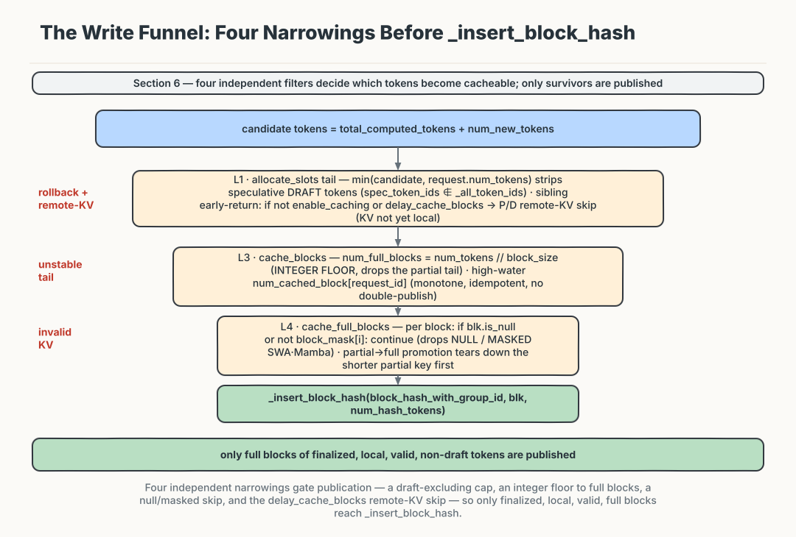</a>

<p class='figure-caption'>The write path's four independent narrowings of 'which tokens become cacheable': draft-excluding cap (rollback), integer floor to full blocks (unstable tail), null/masked skip (invalid KV), and the delay_cache_blocks remote-KV skip — only survivors reach _insert_block_hash.</p>

Reading the fourth narrowing and the promotion, step by step:

1. **Null/mask skip** (`:284`). `blk.is_null or (block_mask is not None and not block_mask[i])` — a masked or null block is treated like a hole and stays out of the map. This is the last narrowing of "which tokens": Layer 1 removed drafts, Layer 3 removed the partial tail, this removes attention regions that cannot serve a valid hit. Caching them would manufacture hits over KV that the reader would then read as garbage.
2. **`num_hash_tokens = (num_cached_blocks + i + 1) * block_size`** (`:287`): the prefix length in tokens this block's KV covers. It is stored alongside the key and is the quantity the promotion assertion compares.
3. **Group-id key** (`:290-292`). `make_block_hash_with_group_id` appends the 4-byte big-endian group id to the raw digest ([`kv_cache_utils.py:57-66`](https://github.com/vllm-project/vllm/blob/6cf7b26bd4bff60bf378e1af14044280ac0d214c/vllm/v1/core/kv_cache_utils.py#L57-L66)), so the same content hash in two KV-cache groups becomes two distinct group-qualified byte keys. [Section 5](#5-finding-the-longest-cache-hit) covers this helper on the read side; the write side must use the identical packing or the two halves would silently disagree.
4. **Partial→full promotion** (`:293-301`). A block in the eligible window should not already carry a hash — the Layer 3 high-water mark excludes already-published blocks, and eviction resets the hash on reallocation ([Section 7](#7-lru-eviction-the-free-queue-as-eviction-order)). The one legal exception is a block earlier registered as a *partial* alias (a sub-`block_size` cache entry) now filling to a full block. `assert blk.block_hash_num_tokens < num_hash_tokens` enforces that the pre-existing identity strictly covers fewer tokens; `_remove_cached_block_hashes(blk)` ([`block_pool.py:484-503`](https://github.com/vllm-project/vllm/blob/6cf7b26bd4bff60bf378e1af14044280ac0d214c/vllm/v1/core/block_pool.py#L484-L503)) then strips every old key off the block — resetting its primary hash via `reset_hash()` and popping each alias out of the index — before the new, longer key seats. An eviction event mirrors the teardown ([Section 11](#11-kv-cache-events-for-external-routers)).

The resulting rule is simple: every published block carries exactly one full-block content hash, keyed by `(hash, group id)`, covering a known finalized prefix length, and any pre-existing identity is a strictly-shorter partial that is torn down first — never two live full-block identities on one physical block.

### How a block enters the index: `_insert_block_hash`

This is the write-once mirror of eviction, and the piece 06 summarizes but does not read.

[`vllm/v1/core/block_pool.py:520-540`](https://github.com/vllm-project/vllm/blob/6cf7b26bd4bff60bf378e1af14044280ac0d214c/vllm/v1/core/block_pool.py#L520-L540):

```python
    def _insert_block_hash(
        self,
        block_hash_with_group_id: BlockHashWithGroupId,
        block: KVCacheBlock,
        num_tokens: int | None,
    ) -> None:
        if block.block_hash == block_hash_with_group_id:
            return

        if self.cached_block_hash_to_block.contain(
            block_hash_with_group_id, block.block_id
        ):
            return

        if block.block_hash is None:
            block.set_block_hash(block_hash_with_group_id, num_tokens=num_tokens)
        else:
            self.cached_block_hashes_by_block.setdefault(block.block_id, set()).add(
                block_hash_with_group_id
            )
        self.cached_block_hash_to_block.insert(block_hash_with_group_id, block)
```

Two idempotency early-outs first: the block already advertises this exact key (`:526-527`), or the forward index already resolves this key to this block id (`:529-532`). Either makes re-entry a no-op. Then the split that matters:

- **No primary hash yet** → `set_block_hash` makes this key the block's write-once primary `_block_hash` and stamps `_block_hash_num_tokens` ([`kv_cache_utils.py:148-157`](https://github.com/vllm-project/vllm/blob/6cf7b26bd4bff60bf378e1af14044280ac0d214c/vllm/v1/core/kv_cache_utils.py#L148-L157)). `set_block_hash` opens with `assert self.block_hash is None and self._block_hash_num_tokens is None` — the primary is write-once; the *only* legal path back to `None` is eviction's `reset_hash()` (`:159-162`), which nothing else calls. A block therefore has at most one primary identity in its lifetime-between-evictions.
- **Already has a primary** → the new key is recorded as a *secondary alias* in `cached_block_hashes_by_block[block_id]` (`:536-539`). This is how one physical block can be reachable under several keys (e.g. across group ids) while still owning a single canonical `_block_hash`.

Either way, `cached_block_hash_to_block.insert(key, block)` (`:540`) adds the reverse edge. As a result, a block's advertised primary key and the index's resolution of that key can never silently diverge, and because eviction reads *both* `_block_hash` and `cached_block_hashes_by_block[block_id]`, `_remove_cached_block_hashes` strips every key pointing at a block in one pass: no orphaned alias can survive to produce a phantom hit.

**The index type: a map that changes shape on collision**

`cached_block_hash_to_block` is a `BlockHashToBlockMap` ([`block_pool.py:185`](https://github.com/vllm-project/vllm/blob/6cf7b26bd4bff60bf378e1af14044280ac0d214c/vllm/v1/core/block_pool.py#L185)), not a plain dict. Its storage is a union whose per-key shape flips the first time two blocks land on one key.

[`vllm/v1/core/block_pool.py:89-105`](https://github.com/vllm-project/vllm/blob/6cf7b26bd4bff60bf378e1af14044280ac0d214c/vllm/v1/core/block_pool.py#L89-L105):

```python
    def insert(self, key: BlockHashWithGroupId, block: KVCacheBlock) -> None:
        blocks = self._cache.get(key)
        if blocks is None:
            # When key is not found, attach a single block to the key
            self._cache[key] = block
        elif isinstance(blocks, KVCacheBlock):
            # If there's a block with the same key, merge the original block
            # and the new block into a dict
            self._cache[key] = {blocks.block_id: blocks, block.block_id: block}
        elif isinstance(blocks, dict):
            # If it's already a dict, simply insert the block
            blocks[block.block_id] = block
        ...
```

<a href='images/vllm-07-21-blockhash-map-shape.svg' target='_blank'>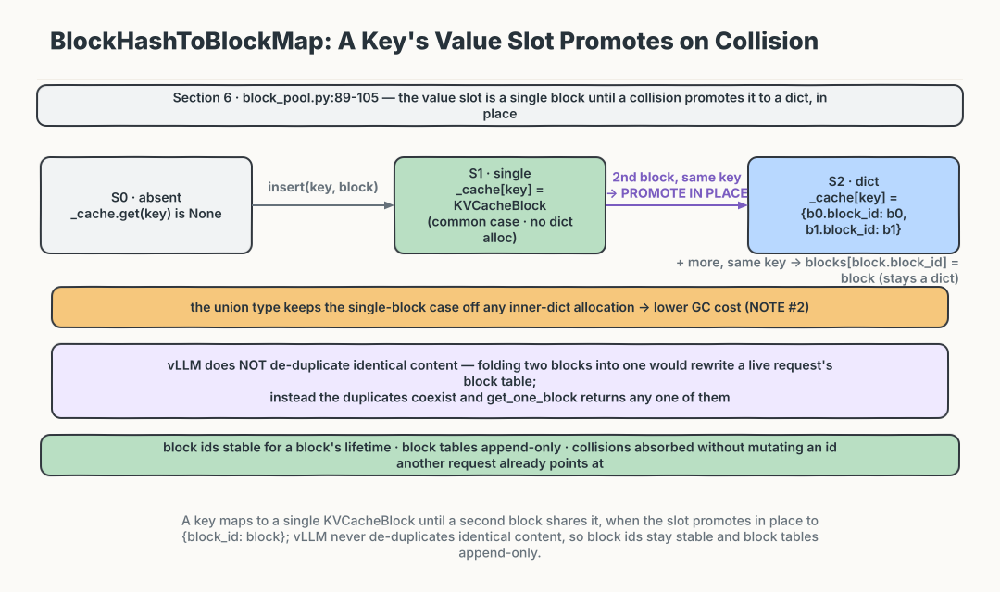</a>

<p class='figure-caption'>BlockHashToBlockMap changes shape on collision: a key maps to a single KVCacheBlock until a second block shares it, when it promotes in place to {block_id: block} — vLLM never de-duplicates identical content so block ids stay stable and block tables append-only.</p>

A key normally maps to a single `KVCacheBlock`; the moment a second block shares that key it promotes in place to `{block_id: KVCacheBlock}`. The motivation is stated in the class docstring ([`block_pool.py:43-52`](https://github.com/vllm-project/vllm/blob/6cf7b26bd4bff60bf378e1af14044280ac0d214c/vllm/v1/core/block_pool.py#L43-L52)): vLLM **does not de-duplicate** identical content — if a block becomes full and an identical block is already cached, it does not fold them, "because we want to make sure the allocated block IDs won't change so that block tables are append-only." De-dup would force a live request's block table to be rewritten mid-flight; instead, two identical blocks coexist under one key, `get_one_block` returns any one of them ([Section 5](#5-finding-the-longest-cache-hit)), and the union type (docstring NOTE #2) keeps the common single-block case off the inner-dict allocation to cut GC cost. The result: block ids are stable for a block's lifetime, block tables stay append-only, and the index absorbs collisions without ever mutating an id another request is already pointing at.

### Coarse groups: reuse the same hash at a coarser boundary

When a KV-cache group's `block_size` is a multiple of `hash_block_size` (hybrid layouts), the writer does not re-hash. Layer 4 wraps the chain in `BlockHashListWithBlockSize` ([`kv_cache_utils.py:2164-2233`](https://github.com/vllm-project/vllm/blob/6cf7b26bd4bff60bf378e1af14044280ac0d214c/vllm/v1/core/kv_cache_utils.py#L2164-L2233)), which maps each coarse block to the `hash_block_size` hash sitting at its last sub-block boundary. That is sound for exactly the Merkle reason from [Section 2](#2-the-block-hash-chaining-tokens-into-a-fingerprint): the finer hash at token `32` already chains over tokens `0–31`, so it *is* a valid fingerprint for the coarse 32-token block's whole prefix. The reader reconstructs the same coarse view, so read and write agree at the coarse boundary.

## 7. LRU Eviction: The Free Queue as Eviction Order

Once a request releases a cached block, the block may remain reusable until allocation pressure needs its slot. vLLM represents this order with the same intrusive `FreeKVCacheBlockQueue` used for free capacity; it has no timestamp field, sweeper, or priority heap. Blocks near the front are recycled first, while blocks moved toward the back survive longer. Article 06 explains the queue operations; the code below focuses on how `free_blocks`, `touch`, and allocation position cached entries within that order.

**The precondition: `ref_cnt` and `_block_hash` are orthogonal**

Before any eviction ordering makes sense, one thing has to be true: a block can be simultaneously *free capacity* and *a live cache hit*. That is only possible because a `KVCacheBlock` carries two independent lifecycles on one record.

Source: `vllm/v1/core/kv_cache_utils.py:L117-138`

```python
@dataclass(slots=True)
class KVCacheBlock:
    """KV-cache block metadata."""

    # Block ID, ranging from 0 to num_gpu_blocks - 1.
    block_id: int
    # Reference count.
    ref_cnt: int = 0
    # The hash key (block hash + group id) of the block, only available
    # when the block is full and cached.
    _block_hash: BlockHashWithGroupId | None = None
    ...
    # Whether the block is a null block that should never be cached.
    is_null: bool = False
```

<a href='images/vllm-07-22-block-lifecycle.svg' target='_blank'>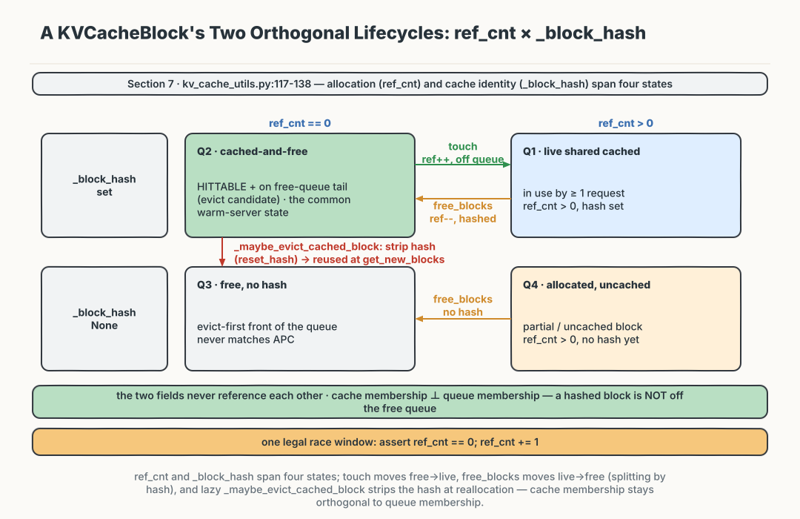</a>

<p class='figure-caption'>A KVCacheBlock's two orthogonal lifecycles: ref_cnt (allocation) and _block_hash (cache identity) span four states, with touch (free→live), free_blocks (live→free-but-cached), and lazy _maybe_evict_cached_block (strip hash at reallocation) as the only transitions.</p>

`ref_cnt` is the *allocation* concern — for a non-null block, `ref_cnt == 0` is exactly equivalent to "linked in the free queue, an eviction candidate" (article 06 reads this biconditional in full). `_block_hash` is the *cache* concern — a non-`None` value means the block still advertises a prefix-cache key in `cached_block_hash_to_block`. The two fields never reference each other. So the state `ref_cnt == 0 ∧ _block_hash != None` is legal and, in a warm server, common: the block sits on the free queue as reusable memory *and* remains a valid hit for any request whose prefix chains to that hash, right up to the instant it is popped. This decoupling is also why a block can flow `free → cached-and-free → reused` without ever changing `block_id` — worker block-tables stay valid across eviction.

Cache membership (`_block_hash != None`) is orthogonal to queue membership (`ref_cnt == 0`); a hashed block is *not* off the queue. If these two were fused, the allocator could never hand out a still-hashed block, and prefix caching would compete with allocation for memory instead of overlaying it.

<a href='images/vllm-07-06-lru-eviction.svg' target='_blank'>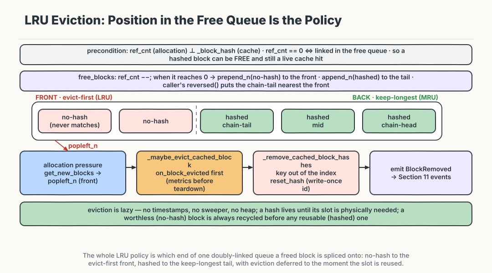</a>

<p class='figure-caption'>A freed request's blocks split by hash: no-hash blocks prepend to the evict-first front, hashed blocks append to the keep-longest tail, chain-tail nearest the front.</p>

### The two priority classes: `free_blocks` encodes cache value as position

When a request's blocks are returned, `free_blocks` does not simply append. It partitions the returned blocks by whether they carry a hash and pushes each class onto a *different end* of the queue.

Source: `vllm/v1/core/block_pool.py:L614-635`

```python
    def free_blocks(self, ordered_blocks: Iterable[KVCacheBlock]) -> None:
        """Free a list of blocks. The blocks should be ordered by their
        eviction priority, where the first block will be evicted first.
        ...
        # Identify blocks with hash (LRU cache) and without it (will never match in APC)
        blocks_with_hash = []
        blocks_without_hash = []
        for block in ordered_blocks:
            block.ref_cnt -= 1
            if block.ref_cnt == 0 and not block.is_null:
                if block.block_hash is None:
                    blocks_without_hash.append(block)
                else:
                    blocks_with_hash.append(block)

        # Blocks without hash always get evicted first - prepend them last to the tail
        self.free_block_queue.prepend_n(blocks_without_hash)
        self.free_block_queue.append_n(blocks_with_hash)
```

The `block.ref_cnt -= 1` decrement and the `ref_cnt == 0` transition are article 06's `free_blocks` mechanic — 06 reads that refcount biconditional (a shared block rejoins the pool only when the last sharer releases it) line by line, so it is not re-derived here. What is new is everything that happens *after* the count reaches zero. The `and not block.is_null` guard keeps the null sentinel out of the queue entirely. Then the split does the real work. A block with `block_hash is None` (a partial trailing block, or a block whose hash was never published) "will never match in APC," so `prepend_n` drops it at the LRU **front** to be recycled first; keeping it would only delay reclaiming genuinely dead memory. A block with a hash still chains to a reachable prefix and could be hit again, so `append_n` puts it at the MRU **tail**, giving its KV maximum time to earn a hit before memory pressure forces the issue. There is no numeric priority anywhere: the two enqueue endpoints *are* the only two priority classes the policy needs, and position in the list *is* the priority.

**The tie-break: chain-tail evicts first, enforced by the caller**

Within a single freed request, all blocks share the same "last access time," so plain LRU cannot order them. The queue's contract specifies a secondary key — and, notably, does *not* implement it.

Source: `vllm/v1/core/kv_cache_utils.py:L188-195`

```python
    The queue is ordered by block ID in the beginning. When a block is allocated
    and then freed, it will be appended back with the eviction order:
    1. The least recent used block is at the front (LRU).
    2. If two blocks have the same last accessed time (allocated by the
       same sequence), the one with more hash tokens (the tail of a block
       chain) is at the front.
    Note that we maintain this order by reversing the block order when free
    blocks of a request. This operation is outside of this class.
```

The reversal is done by the caller, not the list:

Source: `vllm/v1/core/single_type_kv_cache_manager.py:L410-411`

```python
        # Free blocks in reverse order so that the tail blocks are freed first.
        self.block_pool.free_blocks(reversed(self.pop_blocks_for_free(request_id)))
```

`pop_blocks_for_free` returns the request's blocks in *allocation* order (head-of-prefix first); `free()` wraps them in `reversed(...)` so `free_blocks` sees them tail-first. The `append_n` batch therefore lands with the chain tail closest to the LRU front. The rationale is a reuse-probability argument: block *i* covers prefix `[0, (i+1)·B)`, so the *tail* block commits to the longest prefix and is the block *fewest* future requests will share exactly — it is the least reusable, hence the first sacrifice among equals; the chain head (a short, widely-shared prefix like a system prompt) is kept longest. On the coordinator free path the reversal is delegated rather than repeated: the coordinator's `free` hands each request to the per-type managers, whose `free` performs the same `reversed(...)` (`single_type_kv_cache_manager.py:L410-411`); the reverse-order contract itself is documented in the `pop_blocks_for_free` docstring (`kv_cache_coordinator.py:L301-302`), which is why no `reversed(...)` call appears at that line.

This is a deliberate policy/mechanism split: `FreeKVCacheBlockQueue` only knows how to splice; the *ordering meaning* lives in the caller's `reversed`, exactly where article 06 reads the free-path mechanics.

### Eviction is lazy: identity dies only at reallocation

A cached-but-free block is *not* scrubbed when it is freed. It keeps its hash and stays a valid hit indefinitely. Its cache identity is destroyed only at the moment the allocator pops it off the front to satisfy a new allocation.

Source: `vllm/v1/core/block_pool.py:L559-565`

```python
        if self.enable_caching:
            for block in ret:
                self._maybe_evict_cached_block(block)
                assert block.ref_cnt == 0
                block.ref_cnt += 1
```

`get_new_blocks` first pulls `num_blocks` off the LRU front via `free_block_queue.popleft_n` — i.e. the least-reusable cached-but-free blocks the policy above deliberately parked there — then, per block, invokes `_maybe_evict_cached_block` to tear down its hash before reuse.

Source: `vllm/v1/core/block_pool.py:L574-595`

```python
    def _maybe_evict_cached_block(self, block: KVCacheBlock) -> bool:
        """
        If a block is cached in `cached_block_hash_to_block`, we reset its hash
        metadata and evict it from the cache.
        ...
        # Clean up metrics tracking first to prevent leaks
        if self.metrics_collector:
            self.metrics_collector.on_block_evicted(block)

        evicted_hashes = self._remove_cached_block_hashes(block)
        if not evicted_hashes:
            # The block doesn't have hash, eviction is not needed
            return False

        self._emit_block_removed_events(evicted_hashes)
        return True
```

`on_block_evicted` runs *first*, before the hash is removed, so residency metrics can attribute the block while its identity still exists: the comment names this a leak-prevention ordering. Then `_remove_cached_block_hashes` (`block_pool.py:L484-503`) strips the primary `_block_hash` *and* any secondary aliases recorded in `cached_block_hashes_by_block`, popping each key out of `cached_block_hash_to_block` and finally calling `block.reset_hash()` — the write-once identity set by `set_block_hash` (read in article 06) is torn down here and only here on the reallocation path. The return value distinguishes a genuine eviction (`True`, the block carried a hash) from recycling a no-hash block (`False`, nothing to remove), and a real eviction emits a `BlockRemoved` event through the single choke point (see the KV-events section). Laziness is the whole point: no scan ever walks the queue looking for victims; a hash lives exactly until its block's slot is physically needed, which is what lets prefix caching stay near-zero-overhead on misses (V1 alpha release blog, [vLLM blog](https://vllm.ai/blog/2025-01-27-v1-alpha-release)).

**The one legal race window.** `assert block.ref_cnt == 0` then `block.ref_cnt += 1` brackets the single instant where the `ref_cnt == 0 ⇔ on-queue` biconditional is violated: the block has been spliced out of the queue by `popleft_n` but not yet ref-counted. It is closed within the same synchronous call, so no other code observes the inconsistency.

**The mirror on the hit path**

Eviction's counterpart is `touch`, which article 06 reads line by line; here it matters only as the other half of the same invariant. When a lookup hits a cached-but-free block sitting somewhere in the middle of the queue, `touch` splices it out (`if block.ref_cnt == 0 and not block.is_null: self.free_block_queue.remove(block)`) and bumps `ref_cnt` — atomically converting an eviction candidate back into a live shared block. The splice is O(1) because the block is intrusive and carries its own `prev_free_block`/`next_free_block` (`kv_cache_utils.py:L301-319`), so a hit never degrades allocation into a linear scan. Crucially, the read side (`get_cached_block` and `find_longest_cache_hit`) is a *pure probe*: it resolves hit identity and length but touches neither `ref_cnt` nor the queue, so membership in the hash map never implies a block is off the free queue. Lookup ([Section 5](#5-finding-the-longest-cache-hit)) and commit (`touch`) are separate steps; eviction (`_maybe_evict_cached_block`) is a *third*, lazy, allocation-time step. Those three are the only transitions that move a block between "hittable" and "gone."

## 8. Hit Rate and Stats

APC reports reuse in tokens rather than requests or blocks, matching the unit of skipped prefill work. It also separates hits from re-admitted preempted requests so their own surviving KV does not inflate the fresh-request rate. The following path connects `PrefixCacheStats.record` to the recent console window and the cumulative Prometheus counters.

**`PrefixCacheStats` counts tokens, not blocks or requests**

The stat that ships to the console is a hit *rate*, and the first design decision is what the numerator and denominator are counted in. vLLM counts **tokens**.

Source: [`vllm/v1/metrics/stats.py:114-142`](https://github.com/vllm-project/vllm/blob/6cf7b26bd4bff60bf378e1af14044280ac0d214c/vllm/v1/metrics/stats.py#L114-L142)

```python
@dataclass
class PrefixCacheStats(BaseCacheStats):
    """
    Stores prefix cache hit statistics.
    - `reset`: Whether `reset_prefix_cache` was invoked.
    - `queries`: Refers to the number of tokens that were queried.
    """

    preempted_requests: int = 0
    ...
    def record(self, num_tokens: int, num_hits: int, preempted: bool) -> None:
        """Aggregate request information into the stats."""
        if preempted:
            # Previously preempted request
            self.preempted_requests += 1
            self.preempted_queries += num_tokens
            self.preempted_hits += num_hits
        else:
            # New request
            self.requests += 1
            self.queries += num_tokens
            self.hits += num_hits
```

<a href='images/vllm-07-23-stats-buckets.svg' target='_blank'>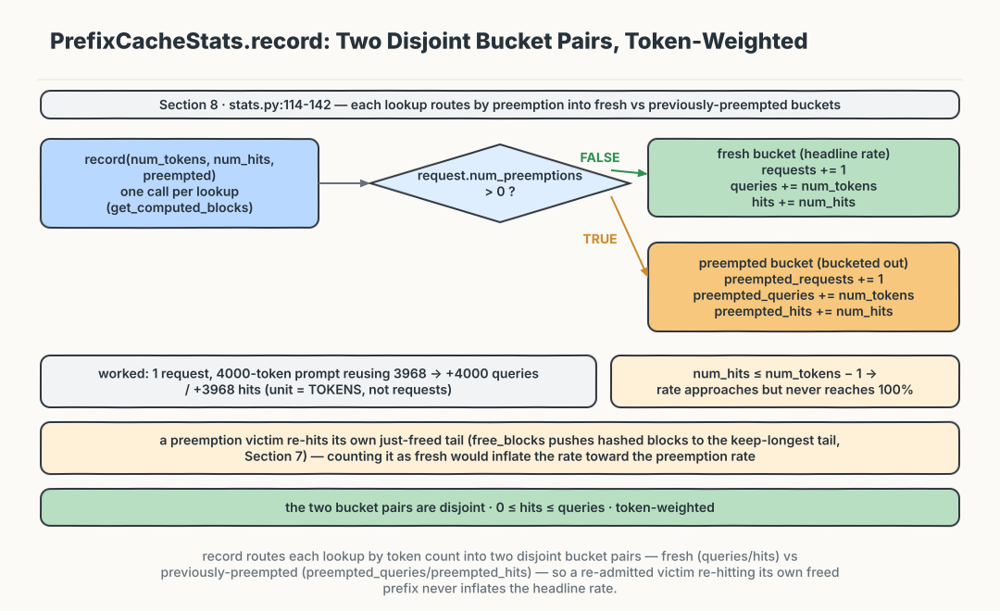</a>

<p class='figure-caption'>PrefixCacheStats.record routes each lookup by token count into two disjoint bucket pairs — fresh (queries/hits) vs previously-preempted (preempted_queries/preempted_hits) — so a re-admitted victim re-hitting its own freed prefix never inflates the headline rate.</p>

`PrefixCacheStats` extends `BaseCacheStats`, whose fields are `reset`, `requests`, `queries`, `hits` ([`stats.py:19-32`](https://github.com/vllm-project/vllm/blob/6cf7b26bd4bff60bf378e1af14044280ac0d214c/vllm/v1/metrics/stats.py#L19-L32)). Read `record` as a two-way router: every request either lands in the `queries`/`hits` pair or the `preempted_queries`/`preempted_hits` pair, and `num_tokens` is added to a *query* counter while `num_hits` is added to a *hit* counter. The docstring pins the unit: "`queries`: Refers to the number of tokens that were queried." So `queries` is the sum of prompt lengths looked up, and `hits` is the sum of matched-prefix lengths. A request with a 4000-token prompt that reuses 3968 tokens contributes `+4000` to `queries` and `+3968` to `hits`: one request, but 4000 units of denominator. This is the right unit precisely because reuse saves *compute*, and compute scales with tokens, not requests: a per-request hit rate would weight a fully-cached 8-token continuation the same as a fully-cached 8000-token document.

Per request, `0 ≤ num_hits ≤ num_tokens`, so across any accumulation `0 ≤ hits ≤ queries`; the rate is a token-weighted fraction of prefill work skipped, never a request count.

### Where the numbers come from: the pure probe and the hybrid path

`record` has exactly two producers, and both feed the same accumulator. The primary one lives inside `get_computed_blocks` — the same lookup that [Section 5](#5-finding-the-longest-cache-hit) established writes nothing back onto the `Request`.

Source: [`vllm/v1/core/kv_cache_manager.py:234-240`](https://github.com/vllm-project/vllm/blob/6cf7b26bd4bff60bf378e1af14044280ac0d214c/vllm/v1/core/kv_cache_manager.py#L234-L240)

```python
        if self.log_stats:
            assert self.prefix_cache_stats is not None
            self.prefix_cache_stats.record(
                num_tokens=request.num_tokens,
                num_hits=num_new_computed_tokens,
                preempted=request.num_preemptions > 0,
            )
```

`num_tokens=request.num_tokens` is the full prompt length; `num_hits=num_new_computed_tokens` is the resolved prefix-match length returned by `coordinator.find_longest_cache_hit` ([Section 5](#5-finding-the-longest-cache-hit)), already capped at `num_tokens - 1` by the recompute-last-token rule ([Section 5](#5-finding-the-longest-cache-hit), [Section 10](#10-when-caching-is-skipped)). So even a prompt that matches a cached prefix in full reports at most `num_tokens - 1` hits — the hit rate can approach but never quite reach 100% on a repeated prompt, which is a real, code-level property of this metric, not a rounding artifact. Recording lives under `if self.log_stats`, so with stats disabled the probe stays allocation-free.

The second producer is the hybrid / KV-connector path in the scheduler, used when a mix of full-attention and Mamba groups (or a disaggregated D-side) resolves hits per group:

Source: [`vllm/v1/core/sched/scheduler.py:715-722`](https://github.com/vllm-project/vllm/blob/6cf7b26bd4bff60bf378e1af14044280ac0d214c/vllm/v1/core/sched/scheduler.py#L715-L722)

```python
                        num_new_local_computed_tokens = max(per_group_hits)
                        if self.kv_cache_manager.log_stats:
                            assert self.kv_cache_manager.prefix_cache_stats is not None
                            self.kv_cache_manager.prefix_cache_stats.record(
                                num_tokens=request.num_tokens,
                                num_hits=num_new_local_computed_tokens,
                                preempted=request.num_preemptions > 0,
                            )
```

Here `num_hits = max(per_group_hits)` — the local hit length feeds the *same* `prefix_cache_stats` object the manager owns, so the two producers are mutually exclusive branches ([`scheduler.py:723`](https://github.com/vllm-project/vllm/blob/6cf7b26bd4bff60bf378e1af14044280ac0d214c/vllm/v1/core/sched/scheduler.py#L723) falls through to plain `get_computed_blocks`) that never double-count a request.

**The preemption bucket.** Both call sites route on `request.num_preemptions > 0`. A request that was preempted (its blocks freed under memory pressure, [Section 7](#7-lru-eviction-the-free-queue-as-eviction-order)) and then re-admitted will very often re-hit *its own* just-freed prefix, because `free_blocks` pushes hashed blocks to the keep-longest tail of the queue and eviction is lazy ([Section 7](#7-lru-eviction-the-free-queue-as-eviction-order)). Counting that near-certain self-hit as a fresh query would inflate the reported rate toward the preemption rate, telling the operator nothing about cross-request sharing. Segregating it into `preempted_queries`/`preempted_hits` keeps the headline `queries`/`hits` measuring genuine first-touch reuse.

**Draining the accumulator: one disjoint window per step**

`PrefixCacheStats` is a per-step accumulator, not a running total. It is drained, read and atomically replaced, once per scheduler step.

Source: [`vllm/v1/core/kv_cache_manager.py:196-200`](https://github.com/vllm-project/vllm/blob/6cf7b26bd4bff60bf378e1af14044280ac0d214c/vllm/v1/core/kv_cache_manager.py#L196-L200)

```python
        if not self.log_stats:
            return None
        stats = self.prefix_cache_stats
        self.prefix_cache_stats = PrefixCacheStats()
        return stats
```

`make_prefix_cache_stats` captures the current object into a local, installs a fresh empty `PrefixCacheStats()`, and returns the captured one. Because Python assignment is atomic against the single-threaded scheduler loop, no `record` call can land between the read and the swap, so every step observes a window that is disjoint from every other step's window: no `record` is ever counted twice and none is dropped. The caller is the scheduler assembling `SchedulerStats` ([`scheduler.py:2293`](https://github.com/vllm-project/vllm/blob/6cf7b26bd4bff60bf378e1af14044280ac0d214c/vllm/v1/core/sched/scheduler.py#L2293)), which also swaps out the separate `connector_prefix_cache_stats` object the same way ([`scheduler.py:2296-2298`](https://github.com/vllm-project/vllm/blob/6cf7b26bd4bff60bf378e1af14044280ac0d214c/vllm/v1/core/sched/scheduler.py#L2296-L2298)). Aggregation across windows happens downstream, in the metric layer, not here.

### The reset flag: signalling invalidation without touching counters

`reset_prefix_cache` exists for RLHF weight updates and benchmarking — situations where every cached KV block is now stale and any future hit would be *wrong*, not just cold. It is the one operation that can invalidate the whole cache, and it must tell the metric layer to discard history rather than blend pre- and post-reset rates.

Source: [`vllm/v1/core/block_pool.py:665-672`](https://github.com/vllm-project/vllm/blob/6cf7b26bd4bff60bf378e1af14044280ac0d214c/vllm/v1/core/block_pool.py#L665-L672)

```python
        num_used_blocks = self.num_gpu_blocks - self.get_num_free_blocks()
        if num_used_blocks != 1:  # The null block is always marked as used
            logger.warning(
                "Failed to reset prefix cache because some "
                "blocks (%d) are not freed yet",
                num_used_blocks - 1,
            )
            return False
```

The reset only proceeds when exactly one block (the null sentinel) is in use (i.e. no live request references any cached block). On success it rebuilds `cached_block_hash_to_block`, clears the alias map, calls `block.reset_hash()` on every block ([`block_pool.py:674-681`](https://github.com/vllm-project/vllm/blob/6cf7b26bd4bff60bf378e1af14044280ac0d214c/vllm/v1/core/block_pool.py#L674-L681)), and, if events are on, appends an `AllBlocksCleared` event ([`block_pool.py:687-688`](https://github.com/vllm-project/vllm/blob/6cf7b26bd4bff60bf378e1af14044280ac0d214c/vllm/v1/core/block_pool.py#L687-L688), the clear message [Section 11](#11-kv-cache-events-for-external-routers) mirrors onto the wire). The manager then records the fact as a flag, not a counter mutation:

Source: [`vllm/v1/core/kv_cache_manager.py:524-528`](https://github.com/vllm-project/vllm/blob/6cf7b26bd4bff60bf378e1af14044280ac0d214c/vllm/v1/core/kv_cache_manager.py#L524-L528)

```python
        if not self.block_pool.reset_prefix_cache():
            return False
        if self.log_stats:
            assert self.prefix_cache_stats is not None
            self.prefix_cache_stats.reset = True
```

Setting `stats.reset = True` leaves `queries`/`hits` untouched; it is a one-bit signal that rides the next drained window into the metric layer, where the sliding-window consumer acts on it.

<a href='images/vllm-07-07-hit-rate.svg' target='_blank'>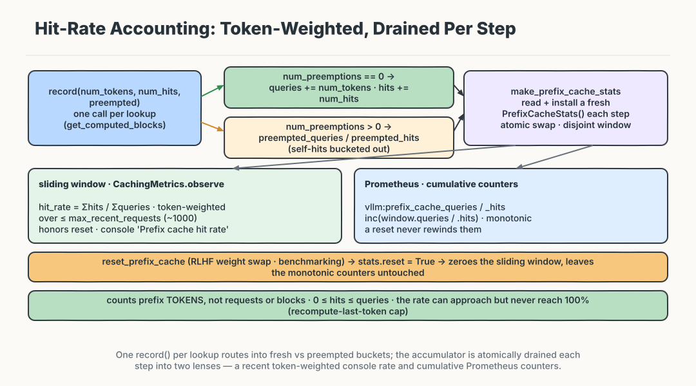</a>

<p class='figure-caption'>record() per lookup, atomic per-step drain, then two consumers: a sliding token-weighted window and cumulative Prometheus counters.</p>

**The windowed hit rate: sliding over the most recent ~1000 requests**

The reported "Prefix cache hit rate" is deliberately *not* cumulative. It is a token-weighted rate over the most recent window of requests, maintained by `CachingMetrics.observe`, which is fed each drained window at [`loggers.py:175`](https://github.com/vllm-project/vllm/blob/6cf7b26bd4bff60bf378e1af14044280ac0d214c/vllm/v1/metrics/loggers.py#L175).

Source: [`vllm/v1/metrics/stats.py:76-92`](https://github.com/vllm-project/vllm/blob/6cf7b26bd4bff60bf378e1af14044280ac0d214c/vllm/v1/metrics/stats.py#L76-L92)

```python
        # Update the metrics.
        self.query_queue.append((stats.requests, stats.queries, stats.hits))
        self.aggregated_requests += stats.requests
        self.aggregated_query_total += stats.queries
        self.aggregated_query_hit += stats.hits

        # Remove the oldest stats until number of requests does not exceed
        # the limit.
        # NOTE: We preserve the latest added stats regardless.
        while (
            len(self.query_queue) > 1
            and self.aggregated_requests > self.max_recent_requests
        ):
            old_requests, old_queries, old_hits = self.query_queue.popleft()
            self.aggregated_requests -= old_requests
            self.aggregated_query_total -= old_queries
            self.aggregated_query_hit -= old_hits
```

Three behaviors matter, and each guards a specific failure. First, `observe` honors the reset flag before anything else — `if stats.reset: self.reset()` ([`stats.py:68-69`](https://github.com/vllm-project/vllm/blob/6cf7b26bd4bff60bf378e1af14044280ac0d214c/vllm/v1/metrics/stats.py#L68-L69)) zeroes the aggregates and clears the deque, so a weight-update's stale rate cannot bleed into the fresh one. Second, it early-returns on empty windows — `if stats.requests == 0: return` ([`stats.py:73-74`](https://github.com/vllm-project/vllm/blob/6cf7b26bd4bff60bf378e1af14044280ac0d214c/vllm/v1/metrics/stats.py#L73-L74)) — so that idle scheduler steps (which produce a window with zero requests) do not enqueue empty entries that would slide genuine history out of a fixed-length deque.

Third, the trim loop pops the oldest `(requests, queries, hits)` triple while `aggregated_requests > max_recent_requests` (default **1000**, [`stats.py:42-45`](https://github.com/vllm-project/vllm/blob/6cf7b26bd4bff60bf378e1af14044280ac0d214c/vllm/v1/metrics/stats.py#L42-L45)), but the `len(self.query_queue) > 1` guard preserves at least the latest entry — so a single request whose prompt alone exceeds the window still yields a defined rate rather than an empty one. The rate itself:

Source: [`vllm/v1/metrics/stats.py:106-111`](https://github.com/vllm-project/vllm/blob/6cf7b26bd4bff60bf378e1af14044280ac0d214c/vllm/v1/metrics/stats.py#L106-L111)

```python
    @property
    def hit_rate(self) -> float:
        """Calculate the hit rate for the past N requests."""
        if self.aggregated_query_total == 0:
            return 0.0
        return self.aggregated_query_hit / self.aggregated_query_total
```

This is a *token-weighted* ratio: it divides aggregated hit tokens by aggregated query tokens over the window, so an 8000-token document dominates the rate exactly as much as its share of the work — not one-request-one-vote. Division by zero is guarded to `0.0`.

### Two views of the same data: sliding console rate vs cumulative Prometheus counters

The window is one of two consumers. The console logger reads it directly:

Source: [`vllm/v1/metrics/loggers.py:252-259`](https://github.com/vllm-project/vllm/blob/6cf7b26bd4bff60bf378e1af14044280ac0d214c/vllm/v1/metrics/loggers.py#L252-L259)

```python
                "GPU KV cache usage: %.1f%%",
                "Prefix cache hit rate: %.1f%%",
            ]
        )
        log_args.extend(
            [
                self.last_scheduler_stats.kv_cache_usage * 100,
                self.prefix_caching_metrics.hit_rate * 100,
            ]
        )
```

The Prometheus logger, by contrast, does not slide — it increments monotonic counters straight from each window's raw fields:

Source: [`vllm/v1/metrics/loggers.py:1088-1093`](https://github.com/vllm-project/vllm/blob/6cf7b26bd4bff60bf378e1af14044280ac0d214c/vllm/v1/metrics/loggers.py#L1088-L1093)

```python
            self.counter_prefix_cache_queries[engine_idx].inc(
                scheduler_stats.prefix_cache_stats.queries
            )
            self.counter_prefix_cache_hits[engine_idx].inc(
                scheduler_stats.prefix_cache_stats.hits
            )
```

These are `vllm:prefix_cache_queries` ("in terms of number of queried tokens") and `vllm:prefix_cache_hits` ("in terms of number of cached tokens"), defined at [`loggers.py:547-565`](https://github.com/vllm-project/vllm/blob/6cf7b26bd4bff60bf378e1af14044280ac0d214c/vllm/v1/metrics/loggers.py#L547-L565) — cumulative, unbounded, token-unit counters. So the same `PrefixCacheStats` feeds two lenses: the console shows a *recent* token-weighted rate an operator reads at a glance, while Prometheus keeps the *lifetime* totals a dashboard integrates or rate-differences over an arbitrary window. Critically, a `reset_prefix_cache` zeroes the sliding window (via the `reset` flag) but leaves the monotonic counters untouched — they are counters, and running them backward would violate Prometheus semantics.

The KV-connector / external-prefix path is metered identically but separately: its own `connector_prefix_cache_stats`, its own `CachingMetrics` ([`loggers.py:177-180`](https://github.com/vllm-project/vllm/blob/6cf7b26bd4bff60bf378e1af14044280ac0d214c/vllm/v1/metrics/loggers.py#L177-L180)), and its own `vllm:external_prefix_cache_{queries,hits}` counters ([`loggers.py:1095-1101`](https://github.com/vllm-project/vllm/blob/6cf7b26bd4bff60bf378e1af14044280ac0d214c/vllm/v1/metrics/loggers.py#L1095-L1101)), so local GPU reuse and remote/offloaded reuse never cross-contaminate one rate.

Console and Prometheus are two projections of one accumulator — a bounded token-weighted rate and unbounded token counters; a cache reset zeroes the former but never rewinds the latter.

The resulting metric answers one operational question: *what fraction of recent prefill token-work did reuse skip?* Token counts match the unit of saved compute, the separate preemption bucket keeps self-hits out of the fresh-request rate, and the per-step drain avoids counting the same interval twice. The console window stays recent while Prometheus retains lifetime counters. Article 05 shows how the scheduler consumes `num_new_computed_tokens`; article 06 covers the allocator decisions reflected by this rate.

## 9. Cross-Tenant Isolation and Cache Salt

Shared prefix reuse creates a timing signal: a tenant that guesses prompt `P` may observe whether `P` was already resident. `cache_salt` mitigates that signal by adding a tenant-specific value to the block-0 hash, which then propagates through the chain. Identical tokens under different salts are expected to miss when the salt is secret and unpredictable, extra-key sources do not alias, and the digest does not collide. The code below follows the salt from the request API into hashing and lookup, then considers the separate exposure created by KV-cache events.

<a href='images/vllm-07-08-cache-salt.svg' target='_blank'>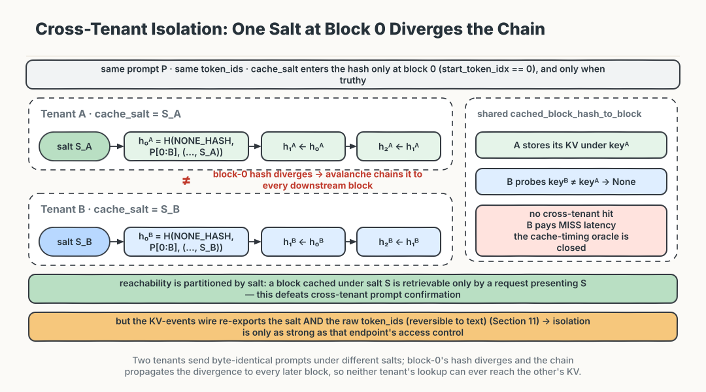</a>

<p class='figure-caption'>Two tenants send the same prompt under different high-entropy salts. Barring an extra-key alias or hash collision, block 0 differs and that difference chains through every downstream key, so each tenant's prefix-cache lookup misses the other's entries.</p>

**The API surface and its stated purpose**

The salt is a first-class request field with a verbatim security rationale.

Source: [`vllm/entrypoints/openai/chat_completion/protocol.py:425-435`](https://github.com/vllm-project/vllm/blob/6cf7b26bd4bff60bf378e1af14044280ac0d214c/vllm/entrypoints/openai/chat_completion/protocol.py#L425-L435)

```python
    cache_salt: str | None = Field(
        default=None,
        description=(
            "If specified, the prefix cache will be salted with the provided "
            "string to prevent an attacker to guess prompts in multi-user "
            "environments. The salt should be random, protected from "
            "access by 3rd parties, and long enough to be "
            "unpredictable (e.g., 43 characters base64-encoded, corresponding "
            "to 256 bit)."
        ),
    )
```

The "43 characters base64-encoded, corresponding to 256 bit" figure is *guidance*, not an enforced constraint. The only validation is a type/non-emptiness check.

Source: [`vllm/entrypoints/openai/chat_completion/protocol.py:913-921`](https://github.com/vllm-project/vllm/blob/6cf7b26bd4bff60bf378e1af14044280ac0d214c/vllm/entrypoints/openai/chat_completion/protocol.py#L913-L921)

```python
    def check_cache_salt_support(cls, data):
        if data.get("cache_salt") is not None and (
            not isinstance(data["cache_salt"], str) or not data["cache_salt"]
        ):
            raise VLLMValidationError(
                "Parameter 'cache_salt' must be a non-empty string if provided.",
                parameter="cache_salt",
            )
        return data
```

A caller may omit the salt (`None`, the default), in which case the request participates in the normal shared pool. If present it must be a non-empty string; nothing else is checked — the engine does not verify length, entropy, or per-tenant uniqueness. Whether the salt actually *is* random, secret, and ≥256-bit is entirely the caller's responsibility, which is why the field docstring spells out the operational contract instead of enforcing it. The salt then rides the request into the engine unchanged: `EngineCoreRequest.cache_salt` ([`vllm/v1/engine/__init__.py:101`](https://github.com/vllm-project/vllm/blob/6cf7b26bd4bff60bf378e1af14044280ac0d214c/vllm/v1/engine/__init__.py#L101)) → stored on `Request.cache_salt` ([`vllm/v1/request.py:159`](https://github.com/vllm-project/vllm/blob/6cf7b26bd4bff60bf378e1af14044280ac0d214c/vllm/v1/request.py#L159)) → copied when the engine-core request is materialized ([`vllm/v1/request.py:219`](https://github.com/vllm-project/vllm/blob/6cf7b26bd4bff60bf378e1af14044280ac0d214c/vllm/v1/request.py#L219), `cache_salt=request.cache_salt`).

### One insertion point: block 0's extra keys

The salt enters the hash in exactly one place, and only for the first block.

Source: [`vllm/v1/core/kv_cache_utils.py:559-568`](https://github.com/vllm-project/vllm/blob/6cf7b26bd4bff60bf378e1af14044280ac0d214c/vllm/v1/core/kv_cache_utils.py#L559-L568)

```python
    lora_extra_keys: list[str] = _gen_lora_extra_hash_keys(request)
    cache_salt_keys: list[str] = (
        [request.cache_salt] if (start_token_idx == 0 and request.cache_salt) else []
    )
    prompt_embeds_keys = _gen_prompt_embeds_extra_hash_keys(
        request, start_token_idx, end_token_idx
    )

    extra_keys: list[Any] = (
        lora_extra_keys + mm_extra_keys + cache_salt_keys + prompt_embeds_keys
    )
```

`cache_salt_keys` is non-empty only when `start_token_idx == 0` *and* `request.cache_salt` is truthy. For every block after the first, the guard is false and the salt contributes nothing — it is never re-hashed on blocks 1, 2, 3, …. The salt lands in the block-0 extra-key tuple, positioned after LoRA and multimodal keys and before prompt-embeds (the fixed concatenation order [Section 3](#3-extra-keys-multimodal-cache-salt-and-lora) relies on for a stable hash). A companion predicate guarantees the extra-key path is even taken:

Source: [`vllm/v1/core/kv_cache_utils.py:424-428`](https://github.com/vllm-project/vllm/blob/6cf7b26bd4bff60bf378e1af14044280ac0d214c/vllm/v1/core/kv_cache_utils.py#L424-L428)

```python
    return (
        bool(request.mm_features)
        or (request.lora_request is not None)
        or (request.cache_salt is not None)
    )
```

A salted request can never be hashed on `(parent, tokens, None)`: `generate_block_hash_extra_keys` is called unconditionally for every full block, and its `cache_salt` branch adds the salt at block 0 whenever one is present, so the salt is guaranteed to participate in block 0's hash. (The declarative `need_extra_keys` predicate states the same arming condition but has no in-tree caller at this commit, [Section 3](#3-extra-keys-multimodal-cache-salt-and-lora); it documents the intent, not the causal path.)

A salted request's block-0 preimage includes the salt; an unsalted request's does not. That makes the intended preimages different, but a cache-key partition still assumes no cross-source extra-key alias and no digest collision ([Section 3](#3-extra-keys-multimodal-cache-salt-and-lora)).

**Why one insertion at block 0 is sufficient**

The obvious worry: if the salt only touches block 0, aren't blocks 1..N shared across tenants? No — and the reason is the hash *chain* ([Section 2](#2-the-block-hash-chaining-tokens-into-a-fingerprint)), not any per-block salting. [Section 2](#2-the-block-hash-chaining-tokens-into-a-fingerprint) reads the per-link recurrence in full ([`kv_cache_utils.py:598-604`](https://github.com/vllm-project/vllm/blob/6cf7b26bd4bff60bf378e1af14044280ac0d214c/vllm/v1/core/kv_cache_utils.py#L598-L604)): block 0's base case folds `NONE_HASH` and the salted `extra_keys` into `H(NONE_HASH, tokens[0:B], (…, salt))`. What matters for isolation is what the driver then does with that digest:

Source: [`vllm/v1/core/kv_cache_utils.py:718-726`](https://github.com/vllm-project/vllm/blob/6cf7b26bd4bff60bf378e1af14044280ac0d214c/vllm/v1/core/kv_cache_utils.py#L718-L726)

```python
            # Compute the hash of the current block
            block_tokens = request.all_token_ids[start_token_idx:end_token_idx]
            block_hash = hash_block_tokens(
                caching_hash_fn, prev_block_hash_value, block_tokens, extra_keys
            )

            new_block_hashes.append(block_hash)
            start_token_idx += hash_block_size
            prev_block_hash_value = block_hash
```

Block 0 hashes `H(NONE_HASH, tokens[0:B], (…, salt))`. The driver then carries that value forward: `prev_block_hash_value = block_hash` (`:726`), so block 1 hashes `H(block_0_hash, tokens[B:2B], …)`, block 2 folds in block 1's hash, and so on. The salt is baked into block 0's digest, and because that digest is the *parent* fed into block 1 (folded *inside* the hashed tuple, not appended alongside it), the salt propagates transitively through the entire chain by avalanche. Poison the root and every downstream link diverges. This is why the code pays the salt cost once: re-hashing the salt on every block would be redundant, since chaining already makes each hash a commitment to its whole salted prefix.

If two requests differ only in non-aliasing `cache_salt` values, their block-0 pre-images differ; absent a digest collision, their downstream block hashes differ as well. This is a derived property of the chain, not an independent per-block guarantee — if chaining were ever segmented or removed, block-0-only salting would no longer separate later blocks. Block-0 sufficiency holds because of the current chain design.

### How isolation actually holds: the lookup side

Perturbing the write-side hash is only half the property. Isolation is real only if *lookup* keys on the same salted hash — otherwise a mismatched read path could still surface another tenant's block. The lookup is `get_cached_block`, which [Section 5](#5-finding-the-longest-cache-hit) reads in full ([`block_pool.py:213-224`](https://github.com/vllm-project/vllm/blob/6cf7b26bd4bff60bf378e1af14044280ac0d214c/vllm/v1/core/block_pool.py#L213-L224)): it re-packs the probed `block_hash` with each group id, resolves it against the shared `cached_block_hash_to_block` index, and returns `None` on any miss.

The `block_hash` it probes came from `request.block_hashes`, computed by the same salted `request_block_hasher` ([Section 2](#2-the-block-hash-chaining-tokens-into-a-fingerprint)), and it resolves against the *shared* `cached_block_hash_to_block` index — there is no separate per-tenant map; isolation is purely a function of the key. Now trace the concrete attack:

- Tenant A sends prompt `P` with salt `S_A`. Block 0's hash is `H(NONE_HASH, tokens(P0), (…, "S_A"))`, and A's KV is stored under that key (article 06 covers the write/`touch`/refcount mechanics; [Section 6](#6-caching-finalized-blocks) details the insertion into this index).
- Tenant B sends the *same* prompt `P` with salt `S_B` (or no salt). If the extra-key encodings differ and the digest does not collide, B derives a different block-0 key.
- B's `get_cached_block` probes B's key, misses A's block, and returns `None`. On this prefix-cache path B recomputes rather than reusing A's KV, so the cache-hit timing signal does not confirm that A cached `P`. This claim does not rule out unrelated timing or system side channels.

The scheduler consumes this the same way it consumes any prefix hit (article 05 covers prefix-aware scheduling): a salted miss simply yields `num_computed_tokens = 0` for that prefix and the request is scheduled as a full prefill.

With high-entropy secret salts, non-aliasing extra-key values, and no digest collision, prefix-cache reachability is partitioned by salt. Under those assumptions, an attacker cannot use this cache-hit timing signal to probe another tenant's prefixes. This claim applies to prefix-cache reuse, not to every observable source of latency.

**Defense in depth: the randomized chain root**

Even without any salt, vLLM does not let block hashes be reproduced offline. The chain root itself is randomized per process.

Source: [`vllm/v1/core/kv_cache_utils.py:111-114`](https://github.com/vllm-project/vllm/blob/6cf7b26bd4bff60bf378e1af14044280ac0d214c/vllm/v1/core/kv_cache_utils.py#L111-L114)

```python
    if hash_seed is None:
        NONE_HASH = BlockHash(os.urandom(32))
    else:
        NONE_HASH = BlockHash(hash_fn(hash_seed))
```

With `PYTHONHASHSEED` unset (the default), `NONE_HASH` is a fresh 32-byte random value per engine process. Since block 0 seeds off `NONE_HASH`, an observer who cannot read that root cannot practically precompute `H(NONE_HASH, tokens(P0), …)` for a guessed prompt `P`, even *without* salts in play. Independently initialized engines are therefore expected to derive different chains, subject to the selected digest's collision properties. Setting `PYTHONHASHSEED` (needed for cross-process cache sharing — P/D disaggregation, KV offload, warm restart, per [Section 4](#4-the-hash-algorithm-sha256-vs-builtin-collisions-pythonhashseed)) trades this randomization away for reproducibility. The salt is orthogonal to and layered on top of this: `NONE_HASH` randomizes the *root* across processes; the salt partitions *within* a process across tenants.

[Section 4](#4-the-hash-algorithm-sha256-vs-builtin-collisions-pythonhashseed) details the full `NONE_HASH` / `PYTHONHASHSEED` determinism seam and the collision-resistance argument (the config docstring's warning that a non-cryptographic hash "even leak[s] private information in multi-tenant environments" is the collision-side companion to this timing-side story).

### The trust boundary: salt on the events wire

There is one place the salt and raw token IDs deliberately leave the engine: the KV-cache event stream ([Section 11](#11-kv-cache-events-for-external-routers) covers the events subsystem). With the matching tokenizer, those IDs are typically reversible to prompt text or a close approximation. External routers need to reconstruct block keys, so `BlockStored` carries the extra keys — salt included.

Source: [`vllm/distributed/kv_events.py:63-68`](https://github.com/vllm-project/vllm/blob/6cf7b26bd4bff60bf378e1af14044280ac0d214c/vllm/distributed/kv_events.py#L63-L68)

```python
    extra_keys: list[tuple[Any, ...] | None] | None = None
    """Extra keys used in block hash computation, one entry per block in
    block_hashes. Each entry contains MM identifiers, LoRA name, cache_salt,
    prompt embedding hashes, etc. for that specific block. Exposed for external
    KV cache consumers to reconstruct block hashes.
    """
```

<a href='images/vllm-07-24-salt-trust-boundary.svg' target='_blank'>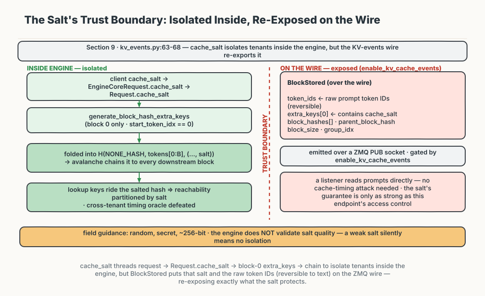</a>

<p class='figure-caption'>The salt's trust boundary: cache_salt rides request→Request.cache_salt→block-0 extra_keys→chain to separate prefix-cache keys inside the engine, while BlockStored puts that salt and raw token_ids on the ZMQ wire. Token IDs are typically reversible with the tokenizer, so the event stream must be treated as sensitive.</p>

A router that re-hashes `(parent_block_hash, token_ids_of_block_i, extra_keys[i])` reproduces `block_hashes[i]` — the same triple the engine hashed ([Section 2](#2-the-block-hash-chaining-tokens-into-a-fingerprint), [Section 11](#11-kv-cache-events-for-external-routers)). For that reconstruction to yield *tenant-specific* keys, `extra_keys[0]` must contain the salt, so the salt is emitted by design. But the same `BlockStored` also carries raw `token_ids`. They are not plaintext bytes, but for ordinary tokenizer vocabularies they are typically reversible to prompt text or close approximations. The endpoint therefore sees both sensitive prompt material and the per-tenant salt that keys it. Consequently, the ZMQ events endpoint is a trust boundary that should be access-controlled like the cache itself; the field docstring's "protected from access by 3rd parties" extends transitively to this channel. Emission is gated on `enable_kv_cache_events` ([Section 11](#11-kv-cache-events-for-external-routers)), so when this publisher is disabled, these event payloads are not emitted on that channel.

## 10. When Caching Is Skipped

Some requests cannot safely use a cached prefix, and some newly allocated blocks are not ready to publish. The branches below fall into those two groups: read-side checks return no computed prefix when reuse would skip required model work, while write-side checks keep draft, partial, invalid, or not-yet-local KV out of the hash index. Article 06 covers the allocator mechanics around these checks.

**Read-side: the global gate and the per-request skip flag**

The outermost read-side skip is the engine-wide toggle, and it is enforced in two independent places. First, the hasher is never even constructed unless prefix caching is on *or* a KV connector is present: the engine-level gate — read in full in [Section 1](#1-what-prefix-caching-is-and-the-reuse-win) ([`vllm/v1/engine/core.py:210-219`](https://github.com/vllm-project/vllm/blob/6cf7b26bd4bff60bf378e1af14044280ac0d214c/vllm/v1/engine/core.py#L210-L219)) — leaves `self.request_block_hasher = None` whenever the `enable_prefix_caching or kv_connector is not None` guard is false. With `request_block_hasher` `None`, `Request.update_block_hashes` ([Section 2](#2-the-block-hash-chaining-tokens-into-a-fingerprint)) no-ops because `self._block_hasher is None`, so `request.block_hashes` never grows and there is nothing to look up.

Note the caching flag can also be *forced* off downstream: if any layer tags its KV spec `non_causal=True`, the engine logs "Disabling prefix caching" and clears `enable_prefix_caching` at [`core.py:265-269`](https://github.com/vllm-project/vllm/blob/6cf7b26bd4bff60bf378e1af14044280ac0d214c/vllm/v1/engine/core.py#L265-L269), because the whole chain-hash argument assumes causal attention.

Second, even with a hasher in hand, the manager re-checks a runtime flag on every lookup:

[`vllm/v1/core/kv_cache_manager.py:214-219`](https://github.com/vllm-project/vllm/blob/6cf7b26bd4bff60bf378e1af14044280ac0d214c/vllm/v1/core/kv_cache_manager.py#L214-L219)

```python
        # We skip finding the prefix cache hit when prefix caching is
        # disabled or the request is marked as skipping kv cache read
        # (which happens when the request requires prompt logprobs
        # or calls a pooling model with all pooling).
        if not self.enable_caching or request.skip_reading_prefix_cache:
            return self.empty_kv_cache_blocks, 0
```

`self.enable_caching` is the manager mirror of the engine gate. The interesting term is the second: a *per-request* opt-out, `request.skip_reading_prefix_cache`, that returns the pre-built immutable `empty_kv_cache_blocks` with `0` computed tokens — forcing the scheduler to treat the entire prompt as uncomputed (article 05 consumes that `num_computed_tokens`). The flag is computed once at request construction ([`request.py:191`](https://github.com/vllm-project/vllm/blob/6cf7b26bd4bff60bf378e1af14044280ac0d214c/vllm/v1/request.py#L191)) and never recomputed, so lookup stays branch-cheap.

Why would a request refuse its own cache? Because two output modes need the real forward pass over *every* prompt position, and a prefix hit would silently drop positions the model was asked to score. The flag resolves from sampling or pooling params:

[`vllm/v1/request.py:271-282`](https://github.com/vllm-project/vllm/blob/6cf7b26bd4bff60bf378e1af14044280ac0d214c/vllm/v1/request.py#L271-L282)

```python
    def get_skip_reading_prefix_cache(self) -> bool:
        if (
            self.sampling_params is not None
            and self.sampling_params.skip_reading_prefix_cache is not None
        ):
            return self.sampling_params.skip_reading_prefix_cache
        elif (
            self.pooling_params is not None
            and self.pooling_params.skip_reading_prefix_cache is not None
        ):
            return self.pooling_params.skip_reading_prefix_cache
        return False
```

The two sources set the flag with a documented reason. For generation, it is tied to prompt logprobs:

[`vllm/sampling_params.py:500-504`](https://github.com/vllm-project/vllm/blob/6cf7b26bd4bff60bf378e1af14044280ac0d214c/vllm/sampling_params.py#L500-L504)

```python
        if self.skip_reading_prefix_cache is None:
            # If prefix caching is enabled,
            # the output of prompt logprobs may less than n_prompt_tokens,
            # we need to skip reading cache at this request.
            self.skip_reading_prefix_cache = self.prompt_logprobs is not None
```

If the caller asked for `prompt_logprobs`, they want a logprob for each prompt token, which only exists if that token actually flows through the model. A prefix hit reuses the cached *KV* but produces no logits for the reused positions, so the returned prompt-logprob array would be short. The fix is not to patch the output shape; it is to refuse the shortcut. For pooling models the reasoning is identical for whole-sequence tasks:

[`vllm/pooling_params.py:124-131`](https://github.com/vllm-project/vllm/blob/6cf7b26bd4bff60bf378e1af14044280ac0d214c/vllm/pooling_params.py#L124-L131)

```python
        if self.skip_reading_prefix_cache is None:
            # If prefix caching is enabled,
            # the output of all pooling may less than n_prompt_tokens,
            # we need to skip reading cache at this request.
            if self.task in ["token_embed", "token_classify"]:
                self.skip_reading_prefix_cache = True
            else:
                self.skip_reading_prefix_cache = False
```

A `token_embed` / `token_classify` request emits one vector *per token*, so, exactly like prompt logprobs, a hit that skips positions would truncate the output; those "all-pooling" tasks set the flag, while pooled-to-one tasks (which only need the final state) leave caching on. (The `plugin` task also opts out at [`pooling_params.py:92-94`](https://github.com/vllm-project/vllm/blob/6cf7b26bd4bff60bf378e1af14044280ac0d214c/vllm/pooling_params.py#L92-L94).) The same flag is honored on the offload path: the CPU-offloading connector's lookup short-circuits to `num_hit_tokens = 0` when it is set ([`offloading/scheduler.py:729-730`](https://github.com/vllm-project/vllm/blob/6cf7b26bd4bff60bf378e1af14044280ac0d214c/vllm/distributed/kv_transfer/kv_connector/v1/offloading/scheduler.py#L729-L730)), so a skipped request never re-enters the cache through the connector's back door either.

### Read-side: the recompute-last-token cap

Even a request that reads the cache can never receive a 100% hit. [Section 5](#5-finding-the-longest-cache-hit) read this line as the entry to lookup; here it belongs to the skip story because it is a deliberate, unconditional truncation of the hit.

[`vllm/v1/core/kv_cache_manager.py:227`](https://github.com/vllm-project/vllm/blob/6cf7b26bd4bff60bf378e1af14044280ac0d214c/vllm/v1/core/kv_cache_manager.py#L227) ([Section 5](#5-finding-the-longest-cache-hit) quotes the full recompute-last-token NOTE comment):

```python
        max_cache_hit_length = request.num_tokens - 1
```

The `- 1` guarantees the forward pass always has at least one position to run, so the first decode step has logits to sample from. Because hits are block-aligned ([Section 5](#5-finding-the-longest-cache-hit)), this can cost more than one token: a fully cached prompt of exactly `2 * block_size` tokens hits at most one block (`(2·bs − 1) // bs = 1`), forcing recompute of the entire trailing block. The comment flags this as a known, accepted cost rooted in `allocate_slots`'s block-alignment requirement (article 06). `num_new_computed_tokens < num_tokens` always, so the scheduler can never schedule zero new tokens for a fresh prompt — there is always a token left to produce the next logit.

**Write-side: never publish KV that isn't finalized and local**

The write-side skips live in `allocate_slots` and `cache_full_blocks`. They protect a different invariant from the read side: *only full blocks of finalized, locally-computed, non-masked tokens are ever inserted into the hash index.* If lookup is "do not reuse what would change the answer," the write path is "do not publish what a future request must not reuse." There are four gates.

**(1) P/D remote KV — `delay_cache_blocks`.** When KV for a block will arrive from a remote worker in a later step (prefill/decode disaggregation), the block's tensors are not yet valid, so publishing its hash would let another request hit an empty block.

[`vllm/v1/core/kv_cache_manager.py:449-461`](https://github.com/vllm-project/vllm/blob/6cf7b26bd4bff60bf378e1af14044280ac0d214c/vllm/v1/core/kv_cache_manager.py#L449-L461) ([Section 6](#6-caching-finalized-blocks) details this block and quotes the full NOTE comment):

```python
        if not self.enable_caching or delay_cache_blocks:
            return self.create_kv_cache_blocks(new_blocks)
        ...
        num_tokens_to_cache = min(
            total_computed_tokens + num_new_tokens,
            request.num_tokens,
        )
```

The early `return` at `:449` skips `cache_blocks` entirely when `delay_cache_blocks` is set (or caching is off): the blocks are allocated and handed to the request, but *not* published. The caller re-attempts caching in the step where the transfer completes.

**(2) Speculative drafts — the finalized cap.** The very next lines, `:457-460`, are the second gate. `num_tokens_to_cache` is capped at `request.num_tokens`, which is `len(self._all_token_ids)` ([`request.py:251-253`](https://github.com/vllm-project/vllm/blob/6cf7b26bd4bff60bf378e1af14044280ac0d214c/vllm/v1/request.py#L251-L253)) and excludes `spec_token_ids` ([Section 6](#6-caching-finalized-blocks)). Draft tokens proposed by EAGLE/MTP may be rejected at the next verification step. The `min` keeps publication within the finalized prefix, so a rejected draft was never cached and needs no rollback. Published block hashes therefore cover committed sequence tokens.

**(3) Null / masked blocks — sliding window and Mamba.** Inside the write body, individual blocks can be dropped even when the request is fully finalized.

[`vllm/v1/core/block_pool.py:280-285`](https://github.com/vllm-project/vllm/blob/6cf7b26bd4bff60bf378e1af14044280ac0d214c/vllm/v1/core/block_pool.py#L280-L285)

```python
        for i, blk in enumerate(new_full_blocks):
            # Some blocks may be null or masked out when enabling sparse attention
            # like sliding window attention, or Mamba models with prefix-caching
            # in align mode. We skip null blocks here.
            if blk.is_null or (block_mask is not None and not block_mask[i]):
                continue
```

For sliding-window attention, a block that has scrolled out of every future query's window holds KV that later queries cannot attend to. For Mamba-style state layers, the "align mode" mask marks interior blocks that are not independently reusable. Those blocks are skipped while surrounding reachable blocks can still be cached; article 06 covers the reachability computation.

**(4) The trailing partial block — never hashed at all.** The last gate is upstream of the write path entirely: a block is only a candidate for caching if it has a hash, and the hasher refuses partial blocks.

[`vllm/v1/core/kv_cache_utils.py:707-711`](https://github.com/vllm-project/vllm/blob/6cf7b26bd4bff60bf378e1af14044280ac0d214c/vllm/v1/core/kv_cache_utils.py#L707-L711)

```python
        while True:
            end_token_idx = start_token_idx + hash_block_size
            if end_token_idx > num_tokens:
                # We only hash full blocks
                break
```

<a href='images/vllm-07-25-skip-taxonomy.svg' target='_blank'>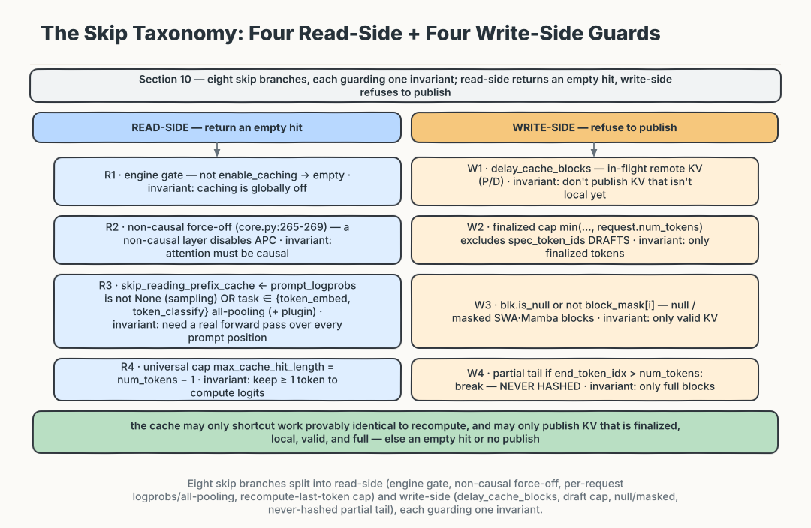</a>

<p class='figure-caption'>The skip taxonomy: eight branches split into read-side (engine gate, non-causal force-off, per-request logprobs/all-pooling flag, recompute-last-token cap) and write-side (delay_cache_blocks, draft cap, null/masked, never-hashed partial tail), each guarding one invariant.</p>

A block that is not yet `hash_block_size` tokens wide produces no `BlockHash`, so it never enters `request.block_hashes`, so `cache_full_blocks` never sees it, so no lookup can match it ([Section 2](#2-the-block-hash-chaining-tokens-into-a-fingerprint)). This is why prefix reuse is always *full-block, block-aligned*: the trailing few tokens of any prompt are structurally uncacheable until they fill a block. The hash index only ever contains fingerprints of complete blocks, which is precisely what lets break-on-first-miss lookup ([Section 5](#5-finding-the-longest-cache-hit)) and single-block-hash reconstruction ([Section 11](#11-kv-cache-events-for-external-routers)) be sound.

## 11. KV Cache Events for External Routers

KV-cache events expose changes in the local prefix cache to external consumers. A P/D router, remote offload tier, or shared KV store can use them to track which engine holds a prefix without sharing the engine's memory. The stream therefore has to describe both cache identity and lifecycle: stored blocks, removed blocks, and full resets.

The stream mirrors stores, evictions, and clears. `BlockStored` carries the inputs needed to reconstruct the engine's block key, allowing an external consumer to maintain a coherent index without access to the engine's memory.

### The wire vocabulary: three structs

An external router learns everything from three `msgspec` structs. They are the entire vocabulary of the protocol.

Source: [`vllm/distributed/kv_events.py:49-113`](https://github.com/vllm-project/vllm/blob/6cf7b26bd4bff60bf378e1af14044280ac0d214c/vllm/distributed/kv_events.py#L49-L113)

```python
# kv_events.py:49-113
class BlockStored(KVCacheEvent):
    block_hashes: list[ExternalBlockHash]
    parent_block_hash: ExternalBlockHash | None
    token_ids: list[int]
    block_size: int

    lora_id: int | None
    ...
    medium: str | None
    lora_name: str | None

    extra_keys: list[tuple[Any, ...] | None] | None = None
    ...
    group_idx: int | None = None
    # Store events carry cache-spec metadata so consumers can classify and
    # filter groups as they are learned. Remove events only need group_idx+hash.
    kv_cache_spec_kind: str | None = None
    kv_cache_spec_sliding_window: int | None = None
    ...

class BlockRemoved(KVCacheEvent):
    block_hashes: list[ExternalBlockHash]
    medium: str | None
    group_idx: int | None = None
    ...

class AllBlocksCleared(KVCacheEvent):
    pass


class KVEventBatch(EventBatch):
    events: list[BlockStored | BlockRemoved | AllBlocksCleared]
```

<a href='images/vllm-07-26-kv-event-vocab.svg' target='_blank'>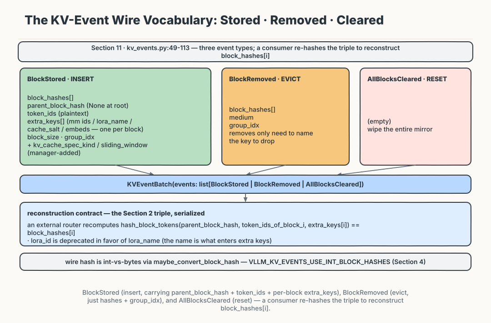</a>

<p class='figure-caption'>The KV-event wire vocabulary: BlockStored (insert, carrying parent_block_hash + token_ids + per-block extra_keys), BlockRemoved (evict, just hashes + group_idx), and AllBlocksCleared (reset) — a consumer re-hashes the triple to reconstruct block_hashes[i].</p>

Read them as insert / evict / reset. `BlockStored` is the *insert* record for a run of newly-cached blocks: the chain of `block_hashes` now resident, their `parent_block_hash` (the prefix predecessor, `None` at the chain root), the raw `token_ids`, and (the piece that makes the events useful rather than opaque) `extra_keys`, one entry per block, carrying the multimodal identifiers, LoRA name, `cache_salt`, and prompt-embed hashes for that block ([Section 3](#3-extra-keys-multimodal-cache-salt-and-lora)). `BlockRemoved` is the *evict* record and is deliberately minimal: just the hashes leaving the cache plus `group_idx`. The comment at `:71-73` states the asymmetry directly — stores carry cache-spec metadata so consumers can classify groups as they learn them, removes only need to name the key to drop. `AllBlocksCleared` is the *reset* record, empty: invalidate the whole mirror. `ExternalBlockHash` is a `bytes | int` alias ([`kv_cache_utils.py:54`](https://github.com/vllm-project/vllm/blob/6cf7b26bd4bff60bf378e1af14044280ac0d214c/vllm/v1/core/kv_cache_utils.py#L54)), which becomes important below.

Why put `parent_block_hash`, `token_ids`, and `extra_keys` on the wire at all, when `block_hashes` is already there? Because a consumer that re-hashes the triple `(parent_block_hash, token_ids_of_block_i, extra_keys[i])` reproduces `block_hashes[i]` — that triple is *exactly* what the engine feeds `hash_block_tokens` ([Section 2](#2-the-block-hash-chaining-tokens-into-a-fingerprint), [`kv_cache_utils.py:598-604`](https://github.com/vllm-project/vllm/blob/6cf7b26bd4bff60bf378e1af14044280ac0d214c/vllm/v1/core/kv_cache_utils.py#L598-L604)). The events are the hash chain, serialized. This is what lets a router key its own store on the same hashes without trusting the engine's opaque digest, and it is also why the `lora_id` field is marked *deprecated in favor of `lora_name`* (`:56-58`): the *name*, not the numeric adapter id, is what enters the extra keys and therefore the reconstructable hash.

The three structs are the complete protocol, and the event stream is a faithful ordered replica of the engine's prefix-cache mutations — every store, evict, and reset the block pool performs emits exactly one corresponding event, so the router's mirror of "what is cached" stays consistent with the engine's `cached_block_hash_to_block`.

### Emission is gated, and store events are assembled from the same keys the hash used

Emission lives in `BlockPool` behind a single gate installed at construction.

Source: [`vllm/v1/core/block_pool.py:194-195`](https://github.com/vllm-project/vllm/blob/6cf7b26bd4bff60bf378e1af14044280ac0d214c/vllm/v1/core/block_pool.py#L194-L195)

```python
        self.enable_kv_cache_events = enable_kv_cache_events
        self.kv_event_queue: list[KVCacheEvent] = []
```

Every emission site is guarded by `if self.enable_kv_cache_events`. When events are off the queue stays empty and `take_events()` short-circuits: no hashes and no `token_ids` ever leave the process. The store event is built inside `cache_full_blocks`, on the same write path that publishes finalized blocks into the index ([Section 6](#6-caching-finalized-blocks)):

Source: [`vllm/v1/core/block_pool.py:340-356`](https://github.com/vllm-project/vllm/blob/6cf7b26bd4bff60bf378e1af14044280ac0d214c/vllm/v1/core/block_pool.py#L340-L356)

```python
            self.kv_event_queue.append(
                BlockStored(
                    block_hashes=new_hashes,
                    parent_block_hash=parent_block_hash,
                    token_ids=request.all_token_ids[start_token_idx:end_token_idx],
                    block_size=block_size,
                    lora_id=request.lora_request.adapter_id
                    if request.lora_request
                    else None,
                    medium=MEDIUM_GPU,
                    lora_name=request.lora_request.name
                    if request.lora_request
                    else None,
                    extra_keys=extra_keys_list if extra_keys_list else None,
                    group_idx=kv_cache_group_id,
                )
            )
```

Two details make the reconstruction contract hold. First, `parent_block_hash` is computed at `:311-316` as `None` when this run starts the prefix chain (`num_cached_blocks == 0`), else the last already-cached block's hash — so a router can thread the run onto the prefix tree it already has. Second, `extra_keys_list` is rebuilt at `:326-338` by calling `generate_block_hash_extra_keys` *per block* — the very same function the hasher calls at hash time ([Section 3](#3-extra-keys-multimodal-cache-salt-and-lora)) — and the loop `continue`s over null and masked-out blocks (`:329-332`) precisely so the list length matches `new_hashes`, keeping the per-block correspondence `extra_keys[i] ↔ block_hashes[i]` exact. The `token_ids` field is a raw slice of `request.all_token_ids`: the prompt's raw token IDs go on the wire — integer IDs, not literal text, but ones a matching tokenizer can typically decode straight back to the prompt, which is the whole reason the endpoint is a trust boundary (below, and [Section 9](#9-cross-tenant-isolation-and-cache-salt)).

**Hashes on the wire: 64-bit int by default, bytes on request**

The digest is either raw bytes or a folded integer, decided by one helper.

Source: [`vllm/v1/core/kv_cache_utils.py:79-82`](https://github.com/vllm-project/vllm/blob/6cf7b26bd4bff60bf378e1af14044280ac0d214c/vllm/v1/core/kv_cache_utils.py#L79-L82)

```python
def maybe_convert_block_hash(hash_bytes: BlockHash) -> ExternalBlockHash:
    if not envs.VLLM_KV_EVENTS_USE_INT_BLOCK_HASHES:
        return hash_bytes
    return int.from_bytes(hash_bytes, byteorder="big") & ((1 << 64) - 1)
```

`VLLM_KV_EVENTS_USE_INT_BLOCK_HASHES` defaults to `True` ([`vllm/envs.py:249`](https://github.com/vllm-project/vllm/blob/6cf7b26bd4bff60bf378e1af14044280ac0d214c/vllm/envs.py#L249)), so by default the 32-byte SHA-256 (or 16-byte xxh3-128) chain digest is masked to its low 64 bits for the wire; set the env var false to ship the full bytes. This fold is *wire-only*: the truncated integer is never fed back into the hash chain, so it does not weaken the in-engine collision resistance discussed in [Section 4](#4-the-hash-algorithm-sha256-vs-builtin-collisions-pythonhashseed) — do not conflate the 128-/256-bit chain digest with this 64-bit event id. The consumer must, of course, apply the same convention when it reconstructs, or its recomputed hashes will not match the ids it received.

### Evictions route through one choke point; no silent removals

Every individual removal of a hash from the cache emits exactly one `BlockRemoved` (the whole-cache reset is the one exception, covered below) because every such removal routes through a single method.

Source: [`vllm/v1/core/block_pool.py:505-518`](https://github.com/vllm-project/vllm/blob/6cf7b26bd4bff60bf378e1af14044280ac0d214c/vllm/v1/core/block_pool.py#L505-L518)

```python
    def _emit_block_removed_events(
        self,
        block_hashes: list[BlockHashWithGroupId],
    ) -> None:
        if not self.enable_kv_cache_events:
            return
        for block_hash in block_hashes:
            self.kv_event_queue.append(
                BlockRemoved(
                    block_hashes=[maybe_convert_block_hash(get_block_hash(block_hash))],
                    medium=MEDIUM_GPU,
                    group_idx=get_group_id(block_hash),
                )
            )
```

The input is a list of `BlockHashWithGroupId` — the packed `hash + group_id` key from the index ([Section 5](#5-finding-the-longest-cache-hit)) — split back into its two components by `get_block_hash`/`get_group_id` so the removed event names the same group identity the store used. The single caller of the *teardown* is `_remove_cached_block_hashes` ([`block_pool.py:484-503`](https://github.com/vllm-project/vllm/blob/6cf7b26bd4bff60bf378e1af14044280ac0d214c/vllm/v1/core/block_pool.py#L484-L503)), which is reached from exactly three call sites: LRU reuse of a cached-but-free block when the allocator pops it in `_maybe_evict_cached_block` ([`block_pool.py:589`](https://github.com/vllm-project/vllm/blob/6cf7b26bd4bff60bf378e1af14044280ac0d214c/vllm/v1/core/block_pool.py#L589), [Section 7](#7-lru-eviction-the-free-queue-as-eviction-order)), and partial→full promotion in both `cache_full_blocks` ([`block_pool.py:300`](https://github.com/vllm-project/vllm/blob/6cf7b26bd4bff60bf378e1af14044280ac0d214c/vllm/v1/core/block_pool.py#L300)) and `cache_partial_block` ([`block_pool.py:419`](https://github.com/vllm-project/vllm/blob/6cf7b26bd4bff60bf378e1af14044280ac0d214c/vllm/v1/core/block_pool.py#L419)), where the coarse partial key is dropped before the finer full key is inserted, so the router never sees a stale partial aliasing the full block. Because the block pool drops a hash by no other route (aside from the whole-cache reset below), the event stream cannot fall behind reality.

No silent evictions: outside a full reset, every hash that leaves `cached_block_hash_to_block` produces one `BlockRemoved`, so the router's mirror never retains a key the engine has already recycled.

The reset path is the counterpart. `reset_prefix_cache` ([Section 8](#8-hit-rate-and-stats)) appends `AllBlocksCleared()` at [`block_pool.py:687-688`](https://github.com/vllm-project/vllm/blob/6cf7b26bd4bff60bf378e1af14044280ac0d214c/vllm/v1/core/block_pool.py#L687-L688), but *only after* it has verified all blocks are free and actually wiped the hash maps — a reset that fails because blocks are still referenced returns early and emits nothing. So a clear event is published only when the engine truly emptied the cache, and the router never over-invalidates on a no-op reset.

**Drain, annotate, publish**

Draining is an atomic swap in the single-threaded scheduler loop: `take_events` hands out the accumulated list and installs a fresh empty one ([`block_pool.py:713-723`](https://github.com/vllm-project/vllm/blob/6cf7b26bd4bff60bf378e1af14044280ac0d214c/vllm/v1/core/block_pool.py#L713-L723)), so each event is drained exactly once locally. Between the block pool and the wire sits one enrichment step, performed by the manager rather than the pool:

Source: [`vllm/v1/core/kv_cache_manager.py:571-589`](https://github.com/vllm-project/vllm/blob/6cf7b26bd4bff60bf378e1af14044280ac0d214c/vllm/v1/core/kv_cache_manager.py#L571-L589)

```python
        events = self.block_pool.take_events()
        for event in events:
            if not isinstance(event, BlockStored):
                continue
            if event.group_idx is None:
                continue
            if event.group_idx < 0 or event.group_idx >= len(
                self.kv_cache_event_metadata
            ):
                logger.warning(
                    "Group index `%s` not in KV cache metadata", event.group_idx
                )
                continue
            # Annotate here so BlockPool can keep emitting structural cache
            # events without owning semantic KV cache spec metadata.
            kind, sliding_window = self.kv_cache_event_metadata[event.group_idx]
            event.kv_cache_spec_kind = kind
            event.kv_cache_spec_sliding_window = sliding_window
        return events
```

The block pool emits *structural* events (hashes, tokens, `group_idx`) and stays free of any KV-spec knowledge; the manager layers the *semantic* group metadata (`kv_cache_spec_kind`, `sliding_window`) onto `BlockStored` events only, after a bounds check on `group_idx`. This is why the store struct carries that metadata and the remove struct does not: a consumer needs it to distinguish a full-attention block from a sliding-window block of identical content (they are different keys in different groups), and it needs that only when learning a key, not when dropping one. The scheduler then collects and ships:

Source: [`vllm/v1/core/sched/scheduler.py:1809-1824`](https://github.com/vllm-project/vllm/blob/6cf7b26bd4bff60bf378e1af14044280ac0d214c/vllm/v1/core/sched/scheduler.py#L1809-L1824)

```python
        # collect KV cache events from KV cache manager
        events = self.kv_cache_manager.take_events()

        # collect KV cache events from connector
        if self.connector is not None:
            connector_events = self.connector.take_events()
            if connector_events:
                if events is None:
                    events = list(connector_events)
                else:
                    events.extend(connector_events)

        # publish collected KV cache events
        if events:
            batch = KVEventBatch(ts=time.time(), events=events)
            self.kv_event_publisher.publish(batch)
```

Each scheduler step drains the manager's block-pool events plus any connector events (offloading, LMCache, multi-connector each expose `take_events`), wraps them in a single timestamped `KVEventBatch`, and publishes. So the emission granularity is one batch per step, timestamped: the same tick at which the prefix cache actually changed.

<a href='images/vllm-07-09-kv-events.svg' target='_blank'>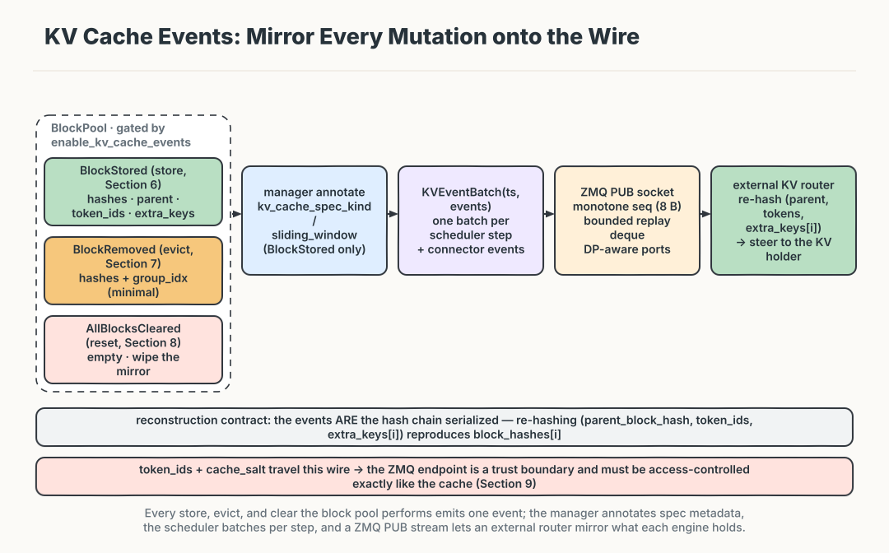</a>

<p class='figure-caption'>BlockPool queue to manager spec-annotation to per-step KVEventBatch to a ZMQ PUB socket with monotone sequence numbers and a bounded replay buffer, feeding an external router's mirror.</p>

### Transport: ZMQ PUB, monotone sequence, bounded replay, DP-aware

`publish` stays off the network — it drops the batch on a bounded in-memory queue (`max_queue_size`, default 100 000) that a background thread services, so the scheduler does not touch the wire; only if that queue backs up completely does the enqueue itself wait. The thread does the wire work:

Source: [`vllm/distributed/kv_events.py:435-442`](https://github.com/vllm-project/vllm/blob/6cf7b26bd4bff60bf378e1af14044280ac0d214c/vllm/distributed/kv_events.py#L435-L442)

```python
                seq = next(self._seq_gen)

                payload = self._pack.encode(event)
                seq_bytes = seq.to_bytes(8, "big")
                self._pub.send_multipart((self._topic_bytes, seq_bytes, payload))

                self._buffer.append((seq, payload))
                self._event_queue.task_done()
```

Each batch is msgpack-encoded, stamped with a monotone 8-byte sequence number, sent as `(topic, seq, payload)` on a `PUB` socket, and retained in a bounded replay `deque` (`buffer_steps`, default 10 000). A subscriber that sees a gap in sequence numbers sends its last-seen `seq` to a `ROUTER` replay socket; `_service_replay` (`:449-467`) re-sends every buffered batch with `seq >= start_seq` followed by an `END_SEQ` sentinel. The abstract contract is explicit at `:256-262`: implementations "should guarantee at-least-once delivery and monotonic ordering (e.g., via sequence numbers)." Data parallelism is handled at the transport edge, not in the scheduler: each DP rank runs its own publisher, `publish` tags the batch with `data_parallel_rank` (`:350-351`), and `offset_endpoint_port` (`:469-500`) shifts each rank's port by its rank so streams never collide. The factory returns a no-op `NullEventPublisher` unless events are enabled with a non-null publisher (`:515-535`), which is the same gate as the block-pool queue, one layer out.

Monotone sequence numbers plus a bounded replay buffer give the subscriber gap detection and recovery — at-least-once, in order, so long as the gap still fits inside the `buffer_steps` replay window; a subscriber that falls further behind can detect the loss but not replay it from this transport. Per-rank ports and tags make every event attributable to exactly one DP rank, so a consumer never conflates or double-counts ranks.

### The events endpoint is a trust boundary

The reconstruction contract has a security consequence. To let a router rebuild keys, `BlockStored` puts raw `token_ids` and per-block `extra_keys` on the wire — and `extra_keys[0]` contains the tenant's `cache_salt` ([Section 3](#3-extra-keys-multimodal-cache-salt-and-lora), [Section 9](#9-cross-tenant-isolation-and-cache-salt)). The struct docstring says so plainly ([`kv_events.py:63-68`](https://github.com/vllm-project/vllm/blob/6cf7b26bd4bff60bf378e1af14044280ac0d214c/vllm/distributed/kv_events.py#L63-L68)): the extra keys are "exposed for external KV cache consumers to reconstruct block hashes." Raw token IDs are typically reversible with the tokenizer, so both sensitive prompt material and the per-tenant salt traverse the ZMQ channel. Whatever separation [Section 9](#9-cross-tenant-isolation-and-cache-salt) buys by salting the hash chain is only as strong as the access control on this endpoint: a listener on the event stream can inspect the payload directly, without relying on a cache-timing signal. The salt's own guidance, "protected from access by 3rd parties", therefore extends to the event transport.

## 12. A Request Through a Warm Prefix Cache

The trace below follows one request through a warm cache in execution order. APC involves two distinct concerns: the hash chain identifies a reusable prefix, while reference counts and the free queue determine whether its physical blocks remain available. Article 06 covers the allocator mechanics underneath this trace; article 05 explains how the scheduler consumes the hit length.

<a href='images/vllm-07-10-prefix-trace.svg' target='_blank'>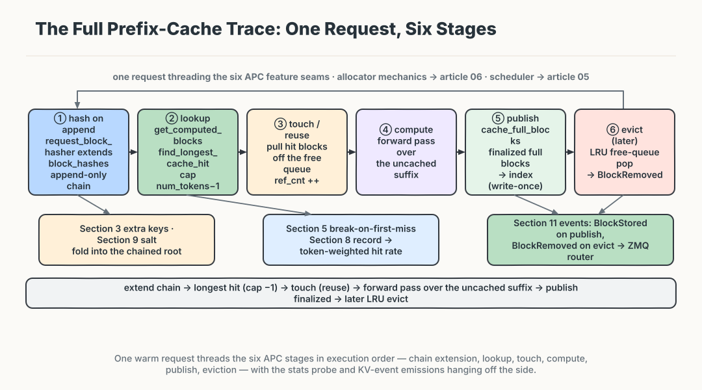</a>

<p class='figure-caption'>One request threading the six APC stages: chain extension, lookup, touch, stats, publish, and eviction.</p>

### Stage 1 — hashing on append: the chain driver

The trace begins before any lookup, when tokens are appended and the request extends its own hash chain. The driver is `request_block_hasher`, the closure returned by `get_request_block_hasher` ([Section 2](#2-the-block-hash-chaining-tokens-into-a-fingerprint) reads it link by link; the excerpt below is a trace recap).

Source: [`vllm/v1/core/kv_cache_utils.py:687-728`](https://github.com/vllm-project/vllm/blob/6cf7b26bd4bff60bf378e1af14044280ac0d214c/vllm/v1/core/kv_cache_utils.py#L687-L728)

```python
    def request_block_hasher(request: Request) -> list[BlockHash]:
        start_token_idx = len(request.block_hashes) * hash_block_size
        num_tokens = request.num_tokens
        ...
        prev_block_hash_value = (
            request.block_hashes[-1] if request.block_hashes else None
        )
        new_block_hashes: list[BlockHash] = []
        while True:
            end_token_idx = start_token_idx + hash_block_size
            if end_token_idx > num_tokens:
                # We only hash full blocks
                break
            ...
            block_hash = hash_block_tokens(
                caching_hash_fn, prev_block_hash_value, block_tokens, extra_keys
            )
            new_block_hashes.append(block_hash)
            start_token_idx += hash_block_size
            prev_block_hash_value = block_hash
        return new_block_hashes
```

This is the chain's writer. `start_token_idx` resumes at `len(block_hashes) * hash_block_size`, so the loop extends the existing chain instead of hashing old links again. `prev_block_hash_value` starts from the last existing hash (or `None`, which `hash_block_tokens` promotes to the per-process `NONE_HASH` root, [Section 2](#2-the-block-hash-chaining-tokens-into-a-fingerprint)/[Section 4](#4-the-hash-algorithm-sha256-vs-builtin-collisions-pythonhashseed)) and is carried forward on line 726. The `end_token_idx > num_tokens` branch leaves a trailing partial block unhashed until it fills; such a block cannot yet be published or found by prefix lookup ([Section 6](#6-caching-finalized-blocks), [Section 10](#10-when-caching-is-skipped)).

This closure is wired only when prefix caching is on or a KV connector is present ([`vllm/v1/engine/core.py:210-219`](https://github.com/vllm-project/vllm/blob/6cf7b26bd4bff60bf378e1af14044280ac0d214c/vllm/v1/engine/core.py#L210-L219)); otherwise `request.block_hashes` stays empty and the entire trace below short-circuits. `block_hashes[i]` is a rolling commitment to the whole prefix `[0, (i+1)·hash_block_size)`, extended monotonically and never truncated on preemption or speculative rejection (article 06, `block_hashes` append-only monotonicity).

### Stage 2 — lookup and the stats probe

When the scheduler prepares the request, it asks the manager for the computed prefix. `get_computed_blocks` is both the read-side entry and the sole producer of the primary hit-rate signal.

Source: [`vllm/v1/core/kv_cache_manager.py:218-242`](https://github.com/vllm-project/vllm/blob/6cf7b26bd4bff60bf378e1af14044280ac0d214c/vllm/v1/core/kv_cache_manager.py#L218-L242)

```python
        if not self.enable_caching or request.skip_reading_prefix_cache:
            return self.empty_kv_cache_blocks, 0
        ...
        max_cache_hit_length = request.num_tokens - 1
        computed_blocks, num_new_computed_tokens = (
            self.coordinator.find_longest_cache_hit(
                request.block_hashes, max_cache_hit_length
            )
        )
        if self.log_stats:
            assert self.prefix_cache_stats is not None
            self.prefix_cache_stats.record(
                num_tokens=request.num_tokens,
                num_hits=num_new_computed_tokens,
                preempted=request.num_preemptions > 0,
            )
        return self.create_kv_cache_blocks(computed_blocks), num_new_computed_tokens
```

Three feature seams compress into these lines. First, the two skip guards ([Section 10](#10-when-caching-is-skipped)): a request needing prompt logprobs or an all-pooling model sets `skip_reading_prefix_cache` and returns an empty result, because a cache hit would suppress the forward pass those semantics require. Second, `max_cache_hit_length = request.num_tokens - 1`: the recompute-last-token cap. Even a 100%-cached prompt reserves at least one token for the forward pass to produce logits, and because hits are block-aligned this can force recomputation of the entire final block. Third, `find_longest_cache_hit` walks the chain break-on-first-miss and all-groups-must-agree ([Section 5](#5-finding-the-longest-cache-hit)); its soundness rests entirely on Stage 1's chain being downward-closed — a miss at block *k* proves every block `≥ k` differs, so scanning can stop.

The `record` call counts prefix *tokens*, not requests or blocks ([Section 8](#8-hit-rate-and-stats)). It places self-hits from a re-admitted preempted request in the `preempted_*` bucket ([`stats.py:131-142`](https://github.com/vllm-project/vllm/blob/6cf7b26bd4bff60bf378e1af14044280ac0d214c/vllm/v1/metrics/stats.py#L131-L142)), keeping them out of the fresh-request window. The method does not write back to the `Request`; it only reads the request and updates the manager's statistics. Subject to correct cache keys and no hash collision, a hit avoids work without changing model semantics. The lookup also leaves at least one token to recompute.

### Stage 3 — touch and reuse

The hit blocks returned by Stage 2 may still be in the free queue with `ref_cnt == 0`: they are free capacity, but remain cache entries until reuse or eviction. The manager therefore calls `touch` before allocating new blocks. `touch` removes each hit block from the queue and increments its reference count ([`block_pool.py:597-612`](https://github.com/vllm-project/vllm/blob/6cf7b26bd4bff60bf378e1af14044280ac0d214c/vllm/v1/core/block_pool.py#L597-L612)). Because this happens before `get_new_blocks` in the same allocation path, the allocator cannot immediately recycle a block selected for reuse.

### Stage 4 — publishing finalized blocks

After the forward pass, the newly finalized full blocks are published into the `hash → block` index through the write path ([Section 6](#6-caching-finalized-blocks)): the finalized-token cap excludes speculative drafts ([`kv_cache_manager.py:452-461`](https://github.com/vllm-project/vllm/blob/6cf7b26bd4bff60bf378e1af14044280ac0d214c/vllm/v1/core/kv_cache_manager.py#L452-L461)), the integer floor drops the partial tail, null/masked blocks are skipped, and `_insert_block_hash` stamps a write-once primary hash or records a secondary alias ([`block_pool.py:520-540`](https://github.com/vllm-project/vllm/blob/6cf7b26bd4bff60bf378e1af14044280ac0d214c/vllm/v1/core/block_pool.py#L520-L540)). Article 06 details these mechanics in its write-funnel section; the feature-level fact is that this is the *only* path by which a block becomes globally reusable, and if KV-cache events are enabled it is also where a `BlockStored` message (carrying the parent hash, the block's token ids, and its per-block `extra_keys`) leaves the process for external routers ([Section 11](#11-kv-cache-events-for-external-routers)). Nothing partial, nothing draft, nothing not-yet-computed ever reaches the index.

### Stage 5 — free and the eviction order

When the request finishes or is preempted, its blocks re-enter the free queue, and this is where the LRU *policy* is encoded — not as timestamps or a sweep, but as position ([Section 7](#7-lru-eviction-the-free-queue-as-eviction-order) reads this policy in full; the excerpt below is a trace recap).

Source: [`vllm/v1/core/block_pool.py:622-635`](https://github.com/vllm-project/vllm/blob/6cf7b26bd4bff60bf378e1af14044280ac0d214c/vllm/v1/core/block_pool.py#L622-L635)

```python
        # Identify blocks with hash (LRU cache) and without it (will never match in APC)
        blocks_with_hash = []
        blocks_without_hash = []
        for block in ordered_blocks:
            block.ref_cnt -= 1
            if block.ref_cnt == 0 and not block.is_null:
                if block.block_hash is None:
                    blocks_without_hash.append(block)
                else:
                    blocks_with_hash.append(block)

        # Blocks without hash always get evicted first - prepend them last to the tail
        self.free_block_queue.prepend_n(blocks_without_hash)
        self.free_block_queue.append_n(blocks_with_hash)
```

The reorder sorts freed blocks into two priority classes by cache value. A block with no hash is worthless to APC because it can never match, so it is prepended to the LRU front to be recycled first. A hashed block is still hittable, so it is appended to the MRU tail to be kept longest. The `ordered_blocks` argument arrives already sorted by the caller, which passes `reversed(...)` ([`single_type_kv_cache_manager.py:410-411`](https://github.com/vllm-project/vllm/blob/6cf7b26bd4bff60bf378e1af14044280ac0d214c/vllm/v1/core/single_type_kv_cache_manager.py#L410-L411)) so that within one freed run the chain tail (the longest prefix, hence the least reusable link) lands nearer the front. Crucially, freeing does *not* evict: the block keeps its hash and stays a valid hit target until the allocator later pops it from the front in `get_new_blocks` and calls `_maybe_evict_cached_block`, which strips the hash, fires `on_block_evicted` first to avoid a metrics leak, and (if events are on) emits `BlockRemoved`.

`ref_cnt == 0 ⇔ on the free queue`, and queue position *is* eviction priority (no-hash before hash, chain-tail before chain-root) with eviction deferred until the memory is actually needed. This laziness is exactly what lets APC cost near-zero on a miss ([Section 1](#1-what-prefix-caching-is-and-the-reuse-win)): a cold request simply pops from the front and the hash map and free queue are the same integrated structure that ordinary allocation already touches.

### Takeaways

- A block hash commits to its whole aligned prefix, its root, and its non-token context; lookup can therefore stop at the first miss.
- Only full, finalized, local, valid blocks are published, and a full-prefix hit still recomputes the final token.
- Hash-function reproducibility requires compatible serialization, digest selection, and root seed; extra-key isolation also assumes source values do not alias.
- Reference counts decide whether a physical block is live, while free-queue position supplies lazy eviction priority.
- Cache salt can separate tenant reachability, but KV-cache events expose token IDs and extra keys and must be protected as sensitive data.

## 13. References

- https://docs.vllm.ai/en/stable/features/automatic_prefix_caching/
- https://vllm.ai/blog/2025-01-27-v1-alpha-release
- https://vllm.ai/blog/2025-09-05-anatomy-of-vllm

*All code conclusions are anchored to [`vllm-project/vllm@6cf7b26bd`](https://github.com/vllm-project/vllm/tree/6cf7b26bd4bff60bf378e1af14044280ac0d214c).*
