# Automatic Prefix Caching：hash、复用与 LRU 淘汰

> 下文所述的 hash 与 cache 行为对应 [`vllm-project/vllm@6cf7b26bd`](https://github.com/vllm-project/vllm/tree/6cf7b26bd4bff60bf378e1af14044280ac0d214c)。代码引用均指向该 revision。摘录若跳过无关代码，会用 `...` 标示缺口；凡是综合整理的内容，都会明确说明。

## 1. Prefix Caching 是什么，以及复用带来的收益

Automatic Prefix Caching（APC）让 vLLM 能够复用与 prompt 前缀匹配、已驻留的 KV block，并从 request 特有的 suffix 开始执行新计算。当长文档、system prompt 或对话历史在多个 request 之间保持不变时，它能带来显著收益（[APC 功能指南](https://docs.vllm.ai/en/stable/features/automatic_prefix_caching/)）。

真正需要匹配的不是原始 prompt bytes，而是 *token* 前缀，以及会改变 KV 语义的上下文：block key 是 `hash(parent_block_hash, tuple(block_token_ids), extra_keys)`（[`kv_cache_utils.py:579-604`](https://github.com/vllm-project/vllm/blob/6cf7b26bd4bff60bf378e1af14044280ac0d214c/vllm/v1/core/kv_cache_utils.py#L579-L604)）。因此，只有当前缀 tokenize 后得到相同的 token ID，extra-key context（LoRA adapter、多模态输入、prompt embeds、cache salt——[第 3 节](#3-extra-keysmultimodalcache-salt-与-lora)）一致，并且使用同一个 per-process root seed（`NONE_HASH`，它通过 parent-hash field 进入，而不是 `extra_keys`）时，两个 request 才能共享 KV。字节完全一致的 prompt 是满足这一条件的常见情形，但并非这一条件本身的定义。

复用收益值得精确说明，因为它为后续一切收益划定了上限。prefill 成本大致与模型需要执行 attention 的 prompt token 数量成正比。如果一个包含 `N` 个 token 的 request 与 cache entry 共享长度为 `P` 个 token 的前缀，APC 就会把原本处理 `N` 个 token 的 prefill 缩短为 `(N − P)` 个 token；前 `P` 个 token 的 KV 直接从 HBM 读取，无需重新生成。以一份 4 000-token 的共享文档和一个 50-token 的问题为例，重复 request 只需让约 2% 的 prompt token（4,050 个中的 50 个）经过新的 forward pass。模型最终使用的条件 token 并未改变；这 50 个 token 的 suffix 仍会对完整 cached prefix 执行 attention，而该前缀的 KV 从 HBM 读取，因此 wall-clock prefill time 的实际降幅会略低于 98%。

APC 以链式方式对完整 token block 做 hash，而不是把整个 prompt 归约成一个 map key；[第 2 节](#2-block-hash将-token-串联成指纹)将进一步分析这种设计带来的影响。

**门控条件：何时才会接入 hash 逻辑**

APC 并非只在 hot path 上检查一个 runtime flag；只有真正需要时，才会*构造* per-request hasher。因此，关闭该功能时完全没有这部分开销——甚至连 object 都不会创建。

源码锚点——[`vllm/v1/engine/core.py:210-219`](https://github.com/vllm-project/vllm/blob/6cf7b26bd4bff60bf378e1af14044280ac0d214c/vllm/v1/engine/core.py#L210-L219)：

```python
        self.request_block_hasher: Callable[[Request], list[BlockHash]] | None = None
        if vllm_config.cache_config.enable_prefix_caching or kv_connector is not None:
            caching_hash_fn = get_hash_fn_by_name(
                vllm_config.cache_config.prefix_caching_hash_algo
            )
            init_none_hash(caching_hash_fn)

            self.request_block_hasher = get_request_block_hasher(
                hash_block_size, caching_hash_fn
            )
```

`request_block_hasher` 的默认值为 `None`；只有设置了 `enable_prefix_caching`，*或*存在 `kv_connector` 时，才会将其替换为真正的 closure。后一个条件很重要：KV-transfer connector（P/D disaggregation、KV offload）即使在 local engine 原本不会使用 cache 时，也需要以 block hash 作为 transfer key，因此同样必须接入 hasher。进入该分支后，有三项内容只会在 engine 构造时绑定一次，之后不会针对每个 request 重新协商：根据配置的 `prefix_caching_hash_algo` 解析 hash function（[第 4 节](#4-hash-算法sha256-与-builtin碰撞及-pythonhashseed)）；`init_none_hash` 使用同一个函数为 chain 的 root sentinel 设定 seed（[第 2 节](#2-block-hash将-token-串联成指纹)、[第 4 节](#4-hash-算法sha256-与-builtin碰撞及-pythonhashseed)）；`get_request_block_hasher` 则将 `hash_block_size` 与该函数捕获到存放在 request 上的 closure 中。

该 closure 为 engine 固定绑定了一套算法、一个 root seed 和一个 block size。如果它仍为 `None`，request 就不会生成 `block_hashes` list，因此既没有内容可供查找，也没有内容可供发布。

此外还有第二道不那么显眼的 gate。它属于真正的*正确性*边界，而非性能边界，第 06 篇并未涉及。Prefix caching（以及 chunked prefill）以 causal attention 为前提；如果某个 layer 以 non-causal 模式运行，二者都会导致该 layer 的 KV 出错。engine 会检测这类 layer，并强制禁用该功能。

源码锚点——[`vllm/v1/engine/core.py:265-269`](https://github.com/vllm-project/vllm/blob/6cf7b26bd4bff60bf378e1af14044280ac0d214c/vllm/v1/engine/core.py#L265-L269)：

```python
            if vllm_config.cache_config.enable_prefix_caching:
                logger.info(
                    "Disabling prefix caching: model has non-causal attention layers."
                )
                vllm_config.cache_config.enable_prefix_caching = False
```

<a href='images/vllm-07-11-hasher-gate.svg' target='_blank'>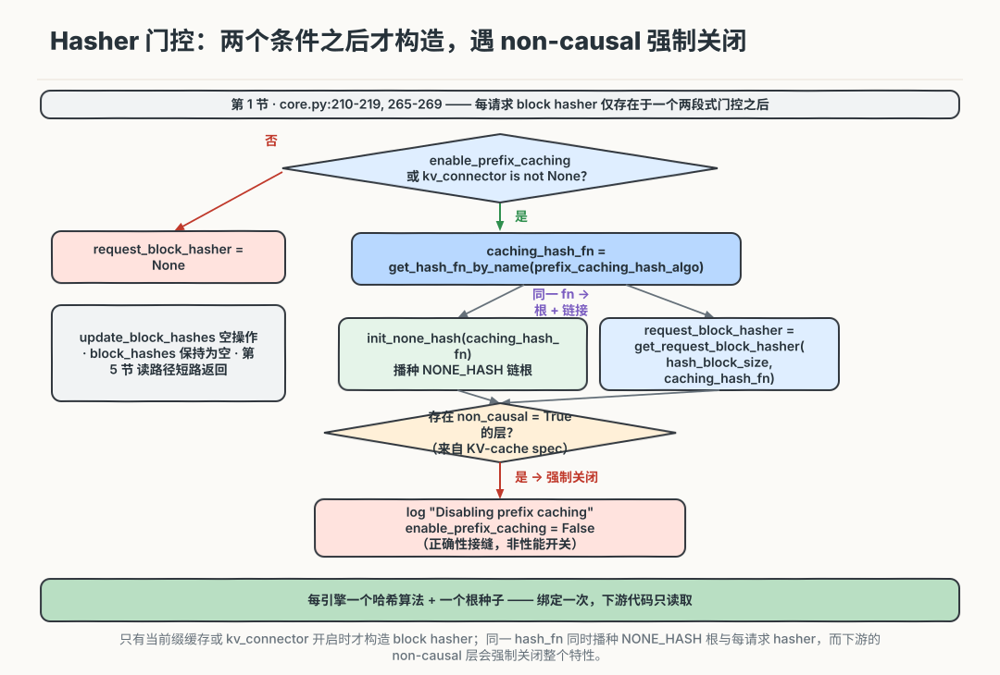</a>

<p class='figure-caption'>决定是否存在 per-request block hasher 的 gate：仅在设置了 enable_prefix_caching 或存在 kv_connector 时才会构造；如果下游检测到任何 non-causal layer，则会强制禁用。</p>

Non-causal layer 会在其 KV spec 上标记 `non_causal=True`；engine core 将该信号转换为调度策略并禁用 cache（[`core.py:249-269`](https://github.com/vllm-project/vllm/blob/6cf7b26bd4bff60bf378e1af14044280ac0d214c/vllm/v1/engine/core.py#L249-L269)）。对这类 layer 而言，复用 causal-prefix KV 并不合法。

<a href='images/vllm-07-02-cache-hit.svg' target='_blank'>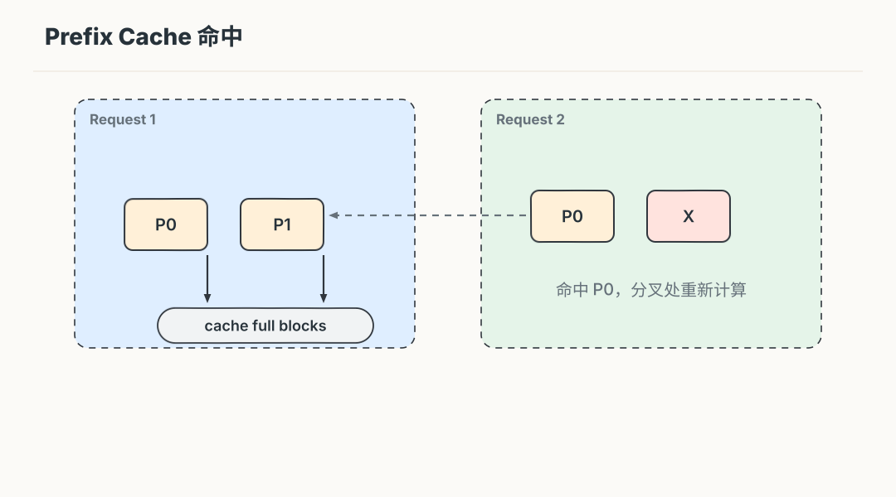</a>

<p class='figure-caption'>Prefix-cache lookup：先在 pool 中找到匹配的前导 block hash 并增加引用计数，然后再继续分配。</p>

### V1 为什么重构 prefix caching，以实现近乎零开销

V0 没有默认启用 APC，因为 cache miss 时，额外管理成本可能超过复用带来的收益。V1 大幅降低了这部分开销，目标是在低 hit rate 下也实现近乎零成本（[V1 alpha 版本发布说明](https://vllm.ai/blog/2025-01-27-v1-alpha-release)）。它的 intrusive free queue 同时承担 LRU 结构的职责：free block 在分配流程重新使用它之前，仍可保留为有效的 cached prefix；移除操作为 O(1)，且无需后台扫描（第 06 篇）。

实践中，cache 只有在 *miss* 时也足够便宜，才值得默认启用；[第 8 节](#8-命中率与统计信息)介绍的按 token 加权 hit rate 统计，正是 vLLM 提供给运维人员的验证手段，可用于确认 cache 在实际流量中确实带来了收益，而非仅仅处于开启状态。

**cache hit 只是一条捷径，不会改变语义**

该设计有一条不可妥协的原则：prefix-cache hit 只会改变模型*多快*得到输出，绝不会改变它*计算什么*。这一点在 read path 入口处体现得最清楚：这里既会拦下语义上禁止复用的 request，也绝不会把任何情况判定为 100% hit。

源码锚点——[`vllm/v1/core/kv_cache_manager.py:218-227`](https://github.com/vllm-project/vllm/blob/6cf7b26bd4bff60bf378e1af14044280ac0d214c/vllm/v1/core/kv_cache_manager.py#L218-L227)：

```python
        if not self.enable_caching or request.skip_reading_prefix_cache:
            return self.empty_kv_cache_blocks, 0
        ...
        max_cache_hit_length = request.num_tokens - 1
```

<a href='images/vllm-07-12-reuse-win.svg' target='_blank'>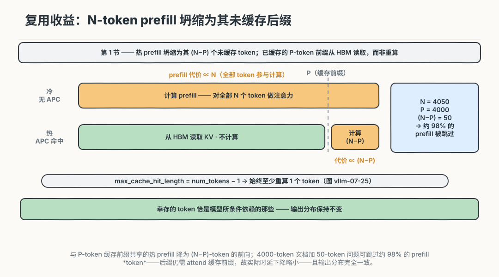</a>

<p class='figure-caption'>复用收益：一个 N-token prefill 若共享 P-token cached prefix，就只剩 N−P 个新 token position 需要 prefill，而前 P 个 token 的 KV 直接从 HBM 读取。对于一份包含 4000 个 token 的 cached document 和一个 50-token 问题，大约 98% 的 prompt position 都可复用；但由于新的 suffix 仍需对 cached prefix 执行 attention，latency 和 FLOPs 的降幅会更小。</p>

该 guard 会拒绝输出要求重新计算每个 prompt position 的 request。`num_tokens - 1` 这一上限还会保留一个 position，用于生成 next-token logits；因此，block alignment 可能导致末尾 block 被重新计算。这两种情况将在[第 5 节](#5-查找最长-cache-命中)和[第 10 节](#10-何时跳过-caching)中展开分析。

## 2. Block Hash：将 token 串联成指纹

APC 通过 per-block hash 识别已 cache 的 prefix。vLLM 并非为每个 block 单独计算 digest，而是计算 `H(parent_block_hash, this_block_tokens, extra_keys)`。将 parent 纳入计算后，这些 hash 就串成了一条 chain：block *i* 处的 match 代表截至该 block 的整个 prefix 都匹配，前提是满足下文讨论的 hash 与 extra-key 假设。第 06 篇通过 `get_computed_blocks`、`allocate_slots` 和 `touch` 使用由此生成的 chain；本文则分析这些 key 是如何构造的。

正是这一项设计选择，使每个 block hash 都成为对其完整 prefix 的滚动承诺——这是一条以 per-process seed 为 root 的线性 hash chain（退化的 Merkle chain，fan-in 为 1）。遇到首个 miss 即中止的 lookup（[第 5 节](#5-查找最长-cache-命中)）、仅针对 block 0 的 cache salting（[第 9 节](#9-跨-tenant-隔离与-cache-salt)），以及 KV-event wire 上的 key 重建（[第 11 节](#11-面向外部-router-的-kv-cache-events)），都只是这种 chaining 的推论，而非彼此独立的特性。

**链节类型：不透明的 bytes，而非 int**

block hash 是原始 digest，并被赋予独立类型，因此不会与普通 byte string 混淆，更不会与带 group 限定的 lookup key 混淆。

源码：[`vllm/v1/core/kv_cache_utils.py:41-44`](https://github.com/vllm-project/vllm/blob/6cf7b26bd4bff60bf378e1af14044280ac0d214c/vllm/v1/core/kv_cache_utils.py#L41-L44)

```python
# BlockHash represents the hash of a single KV-cache block used for
# prefix caching.  Treating it as a distinct type from `bytes` helps
# catch accidental misuse when passing around raw byte strings.
BlockHash = NewType("BlockHash", bytes)
```

<a href='images/vllm-07-13-blockhash-type.svg' target='_blank'>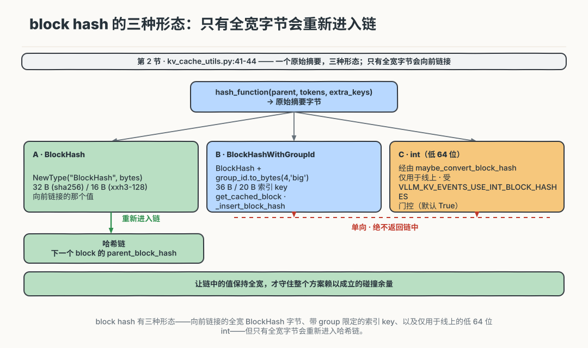</a>

<p class='figure-caption'>block hash 的三种形态：向后参与 chaining 的全宽 BlockHash digest bytes、带 group 限定的 BlockHashWithGroupId index key，以及仅用于 wire 的低 64-bit int——只有完整 bytes 会重新进入 chain。</p>

`BlockHash` 是基于 `bytes` 定义的 `NewType`；在 runtime 中，它*就是* digest——SHA-256 为 32 bytes，xxh3-128 为 16 bytes（algorithm 维度是[第 4 节](#4-hash-算法sha256-与-builtin碰撞及-pythonhashseed)的主题）。它被刻意设计成非 int。block hash 唯一的 int 形式是 `maybe_convert_block_hash`（`:79-82`），即一个低 64-bit fold，仅用于 KV-event wire（[第 11 节](#11-面向外部-router-的-kv-cache-events)），绝不会反馈到 chain 中。chain 中始终保留全宽 bytes，正是这一点维持了整个方案赖以成立的抗碰撞余量。

### 递推关系：一个链节即 `H(parent, tokens, extra_keys)`

一个函数负责计算一个链节。其 pre-image 是固定顺序的 3-tuple，base case 则将 chain 锚定到 root seed。

源码：[`kv_cache_utils.py:598-604`](https://github.com/vllm-project/vllm/blob/6cf7b26bd4bff60bf378e1af14044280ac0d214c/vllm/v1/core/kv_cache_utils.py#L598-L604)（来自 `hash_block_tokens`，sig 位于 `:577`）

```python
    if not parent_block_hash:
        parent_block_hash = NONE_HASH

    curr_block_token_ids_tuple = tuple(curr_block_token_ids)
    return BlockHash(
        hash_function((parent_block_hash, curr_block_token_ids_tuple, extra_keys))
    )
```

<a href='images/vllm-07-14-link-preimage.svg' target='_blank'>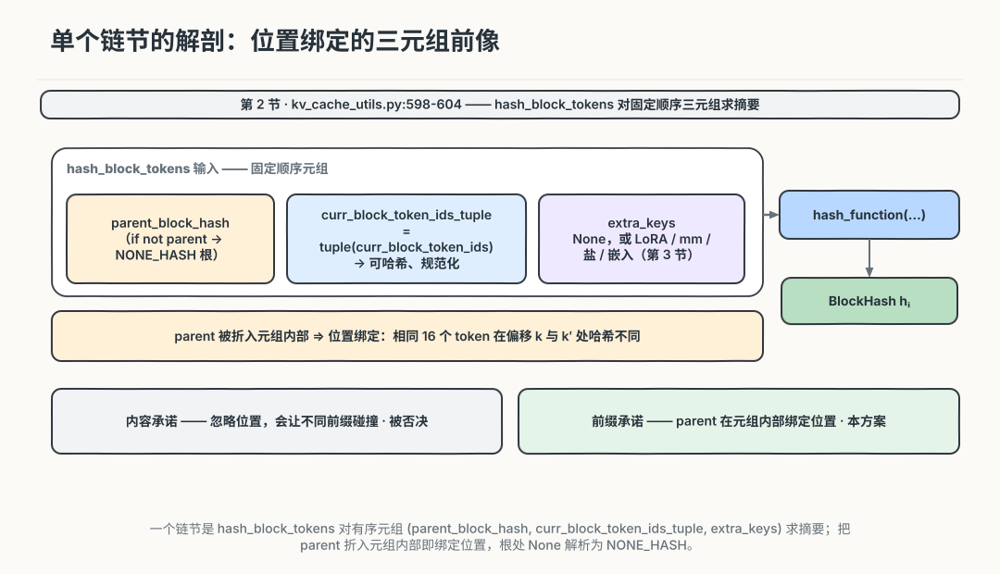</a>

<p class='figure-caption'>一个 chain 链节的构成：hash_block_tokens 对固定顺序的 3-tuple（parent_block_hash, curr_block_token_ids_tuple, extra_keys）计算 digest；parent hash 被纳入 tuple 内部，因此 position 会被绑定，而在 root 处，None 会解析为 NONE_HASH。</p>

1. `if not parent_block_hash: parent_block_hash = NONE_HASH` 是 base case。对于第一个 block，driver 传入 `None`；递推过程会改用 module-global 的 `NONE_HASH` root（其构造方式以及 `PYTHONHASHSEED` seam 属于[第 4 节](#4-hash-算法sha256-与-builtin碰撞及-pythonhashseed)的内容）。有个细节值得单独说明：`not parent_block_hash` 在 `None` *以及*空 bytes `b""` 两种情况下都会得到 truthy 结果；对 SHA-256/xxh3 而言，全空 digest 实际上不可能出现，因此这是无害行为，并非 bug。
2. hash 的 pre-image 是按固定顺序排列的 3-tuple `(parent_block_hash, curr_block_token_ids_tuple, extra_keys)`，并作为整体一次性 hash。三个字段分别是：递归链接到当前 block 之前完整 prefix 的链节；当前 block 自身的 token ids（转换为 `tuple`，使其可以 hash，并能以 canonical 形式 serialize）；以及 `extra_keys`——即 `None`，或由 `generate_block_hash_extra_keys` 组装的 multimodal / LoRA / cache-salt / prompt-embeds side channel（这正是[第 3 节](#3-extra-keysmultimodalcache-salt-与-lora)完整讨论的主题）。
3. `hash_function` 会 serialize 该 tuple（使用 pickle 或 canonical CBOR）并计算 digest；docstring 指出，整个 tuple“被用作 block 的 hash key”（`:595-596`）。

一个 block hash 对三项输入作出承诺：parent hash、当前 block 的 token，以及当前 block 的 extra key。由于 `parent_block_hash` 位于 tuple *内部*，position 会通过前序 chain 被绑定：同一个 16-token block 位于 prefix offset `k` 和 `k'` 时，通常会产生不同的 hash，因为二者的 parent 不同。这就是*内容*承诺与 *prefix* 承诺的区别。与任何基于 hash 的 index 一样，这一结论也受 hash collision 影响。

**驱动 chain：仅处理完整 block、append-only，并向前传递**

一个 per-request closure 会按每个完整 block 一个链节的粒度构建 chain；它从上次调用停止的位置继续，并将每次输出传入下一个链节的 parent slot。

源码：[`kv_cache_utils.py:687-728`](https://github.com/vllm-project/vllm/blob/6cf7b26bd4bff60bf378e1af14044280ac0d214c/vllm/v1/core/kv_cache_utils.py#L687-L728)（有省略），由 `get_request_block_hasher` 返回

```python
    def request_block_hasher(request: Request) -> list[BlockHash]:
        start_token_idx = len(request.block_hashes) * hash_block_size
        num_tokens = request.num_tokens
        ...
        prev_block_hash_value = (
            request.block_hashes[-1] if request.block_hashes else None
        )
        new_block_hashes: list[BlockHash] = []
        while True:
            end_token_idx = start_token_idx + hash_block_size
            if end_token_idx > num_tokens:
                # We only hash full blocks
                break
            ...
            block_tokens = request.all_token_ids[start_token_idx:end_token_idx]
            block_hash = hash_block_tokens(
                caching_hash_fn, prev_block_hash_value, block_tokens, extra_keys
            )

            new_block_hashes.append(block_hash)
            start_token_idx += hash_block_size
            prev_block_hash_value = block_hash

        return new_block_hashes
```

1. **恢复执行。** `start_token_idx = len(request.block_hashes) * hash_block_size`——已经 committed 的 hash 精确决定已有多少 aligned token 完成了 fingerprint；新工作从该 boundary 开始。chain 以增量方式推进，绝不会重新 hash 早期链节。
2. **传递 seed。** `prev_block_hash_value = request.block_hashes[-1] if request.block_hashes else None`。全新的 request 以 `None` 为 seed（→ `NONE_HASH`）；进入 decode 的 request 则以最后一个 committed hash 为 seed，因此生成的 block 可以无缝接到 prompt 的 chain 后：prefill 与 decode 之间形成一条连续的 chain。
3. **仅完整 block 的 loop。** `end_token_idx = start_token_idx + hash_block_size; if end_token_idx > num_tokens: break`（`:708-711`）。末尾的 partial block 在填满之前不会 hash，因此任一 `BlockHash` 始终对应精确且对齐的 token 数量。这就是 partial tail 永远无法通过 hash map 执行 lookup、共享或驱逐的原因（[第 5 节](#5-查找最长-cache-命中)、[第 10 节](#10-何时跳过-caching)）。
4. **chaining 步骤。** 计算出 `block_hash` 后，loop 会执行 `prev_block_hash_value = block_hash`（`:726`）。*这一个 assignment 就构成了 chain*：本轮迭代的输出会成为下一轮迭代的 `parent_block_hash`。删掉它，得到的就只是彼此独立的 per-block digest，不再具备下文所述的任何 prefix 承诺属性。
5. **Granularity。** Hashing 以 `hash_block_size` 的 granularity 执行，这是由 GCD 推导出的 hashing granularity，可能比某个 group 的物理 `block_size` 更细（“例如 16”只是示例，并非常量）。粒度更粗的 consumer 通过 `BlockHashListWithBlockSize` 复用同一批链节，而不是重新 hash（docstring `:681-684`；第 06 篇介绍了这些 coarse key 如何进入 `cache_full_blocks`），因此每个 request 都只有一条 canonical chain。

这条 chain 是 append-only 且单调增长的。`request.block_hashes[-1]` 始终是 live head，`len(block_hashes) * hash_block_size` 是精确的 committed token count；一旦 token 确定，早期链节便不可变。Preemption 和 speculative-token rejection 从不会截断它（参见第 06 篇的 write-funnel 小节）。

### chain 存放在哪里：以 append-only 方式保存在 Request 上

源码：[`vllm/v1/request.py:184-189`](https://github.com/vllm-project/vllm/blob/6cf7b26bd4bff60bf378e1af14044280ac0d214c/vllm/v1/request.py#L184-L189)（init）和 `:242-245`（extend）

```python
    def update_block_hashes(self) -> None:
        """Compute block hashes for any new full blocks and append them."""
        if self._block_hasher is not None:
            self.block_hashes.extend(self._block_hasher(self))
```

`request.block_hashes` 负责持久化这条 chain。`update_block_hashes` 会在构造完成后以及每次追加 token 后运行，并且只添加新近完成的 link；其中 entry `i` 覆盖 `[0, (i+1)·hash_block_size)`。存储 `_block_hasher` 时不会绑定 `self`，以免形成 `Request → partial → Request` reference cycle（`:185-188`）。

### 为何 block *i* 能证明其完整 prefix

在 hash 粒度为 `B = hash_block_size` 时，将递推式一路展开到 root：

<a href='images/vllm-07-01-block-hash-chain.svg' target='_blank'>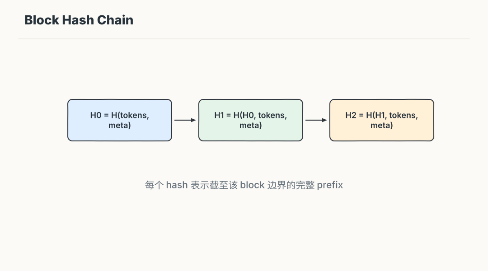</a>

<p class='figure-caption'>每个 block hash 都会纳入其 parent，因此 h_i 会通过传递关系对 tokens[0:(i+1)·B] 覆盖范围内的每个 token 和 extra key，以及 root seed 作出承诺。</p>

```
h_0 = H(NONE_HASH, tokens[0:B],          e_0)
h_1 = H(h_0,       tokens[B:2B],         e_1)
h_2 = H(h_1,       tokens[2B:3B],        e_2)
...
h_i = H(h_{i-1},   tokens[i*B:(i+1)*B],  e_i)
```

逐层代入后，`h_i` 由 `NONE_HASH`、`tokens[0:(i+1)*B]` 中的每个 token **以及** `e_0..e_i` 中的每个 extra key 共同决定。由此可得三个性质，它们分别为本文其他部分的功能提供理论依据：

- **可靠性（前向证明）。** 如果两个 request 的 `h_i` 相同，那么在密码学算法不发生 hash collision（[第 4 节](#4-hash-算法sha256-与-builtin碰撞及-pythonhashseed)）的前提下，它们的整个 prefix `[0,(i+1)*B)`、extra-key context 和 root seed 也相同。这*正是* lookup 可以确信 `h_i` 匹配就意味着 prefix 匹配的原因，也是 `find_longest_cache_hit` 能从左向右扫描并**在第一次 miss 时立即 break**（[第 5 节](#5-查找最长-cache-命中)）的原因：由于 chain 向下闭合，block *k* 的 miss 意味着 block `≥ k` 已经不同。
- **雪崩效应（篡改传播）。** 在位置 `p`（block `j = p // B`）更改一个 token，或更改一个 `e_j`，都会改变 link `j` 的 preimage。对于 collision-resistant digest，随着新的 parent 值沿 chain 传播，`h_j` 及后续 hash 预期都会改变。与任何基于 hash 的承诺一样，这一结论仍取决于 digest 的 collision 特性。
- **位置绑定。** 相同内容出现在不同 offset 时会得到不同的 `h_i`，因为其 parent 不同。hash 承诺的是*位于对应 prefix 位置上的内容*。

从结构上看，这是一个 **hash chain**，而不是 Merkle *tree*：它是线性的，fan-in 为 1，没有 sibling branch，也没有 membership-proof 机制。每个 link 证明的是其*整个 prefix*，而非其中某个单独元素。称其为“Merkle-style”仅在以下意义上成立：每个 link 都是 `H(parent ‖ new-data)`，完整性会通过传递关系一直传播到 root。这也正是“Inside vLLM”一文所采用的思维模型：将前一个 block 的 hash 与当前 token 和 metadata 一起进行 hash（[Inside vLLM](https://vllm.ai/blog/2025-09-05-anatomy-of-vllm)）。

### 作为 domain-separation input 的 root seed

base case 将 block 0 与 `NONE_HASH` 绑定，因此不同 process 只有使用同一个 root 才能复现这条 chain；要实现可移植重建，还必须使用 canonical CBOR。默认的随机 root 会阻止在缺少该值时进行离线重建。per-tenant 的 `cache_salt` 则通过 `extra_keys` 进入 block 0，详见[第 3 节](#3-extra-keysmultimodalcache-salt-与-lora)和[第 9 节](#9-跨-tenant-隔离与-cache-salt)。

## 3. Extra Keys：Multimodal、Cache Salt 与 LoRA

仅凭 token ids 无法唯一确定 KV 语义：相同的 ids 可能代表不同的 image、adapter、prompt embeddings 或 tenant namespaces。`extra_keys` 按固定顺序 `lora + mm + cache_salt + prompt_embeds` 拼接这些 source（[`kv_cache_utils.py:539-574`](https://github.com/vllm-project/vllm/blob/6cf7b26bd4bff60bf378e1af14044280ac0d214c/vllm/v1/core/kv_cache_utils.py#L539-L574)）。由于这种 encoding 没有 source tag，其隔离保证依赖一个假设：来自不同 source domain 的值不会 alias。

<a href='images/vllm-07-03-extra-keys.svg' target='_blank'>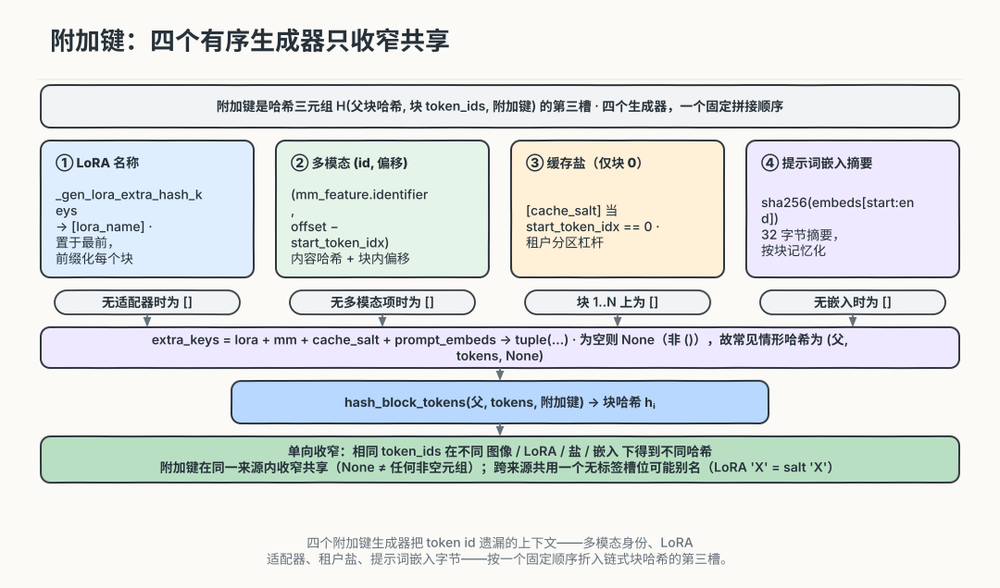</a>

<p class='figure-caption'>四个按固定顺序排列的 generator（LoRA name、multimodal (id, offset)、block-0 salt、prompt-embeds digest）会依次折叠进 chained block hash 的 `extra_keys` slot。</p>

**组装入口：generate_block_hash_extra_keys**

一个函数会为 `[start_token_idx, end_token_idx)` block 汇集这四类 context source，并将其作为一个有序 tuple 返回；如果为空，则返回 `None`。

源码：[`vllm/v1/core/kv_cache_utils.py:555-574`](https://github.com/vllm-project/vllm/blob/6cf7b26bd4bff60bf378e1af14044280ac0d214c/vllm/v1/core/kv_cache_utils.py#L555-L574)

```python
    mm_extra_keys: list[Any]
    mm_extra_keys, new_start_mm_idx = _gen_mm_extra_hash_keys(
        request, start_token_idx, end_token_idx, start_mm_idx
    )
    lora_extra_keys: list[str] = _gen_lora_extra_hash_keys(request)
    cache_salt_keys: list[str] = (
        [request.cache_salt] if (start_token_idx == 0 and request.cache_salt) else []
    )
    prompt_embeds_keys = _gen_prompt_embeds_extra_hash_keys(
        request, start_token_idx, end_token_idx
    )

    extra_keys: list[Any] = (
        lora_extra_keys + mm_extra_keys + cache_salt_keys + prompt_embeds_keys
    )

    if not extra_keys:
        return None, new_start_mm_idx

    return tuple(extra_keys), new_start_mm_idx
```

source 的顺序固定为 `lora + mm + cache_salt + prompt_embeds`。空结果会变为 `None`；只要存在任何值，结果就是一个没有 source tag、按位置编码的 tuple。实际使用的类型使大多数跨 source alias 不太可能发生，但这种 encoding 并不能证明 domain separation。chain driver 会对每个完整 block 调用一次该函数；各 source 不存在时，对应 generator 会以很低的开销返回 `[]`。

声明式 predicate `need_extra_keys`（[`kv_cache_utils.py:411-428`](https://github.com/vllm-project/vllm/blob/6cf7b26bd4bff60bf378e1af14044280ac0d214c/vllm/v1/core/kv_cache_utils.py#L411-L428)，“Multimodal request 需要包含 MM hash … LoRA request … cache salt”）表达了同样的三个启用条件，但**在当前 commit 的源码树中没有 caller**——实际 gating 由四个 generator 各自完成：source 缺失时，它们会 short-circuit 并返回 `[]`。因此，常见场景的成本是四次低开销 early return，而不是跳过 call。

### Multimodal keys：(content-hash, block 内 offset)

用于表示 image、audio clip 或 video frame 的 token ids 只是可互换的 dummy placeholder；真正的内容位于 token stream 之外。因此，multimodal block 的 key 必须同时取决于 item *是什么*，以及它*位于 block 中的哪里*。

identity 字段定义见 [`vllm/multimodal/inputs.py:322-323`](https://github.com/vllm-project/vllm/blob/6cf7b26bd4bff60bf378e1af14044280ac0d214c/vllm/multimodal/inputs.py#L322-L323)：

```python
    identifier: str
    """The hash for caching encoder outputs (with LoRA prefix if applicable)."""
```

对应的 key 生成逻辑见 [`vllm/v1/core/kv_cache_utils.py:466-495`](https://github.com/vllm-project/vllm/blob/6cf7b26bd4bff60bf378e1af14044280ac0d214c/vllm/v1/core/kv_cache_utils.py#L466-L495)：

```python
    curr_mm_idx = start_mm_idx
    while mm_features and curr_mm_idx < len(mm_features):
        mm_feature = mm_features[curr_mm_idx]
        assert mm_feature.identifier is not None
        offset = mm_feature.mm_position.offset
        length = mm_feature.mm_position.length
        if end_token_idx > offset:
            if start_token_idx >= offset + length:
                # This block has passed the current mm input.
                curr_mm_idx += 1
                continue

            # The block contains the current mm input. Include its offset
            # relative to the start of the block so prefix-cache keys stay
            # distinct when the same MM item appears at different positions
            # within otherwise-identical placeholder blocks.
            extra_keys.append((mm_feature.identifier, offset - start_token_idx))

            if end_token_idx >= offset + length:
                # If this block contains the end of the current mm input,
                # move to the next mm input as this block may also contain
                # the next mm input.
                curr_mm_idx += 1
            else:
                # Otherwise this block is done with mm inputs.
                break
        else:
            # This block has not reached the current mm input.
            break
    return extra_keys, curr_mm_idx
```

<a href='images/vllm-07-15-mm-key-scan.svg' target='_blank'>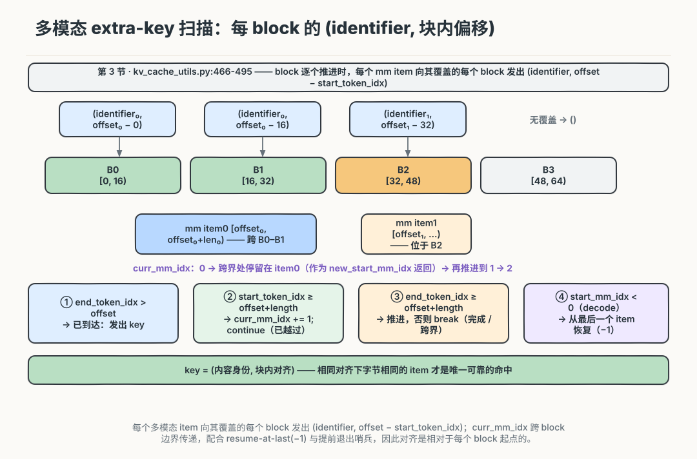</a>

<p class='figure-caption'>Multimodal extra-key 的扫描过程：随着 block 推进，每个 mm item [offset, length) 都会向它所覆盖的 block 发出 (identifier, offset − start_token_idx)；curr_mm_idx 会跨 block boundary 传递，并配合 resume-at-last (−1) 和 early-exit sentinel。</p>

生成的 key 是 pair `(mm_feature.identifier, offset - start_token_idx)`。第一个元素是 multimodal item 的 content hash；根据其 docstring，该 hash 已经纳入 LoRA prefix。因此，即使 placeholder token ids 完全相同，不同 image（或同一 image 搭配不同 adapter）也会产生不同 identifier。第二个元素是 item **相对于 block 起点**的 offset，而不是绝对 prompt offset。inline comment 准确说明了原因：让 key“在同一 MM item 出现在其他方面完全相同的 placeholder block 内不同位置时仍保持不同”。如果两个 block 中同一 image 的 block 内 alignment 不同，就不能发生 alias，因为它们生成的 KV 取决于这种 alignment。

这个 loop 执行的是有状态扫描，而不是逐 block lookup。一个 block 内可能包含多个 item，因此它会在退出前 `append`s 若干组 `(id, off)` pair；如果某个 block 横跨 item 边界，扫描会让 `curr_mm_idx` 停在尚未完成的 item 上并将其返回，于是*下一个* block 的调用会从这里继续——这就是 `new_start_mm_idx`，它会通过 `generate_block_hash_extra_keys` 逐级传回。两处 early exit 可让 decode 阶段的 block 保持低开销：`_gen_mm_extra_hash_keys` 会在以下两种情况下立即返回：`not mm_features`（`:451-452`），或最后一个 item 在当前 block 开始前就已结束（`last_pos.offset + last_pos.length <= start_token_idx`、`:457-459`）。`start_mm_idx < 0` 则是“从最后一个 mm input 继续”的 sentinel（`:461-464`）：chain driver 会设置 `curr_mm_idx = -1`，条件是 `start_token_idx > 0`（`:695-701`），因为由*生成的* token 补齐的 block 只可能与最后一个 multimodal item 重叠。

**LoRA key：通过 adapter name 隔离 adapter**

同一组 token ids 在不同 LoRA adapter 下会产生不同的 KV，因此必须将 adapter 身份纳入 hash。

来源：[`vllm/v1/core/kv_cache_utils.py:498-510`](https://github.com/vllm-project/vllm/blob/6cf7b26bd4bff60bf378e1af14044280ac0d214c/vllm/v1/core/kv_cache_utils.py#L498-L510)

```python
def _gen_lora_extra_hash_keys(request: Request) -> list[str]:
    ...
    if not request.lora_request:
        return []
    return [request.lora_request.lora_name]
```

非 LoRA request 会加入 `[]`；LoRA request 则会加入单个字符串 `lora_name`，并将其放在拼接结果的**最前面**（`:567-568`），使其成为每个 block 的 extra-key 内容前缀。该设计以 adapter 的 *name* 而非其 *tensors* 作为 key——这相当于一项运维约定：name↔weights 必须保持稳定的一一映射。如果两个不同 adapter 以同一个 name 提供服务，就会发生 alias（不可靠）；系统以“每组权重都拥有唯一 name”这一假设为前提，省去了每个 block 对完整权重 bytes 执行 hash 的开销。注意，这与 multimodal 路径存在冗余：mm `identifier` 本身已经带有 LoRA prefix，因此经过 LoRA 条件化的图像实际上被隔离了两次。

### Cache salt：block-0 的租户分区

cache salt 是调用方提供的不透明字符串，即使 token 完全相同，也会强制隔离。它是显式的多租户隐私隔离手段；相比之下，mm/LoRA key 根据*隐式*内容差异实现隔离。

来源：[`vllm/v1/core/kv_cache_utils.py:560-562`](https://github.com/vllm-project/vllm/blob/6cf7b26bd4bff60bf378e1af14044280ac0d214c/vllm/v1/core/kv_cache_utils.py#L560-L562)

```python
    cache_salt_keys: list[str] = (
        [request.cache_salt] if (start_token_idx == 0 and request.cache_salt) else []
    )
```

salt 只会加入 block 0（`start_token_idx == 0`）。由于后续每个 link 都包含其 parent，不同 salt 同样会分离后代 chain；希望共享 cache 的 request 必须提供相同的 salt。[第 9 节](#9-跨-tenant-隔离与-cache-salt)介绍了威胁模型、熵要求和 event-stream 暴露问题。

**Prompt-embeds key：对 embedding bytes 执行 hash**

当 request 提供原始 prompt *embeddings* 而不是 token ids 时，token ids 就无法再作为内容指纹，因此必须将 embedding bytes 本身纳入 hash。

来源：[`vllm/v1/core/kv_cache_utils.py:527-536`](https://github.com/vllm-project/vllm/blob/6cf7b26bd4bff60bf378e1af14044280ac0d214c/vllm/v1/core/kv_cache_utils.py#L527-L536)

```python
    if request.prompt_embeds is None:
        return []
    block_range = (start_token_idx, end_token_idx)
    embeds_hash = request._prompt_embeds_per_block_hashes.get(block_range)
    if embeds_hash is None:
        block_prompt_embeds = request.prompt_embeds[start_token_idx:end_token_idx]
        # Hash prompt embeds once per block and cache on request
        embeds_hash = hashlib.sha256(tensor_data(block_prompt_embeds)).digest()
        request._prompt_embeds_per_block_hashes[block_range] = embeds_hash
    return [embeds_hash]
```

<a href='images/vllm-07-16-extra-key-matrix.svg' target='_blank'>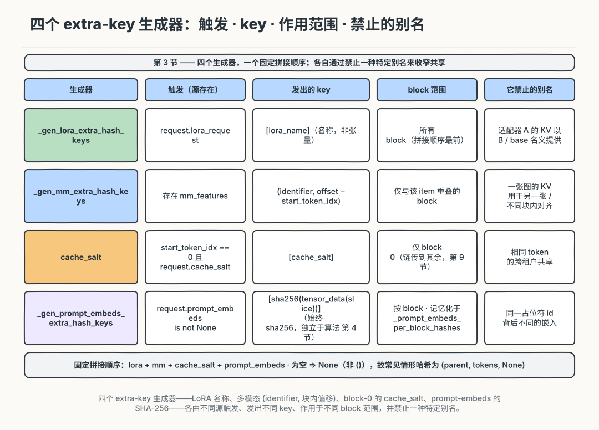</a>

<p class='figure-caption'>四种 extra-key generator 的对比矩阵——LoRA name、multimodal（identifier、block 内 offset）、block-0 cache_salt、prompt-embeds SHA-256——展示了各自的触发条件、输出 key、block 作用域，以及它们所阻止的 alias。</p>

未提供 prompt embeds 时，generator 返回 `[]`。否则，每个 block 对应的 embedding slice 会被归约为 32-byte digest，该 digest 随即成为 extra key，并按 `(start, end)` memoize 到 `request._prompt_embeds_per_block_hashes` 上（[`request.py:129`](https://github.com/vllm-project/vllm/blob/6cf7b26bd4bff60bf378e1af14044280ac0d214c/vllm/v1/request.py#L129)），避免跨多个 decode step 重复 hash 同一个 slice。与[第 4 节](#4-hash-算法sha256-与-builtin碰撞及-pythonhashseed)相关的一个关键细节是：这里的内部归约**始终使用 `hashlib.sha256`**，不受 `prefix_caching_hash_algo` 影响。可配置 algorithm 只控制*外层* block hash；embedding bytes 会在这里预先归约为稳定的 SHA-256 digest，使外层 hasher 始终只处理定宽 key，而不会直接面对变长 tensor。

相同的 embedding bytes 会生成相同的 per-block SHA-256 key。除非发生 SHA-256 碰撞，否则不同 bytes 会产生不同 key；在这一假设下，仅凭 placeholder token ids 无法让不同 embedding 共享同一个 block。

## 4. Hash 算法：sha256 与 builtin、碰撞及 PYTHONHASHSEED

所配置的 hash function 决定了碰撞风险，也决定了其他进程能否根据相同输入复现这条 chain。各可选项的 serialization 方式不同，对 `PYTHONHASHSEED` 的依赖也不同。下文将沿这条路径，从 config 一路追踪到每个 `BlockHash` 中存储的 bytes，逐一说明这些差异。

先对本节标题作一个更正：该源码版本中**没有 `builtin` 选项。** 历史上的 "builtin" 指 CPython 原生的 `hash()`——一种随机化的 per-process 整数 hash，旧版 prefix caching 代码曾直接使用它。在 commit `6cf7b26bd` 中，block hash 绝不会使用 Python builtin `hash()`；那个时代唯一的遗留是 `NONE_HASH`，它仅在 chain root 上（见下文）*模拟* builtin `hash()` 的随机 seed 行为，link 并不会如此。真正的比较维度是 **sha256（密码学 hash，默认）与 xxhash（xxh3-128，快速、非密码学 hash）**，再与 serializer 选项组合。

### 可选项集合：两个正交维度

该算法的选项是一个包含四个名称的 `Literal`，由 `prefix_caching_hash_algo` 配置字段选择。

来源：[`vllm/config/cache.py:39`](https://github.com/vllm-project/vllm/blob/6cf7b26bd4bff60bf378e1af14044280ac0d214c/vllm/config/cache.py#L39)：

```python
PrefixCachingHashAlgo = Literal["sha256", "sha256_cbor", "xxhash", "xxhash_cbor"]
```

来源：该字段及其 docstring，[`vllm/config/cache.py:95-110`](https://github.com/vllm-project/vllm/blob/6cf7b26bd4bff60bf378e1af14044280ac0d214c/vllm/config/cache.py#L95-L110)：

```python
    prefix_caching_hash_algo: PrefixCachingHashAlgo = "sha256"
    """Set the hash algorithm for prefix caching:

    - "sha256" uses Pickle for object serialization before hashing. This is the current
      default, as SHA256 is the most secure choice to avoid potential hash collisions.
    - "sha256_cbor" provides a reproducible, cross-language compatible hash. It
      serializes objects using canonical CBOR and hashes them with SHA-256.
    - "xxhash" uses Pickle serialization with xxHash (128-bit) for faster,
      non-cryptographic hashing. Requires the optional ``xxhash`` package.
      IMPORTANT: Use of a hashing algorithm that is not considered  cryptographically
      secure theoretically increases the risk of hash collisions, which can cause
      undefined behavior or even leak private information in multi-tenant environments.
      Even if collisions are still very unlikely, it is important to consider your
      security risk tolerance against the performance benefits before turning this on.
    - "xxhash_cbor" combines canonical CBOR serialization with xxHash for
      reproducible hashing. Requires the optional ``xxhash`` package."""
```

这四个名称来自两个相互独立的二元选择组合，并不是四种彼此无关的算法：

- **Serializer** — 作为 pre-image 的 3-tuple `(parent_block_hash, tokens, extra_keys)`（[第 2 节](#2-block-hash将-token-串联成指纹)）如何转换为 bytes。`pickle`（不带 suffix 的名称）速度快且采用 Python-native 方式，但在不同 Python 版本或 object layout 之间*不保证* byte-stable。`canonical CBOR`（`_cbor` 这组名称）则采用确定性、与语言无关的 wire encoding。
- **Digest** — 这些 bytes 如何变成定宽指纹。可选择 `SHA-256`（32 bytes，具备密码学抗碰撞性）或 `xxh3-128`（16 bytes，快速的非密码学 hash）。

默认值为 `"sha256"`：pickle + SHA-256。注意 docstring 自身的表述：SHA-256 是“避免潜在 hash 碰撞最安全的选择”；xxhash 分支则带有明确的安全警告，原文称其非密码学 digest“理论上会增加 hash 碰撞风险，进而导致未定义行为，甚至在多租户环境中泄露隐私信息”。最后这句话来自 config 作者，并非已经证实的 exploit；但它所指向的机制确实存在，也正是[第 9 节](#9-跨-tenant-隔离与-cache-salt)讨论的跨租户隔离问题。

<a href='images/vllm-07-04-hash-algo.svg' target='_blank'>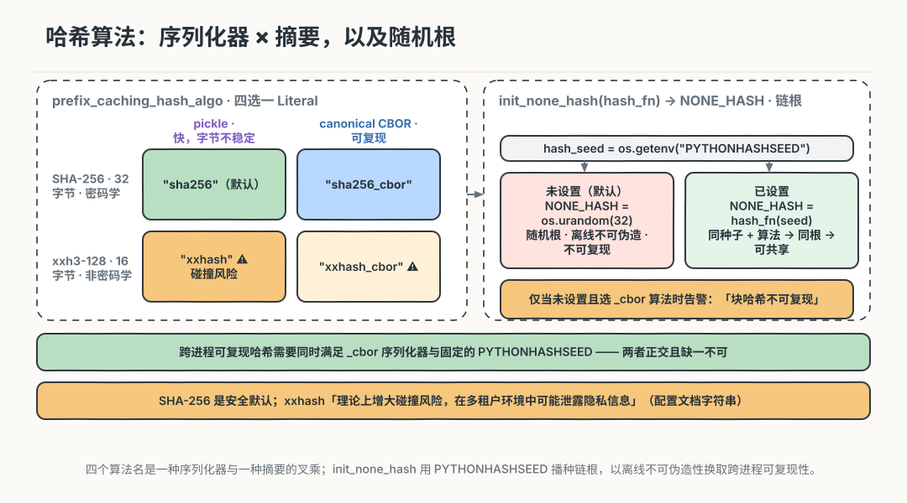</a>

<p class='figure-caption'>四种 hash-algo 名称组成的矩阵：serializer 分为 pickle 与 canonical CBOR，digest 分为 SHA-256 与 xxh3-128；PYTHONHASHSEED 分支则指向 NONE_HASH。</p>

**具体实现**

每个名称最终都解析为一个单行函数：先 serialize，再计算 digest。

源码：[`vllm/utils/hashing.py:26-100`](https://github.com/vllm-project/vllm/blob/6cf7b26bd4bff60bf378e1af14044280ac0d214c/vllm/utils/hashing.py#L26-L100)（节选）：

```python
def sha256(input: Any) -> bytes:
    ...
    input_bytes = pickle.dumps(input, protocol=pickle.HIGHEST_PROTOCOL)
    return hashlib.sha256(input_bytes).digest()


def sha256_cbor(input: Any) -> bytes:
    ...
    input_bytes = cbor2.dumps(input, canonical=True)
    return hashlib.sha256(input_bytes).digest()


def _xxhash_digest(input_bytes: bytes) -> bytes:
    if _xxhash is None:
        raise ModuleNotFoundError(...)
    return _xxhash.xxh3_128_digest(input_bytes)


def xxhash(input: Any) -> bytes:
    """Hash picklable objects using xxHash."""
    input_bytes = pickle.dumps(input, protocol=pickle.HIGHEST_PROTOCOL)
    return _xxhash_digest(input_bytes)


def xxhash_cbor(input: Any) -> bytes:
    """Hash objects serialized with CBOR using xxHash."""
    input_bytes = cbor2.dumps(input, canonical=True)
    return _xxhash_digest(input_bytes)


def get_hash_fn_by_name(hash_fn_name: str) -> Callable[[Any], bytes]:
    ...
    if hash_fn_name == "sha256":
        return sha256
    if hash_fn_name == "sha256_cbor":
        return sha256_cbor
    if hash_fn_name == "xxhash":
        return xxhash
    if hash_fn_name == "xxhash_cbor":
        return xxhash_cbor
    raise ValueError(f"Unsupported hash function: {hash_fn_name}")
```

每种变体都返回 raw `bytes`：即 digest，绝不会返回 int。这一点很重要，因为 chain 的类型 `BlockHash = NewType("BlockHash", bytes)`（[`vllm/v1/core/kv_cache_utils.py:41-44`](https://github.com/vllm-project/vllm/blob/6cf7b26bd4bff60bf378e1af14044280ac0d214c/vllm/v1/core/kv_cache_utils.py#L41-L44)）是 `bytes`，而回传给下一个 block 作为 parent 的 chain 值正是这个 raw digest：SHA-256 变体为 32 bytes，xxh3-128 变体为 16 bytes。对 `xxhash` 的 import 被刻意设计为可选（[`hashing.py:14-23`](https://github.com/vllm-project/vllm/blob/6cf7b26bd4bff60bf378e1af14044280ac0d214c/vllm/utils/hashing.py#L14-L23) 会检查 `hasattr(_xxhash, "xxh3_128_digest")`，如果缺失，`_xxhash_digest` 会抛出 `ModuleNotFoundError`）——经过安全加固的部署完全可以不安装它，默认路径也绝不会触及它。

**不要**混淆 128-bit chain digest 与 KV-events wire 上出现的 64-bit integer。`maybe_convert_block_hash`（[`kv_cache_utils.py:79-82`](https://github.com/vllm-project/vllm/blob/6cf7b26bd4bff60bf378e1af14044280ac0d214c/vllm/v1/core/kv_cache_utils.py#L79-L82)）仅在设置 `VLLM_KV_EVENTS_USE_INT_BLOCK_HASHES` 时，才会将 digest 折叠为低 64-bit int 供外部发送使用（默认为 `True`，[`vllm/envs.py:249`](https://github.com/vllm-project/vllm/blob/6cf7b26bd4bff60bf378e1af14044280ac0d214c/vllm/envs.py#L249)）；这个截断后的 int 绝不会回传到 chain 中。chain 始终保留完整宽度的 digest。event 属于[第 11 节](#11-面向外部-router-的-kv-cache-events)的讨论范畴。

正是 digest 宽度与 raw-bytes 类型，让这条 chain 能够逐级形成承诺。`parent_block_hash` 会原封不动地写入下一个链节的 pre-image（[第 2 节](#2-block-hash将-token-串联成指纹)），因此单个链节的抗碰撞性，*就是*整个前缀承诺的抗碰撞性。选择 `xxhash` 会削弱所有下游断言，而不仅仅是最后一个 block。

### 为什么需要 CBOR：可复现性

Pickle 速度很快，但不同 Python 版本和对象表示形式可能产生不同的 bytes；canonical CBOR 则是一种固定的跨语言编码。之所以提供 `_cbor` 变体，是为了让*不同进程*能够针对同一个逻辑前缀计算出*相同的* block hash。

这种可复现性是一切跨环境能力的前提，包括 prefill/decode（P/D）分离、将 KV offload 到第二级存储、engine 基于持久化 cache 进行 warm restart，以及外部 KV router 根据 events stream 中的 `(parent, tokens, extra_keys)` 重建 block hash（[第 11 节](#11-面向外部-router-的-kv-cache-events)）。Pickle bytes 依赖 Python 及对象序列化的具体实现，因此无法作为可移植的跨版本或跨语言契约。兼容进程仍可能得到一致的 pickle 输出，但需要稳定、可互操作编码的部署应使用 canonical CBOR。

要实现可移植的 hash 一致性，serializer 必须保证 bytes 稳定。Canonical CBOR 提供了这一序列化契约，但正如下文所示，仅靠它还不足以让 chain 可复现：root 也必须保持一致。

**确定性的衔接点：NONE_HASH 与 PYTHONHASHSEED**

每条 chain 都以 `NONE_HASH` 为 root，它是第一个 block 的占位 parent（[第 2 节](#2-block-hash将-token-串联成指纹)）。如果两个进程的 root 不同，所有下游 hash 都会不同——因此，除非 root 同样可复现，否则 serializer 的可复现性毫无意义。`NONE_HASH` 根据 `PYTHONHASHSEED` 初始化。

源码：声明及设计理由，见 [`vllm/v1/core/kv_cache_utils.py:87-96`](https://github.com/vllm-project/vllm/blob/6cf7b26bd4bff60bf378e1af14044280ac0d214c/vllm/v1/core/kv_cache_utils.py#L87-L96)：

```python
# The hash seed for the first block of any prefix block sequence.
#
# We use a random value to avoid hash collisions or PYTHONHASHSEED environment
# variable if set such that processes can share the seed if needed. This aligns
# with the behavior of Python's hash() function, which also uses a random seed
# if PYTHONHASHSEED is not set.
#
# The function `init_none_hash` initializes this variable globally.
NONE_HASH: BlockHash
_CBOR_HASH_FUNCTIONS = frozenset({sha256_cbor, xxhash_cbor})
```

<a href='images/vllm-07-17-none-hash-determinism.svg' target='_blank'>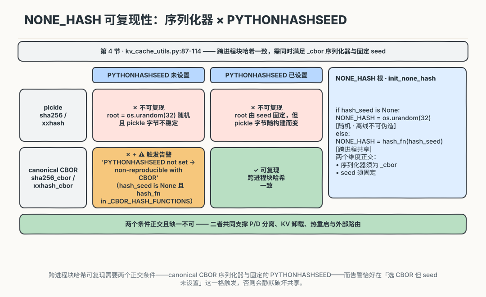</a>

<p class='figure-caption'>NONE_HASH 的可复现性决策矩阵：未设置 PYTHONHASHSEED → 每个进程使用 os.urandom(32) 生成 root；已设置 → 使用 hash_fn(seed) 生成 root；再分别与 pickle 和 canonical CBOR 组合。要实现可移植的跨版本重建，需要使用 _cbor 算法并设置固定 seed；兼容的 pickle 进程也可能得到一致结果，但这种 byte 表示并不是互操作契约。</p>

源码：初始化函数，见 [`vllm/v1/core/kv_cache_utils.py:99-114`](https://github.com/vllm-project/vllm/blob/6cf7b26bd4bff60bf378e1af14044280ac0d214c/vllm/v1/core/kv_cache_utils.py#L99-L114)：

```python
def init_none_hash(hash_fn: Callable[[Any], bytes]):
    global NONE_HASH

    hash_seed = os.getenv("PYTHONHASHSEED")
    if hash_seed is None and hash_fn in _CBOR_HASH_FUNCTIONS:
        logger.warning(
            "PYTHONHASHSEED is not set. This will lead to non-reproducible "
            "block-hashes when using CBOR-based hash functions such as "
            "sha256_cbor or xxhash_cbor. Consider setting PYTHONHASHSEED to a "
            "fixed value for reproducibility."
        )

    if hash_seed is None:
        NONE_HASH = BlockHash(os.urandom(32))
    else:
        NONE_HASH = BlockHash(hash_fn(hash_seed))
```

系统根据环境中是否存在 `PYTHONHASHSEED`，选择以下两种模式之一：

1. **未设置 → `NONE_HASH = os.urandom(32)`。** 每个进程生成 32 个全新的随机 byte。对于无法读取进程状态的观察者，chain root 是不可预测的，这使得离线复现或预计算难以实现；而且独立初始化的进程几乎必然会得到不同的 root。它在设计思路上与 CPython 的随机化 `hash()` 行为相似，但随机化仅作用于 root，而非后续链节。代价是独立初始化的 block hash 无法跨进程复现。

2. **已设置 → `NONE_HASH = hash_fn(hash_seed)`。** seed 字符串会传入*同一个*已配置 hash function，因此，只要各进程使用相同 seed 和相同算法，就会得到相同的 root；如果同时使用 canonical serializer，还会得到相同的 chain。这是启用可复现、可共享 cache 的显式选项。

warning 清楚揭示了问题所在。它**仅**在同时满足 `hash_seed is None` 和 `hash_fn in {sha256_cbor, xxhash_cbor}` 时触发，也就是仅针对提供可移植 serializer 的变体。即使选择了 CBOR 算法，只要未设置 `PYTHONHASHSEED`，root 仍会被随机化，因此独立初始化的 chain 仍然不同。对于 pickle 变体，这条 warning 并不能保证可移植的可复现性：固定 root 无法让 pickle 成为跨版本序列化契约。不过，兼容进程仍有可能生成相同的 bytes。

### 每个 engine 只选择一次算法

算法不是 per-request 配置项；它在 engine 构造时只解析一次，随后同一个函数对象会贯穿 root 和每个链节。

源码：engine gate 内的解析逻辑，见 [`vllm/v1/engine/core.py:212-219`](https://github.com/vllm-project/vllm/blob/6cf7b26bd4bff60bf378e1af14044280ac0d214c/vllm/v1/engine/core.py#L212-L219)（[第 1 节](#1-prefix-caching-是什么以及复用带来的收益)展示了完整的 `if ... enable_prefix_caching or kv_connector` gate；这里只看它最终解析出的内容）：

```python
            caching_hash_fn = get_hash_fn_by_name(
                vllm_config.cache_config.prefix_caching_hash_algo
            )
            init_none_hash(caching_hash_fn)

            self.request_block_hasher = get_request_block_hasher(
                hash_block_size, caching_hash_fn
            )
```

解析得到的函数负责为 `NONE_HASH` 生成 seed，并计算之后的每个链节，因此一个 engine 始终使用同一个 `(serializer, digest, root)` 三元组。需要重建相同 key 的 engine，必须采用兼容的序列化方式、digest 选项和 root seed；tenant salt 则是 keyed chain 的另一个独立输入。

## 5. 查找最长 cache 命中

接纳 request 时，scheduler 需要确定已驻留前缀的长度。`get_computed_blocks` 会将 request 的 hash chain（[第 2 节](#2-block-hash将-token-串联成指纹)）与 block pool 的 `hash → block` 索引进行比较。扫描会在第一次 miss 时停止，因为后续 hash 都将缺失的链节作为 ancestor。第 06 篇会将返回的 block 交给 `allocate_slots` 继续处理；第 05 篇则使用由此得到的 `num_computed_tokens` 值。

<a href='images/vllm-07-05-longest-hit.svg' target='_blank'>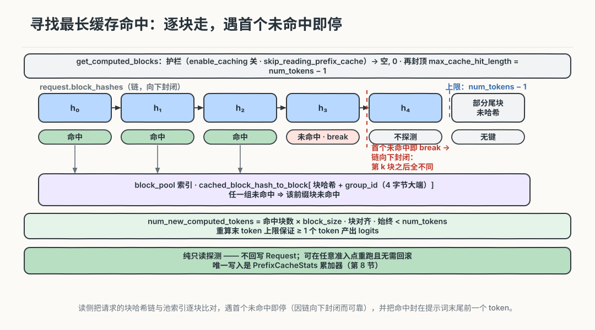</a>

<p class='figure-caption'>沿 request 的 block-hash chain 在 pool index 中执行前缀扫描，遇到首次 miss 即停止，同时将上限设为比 prompt 少一个 token。</p>

**manager 入口：两道 guard 与“重算最后一个 token”上限**

执行任何 lookup 之前，`get_computed_blocks` 会先进行 short-circuit，随后将搜索上限限制在 prompt 末尾之前。

[`vllm/v1/core/kv_cache_manager.py:214-232`](https://github.com/vllm-project/vllm/blob/6cf7b26bd4bff60bf378e1af14044280ac0d214c/vllm/v1/core/kv_cache_manager.py#L214-L232)：

```python
        # We skip finding the prefix cache hit when prefix caching is
        # disabled or the request is marked as skipping kv cache read
        # (which happens when the request requires prompt logprobs
        # or calls a pooling model with all pooling).
        if not self.enable_caching or request.skip_reading_prefix_cache:
            return self.empty_kv_cache_blocks, 0

        # NOTE: When all tokens hit the cache, we must recompute the last token
        # to obtain logits. Thus, set max_cache_hit_length to prompt_length - 1.
        # This can trigger recomputation of an entire block, rather than just
        # the single last token, because allocate_slots() requires
        # num_computed_tokens to be block-size aligned. Removing this limitation
        # could slightly improve performance in the future.
        max_cache_hit_length = request.num_tokens - 1
        computed_blocks, num_new_computed_tokens = (
            self.coordinator.find_longest_cache_hit(
                request.block_hashes, max_cache_hit_length
            )
        )
```

这两道 guard（全局 `enable_caching` 关闭，或 per-request 的 `skip_reading_prefix_cache` flag 被置位）会返回预先构造的 immutable `empty_kv_cache_blocks` singleton（[`kv_cache_manager.py:177-179`](https://github.com/vllm-project/vllm/blob/6cf7b26bd4bff60bf378e1af14044280ac0d214c/vllm/v1/core/kv_cache_manager.py#L177-L179)），其 computed token 数为 `0`。这会迫使 scheduler 将整个 prompt 视为尚未计算。对于需要 prompt logprobs 的 request（这要求对 prompt 的每个 position 执行真实的 forward pass），或使用 all-pooling model 的 request，该 skip flag 会在构造 request 时一次性设置。[第 10 节](#10-何时跳过-caching)完整列出了各种 skip 情形，包括写入侧的 skip。随后执行 `max_cache_hit_length = request.num_tokens - 1`。由于 `request.num_tokens` 就是 `len(_all_token_ids)`，因此这里恰好会从 prompt length 中减去一个 token。

这个上限确保 **forward pass 始终至少有一个 token 需要计算**。如果 lookup 可以返回 100% hit，`allocate_slots` 就会调度 0 个新 token，第一次 decode step 也就没有可用于生成 logits 的 position。还要注意 comment 中指出的次生效应：由于 hit 按 block 对齐，将上限压到 `num_tokens` 以下，可能导致*整个*最后一个 block 被重算，而不只是一个 token。对于一个恰好包含 `2 * block_size` 个 token 且已全部 cache 的 prompt，只能得到 `(2*block_size - 1) // block_size = 1` 个 block 的 hit，因此第二个 block 会被完整重算。这是为了让 `num_computed_tokens` 对 `allocate_slots` 保持 block 对齐所付出的代价（第 06 篇介绍了这一对齐要求）。紧接在下面的 `record` 调用（[`kv_cache_manager.py:234-240`](https://github.com/vllm-project/vllm/blob/6cf7b26bd4bff60bf378e1af14044280ac0d214c/vllm/v1/core/kv_cache_manager.py#L234-L240)）会将该 hit 传给 `PrefixCacheStats`；[第 8 节](#8-命中率与统计信息)详细介绍了这部分计数逻辑。

### hit 逻辑：遇到首次 miss 即停止

manager 将工作委托给 `coordinator.find_longest_cache_hit`；对于 full attention，最终会进入 `FullAttentionManager.find_longest_cache_hit` 执行具体扫描。

[`vllm/v1/core/single_type_kv_cache_manager.py:585-613`](https://github.com/vllm-project/vllm/blob/6cf7b26bd4bff60bf378e1af14044280ac0d214c/vllm/v1/core/single_type_kv_cache_manager.py#L585-L613)：

```python
        computed_blocks: tuple[list[KVCacheBlock], ...] = tuple(
            [] for _ in range(len(kv_cache_group_ids))
        )
        block_size = kv_cache_spec.block_size
        if dcp_world_size * pcp_world_size > 1:
            block_size *= dcp_world_size * pcp_world_size
        max_num_blocks = max_length // block_size
        for block_hash in itertools.islice(block_hashes, max_num_blocks):
            # block_hashes is a chain of block hashes. If a block hash is not
            # in the cached_block_hash_to_id, the following block hashes are
            # not computed yet for sure.
            if cached_block := block_pool.get_cached_block(
                block_hash, kv_cache_group_ids
            ):
                for computed, cached in zip(computed_blocks, cached_block):
                    computed.append(cached)
            else:
                break
        if drop_eagle_block and computed_blocks[0]:
            # Need to drop the last matched block if eagle is enabled.
            for computed in computed_blocks:
                computed.pop()
        while (
            block_size != alignment_tokens  # Faster for common case.
            and len(computed_blocks[0]) * block_size % alignment_tokens != 0
        ):
            for computed in computed_blocks:
                computed.pop()
        return computed_blocks
```

该上限以 token 为单位传入，但 `max_num_blocks = max_length // block_size` 会将扫描范围限制为完整 block。loop 从左向右遍历，遇到首次 miss 就停止。由于之后的每个 hash 都将这个缺失链节作为 ancestor（[第 2 节](#2-block-hash将-token-串联成指纹)），继续向后探测也不可能延长已驻留的 prefix。

扫描完成后还会进行两次裁剪。`drop_eagle_block` 会 pop 最后一个匹配的 block：EAGLE/MTP speculative decoding 必须重算最后一个匹配 block，才能获得 draft head 所需的 hidden states，因此该 block 不能直接由 cache 提供。最后，`while` 会持续 pop block，直到 hit length 成为 `alignment_tokens` 的整数倍（coordinator 传入的是 `scheduler_block_size`）。这可以确保返回的 length 按 scheduler block 对齐，即使该 group 自身的 `block_size` 粒度更细也不例外；而在常见的单一粒度场景中，`block_size != alignment_tokens` 的 short-circuit 会完全跳过这个 loop。

最终，**hit 始终是由完整 block 构成、按 block 对齐且单调的 prefix**。末尾不完整的 block 没有 hash，无法 lookup，也无法共享。结合前面的上限，`num_new_computed_tokens` 始终是一个按 block 对齐、且严格小于 `num_tokens` 的计数。

**hit 判定条件：所有 group 必须一致**

`get_cached_block` 才真正定义了“在 cache 中”的含义。它并不是简单地按 raw content hash 进行 lookup；真正的 index key 还会纳入 KV-cache group id。

[`vllm/v1/core/block_pool.py:213-224`](https://github.com/vllm-project/vllm/blob/6cf7b26bd4bff60bf378e1af14044280ac0d214c/vllm/v1/core/block_pool.py#L213-L224)：

```python
        cached_blocks = []
        for group_id in kv_cache_group_ids:
            block_hash_with_group_id = make_block_hash_with_group_id(
                block_hash, group_id
            )
            block = self.cached_block_hash_to_block.get_one_block(
                block_hash_with_group_id
            )
            if not block:
                return None
            cached_blocks.append(block)
        return cached_blocks
```

key 由 `make_block_hash_with_group_id` 打包，即在 raw content digest 后追加以 4 个 big-endian byte 表示的 group id（[`vllm/v1/core/kv_cache_utils.py:57-66`](https://github.com/vllm-project/vllm/blob/6cf7b26bd4bff60bf378e1af14044280ac0d214c/vllm/v1/core/kv_cache_utils.py#L57-L66)）：

```python
    return BlockHashWithGroupId(block_hash + group_id.to_bytes(4, "big", signed=False))
```

<a href='images/vllm-07-18-group-agreement-key.svg' target='_blank'>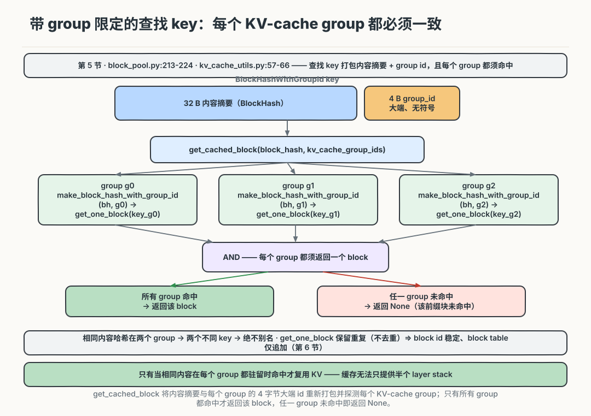</a>

<p class='figure-caption'>按 group 限定的 lookup key：get_cached_block 通过 make_block_hash_with_group_id，将 32/16-byte content digest 与各 group 的 4-byte big-endian id 重新打包，并要求每个 KV-cache group 都 hit——任一 group miss 都会返回 None。</p>

对于 spec 的 group list 中的每个 group id，都会将 content hash 与该 group 的 id 重新打包，再到 `cached_block_hash_to_block` 中探测。*任意* group 出现 miss 都会返回 `None`，也就是整个 prefix block 判定为 miss。当多个 physical block 共享同一个 key 时，`get_one_block`（[`block_pool.py:62-73`](https://github.com/vllm-project/vllm/blob/6cf7b26bd4bff60bf378e1af14044280ac0d214c/vllm/v1/core/block_pool.py#L62-L73)）会返回其中第一个 block（并发 request cache 相同内容时会产生重复项——index 不做 de-duplicate，因此 block id 能保持稳定，block table 也始终保持 append-only；[第 6 节](#6-缓存已最终确认的-block)详细介绍了 `BlockHashToBlockMap` promotion）。key 中的 group id 可以防止两个恰好对相同 token 得到同一 hash、但持有不同 KV 的 group（例如 attention type 或 layer grouping 不同）互相 alias 到对方的 block。

只有相同内容在共享该 spec 的 **每一个 KV-cache group** 中都已驻留，hit 才会复用 KV；不可能只从 cache 提供半套 layer stack。正因如此，写入侧（[第 6 节](#6-缓存已最终确认的-block)）会将一个 block 发布到每个 group 对应的 key 下，读取侧也会要求所有 group 的结果一致。

### Coordinator 分派：“longest hit”的三种变体

`get_computed_blocks` 会调用 `self.coordinator.find_longest_cache_hit`，具体实例化哪种 coordinator 决定了它的语义。三者返回相同的 shape（每个 group 对应的 block tuple，加上一个 token count），但计算方式不同。

**No-cache.** 如果 cache 被禁用或不受支持，coordinator 会返回结构化 miss（[`vllm/v1/core/kv_cache_coordinator.py:417-425`](https://github.com/vllm-project/vllm/blob/6cf7b26bd4bff60bf378e1af14044280ac0d214c/vllm/v1/core/kv_cache_coordinator.py#L417-L425)）：每个 manager 对应一个空 list，以及 `0`。manager-level guard 通常会在此之前 short-circuit，但这一实现确保 non-caching 路径始终能得到明确定义的“无 hit”结果。

**Unitary**（只有一个 KV-cache group，即所有 layer 都使用 full attention，或都使用 sliding window）。它只向单个 manager 委托一次并返回 `len(hit_blocks[0]) * self.block_size`（[`kv_cache_coordinator.py:481-497`](https://github.com/vllm-project/vllm/blob/6cf7b26bd4bff60bf378e1af14044280ac0d214c/vllm/v1/core/kv_cache_coordinator.py#L481-L497)），同时 assert `hash_block_size == block_size`，因此 `alignment_tokens` 就是该 group 自身的 block size，最后的 `while` trim 是 no-op。

**Hybrid**（包含多个 spec，例如 full attention 与 sliding-window 交错）。这里的“longest hit”是所有 spec-group hit 的*交集*，通过单调递减不动点计算得到（[`kv_cache_coordinator.py:677-726`](https://github.com/vllm-project/vllm/blob/6cf7b26bd4bff60bf378e1af14044280ac0d214c/vllm/v1/core/kv_cache_coordinator.py#L677-L726)）：

```python
        while True:
            curr_hit_length = hit_length

            for idx, (spec, group_ids, manager_cls, use_eagle) in enumerate(
                self.attention_groups
            ):
                cached_blocks = hit_blocks_by_group[group_ids[0]]
                if isinstance(spec, FullAttentionSpec) and cached_blocks is not None:
                    # Full attention is downward-closed: we only need to look
                    # up cached blocks once; on subsequent iterations just trim
                    # to the (reduced) current hit length.
                    curr_hit_length = (
                        curr_hit_length // spec.block_size * spec.block_size
                    )
                    continue
                ...
            if curr_hit_length >= hit_length:
                break
            hit_length = curr_hit_length
            if is_simple_hybrid:
                break
```

<a href='images/vllm-07-19-coordinator-dispatch.svg' target='_blank'>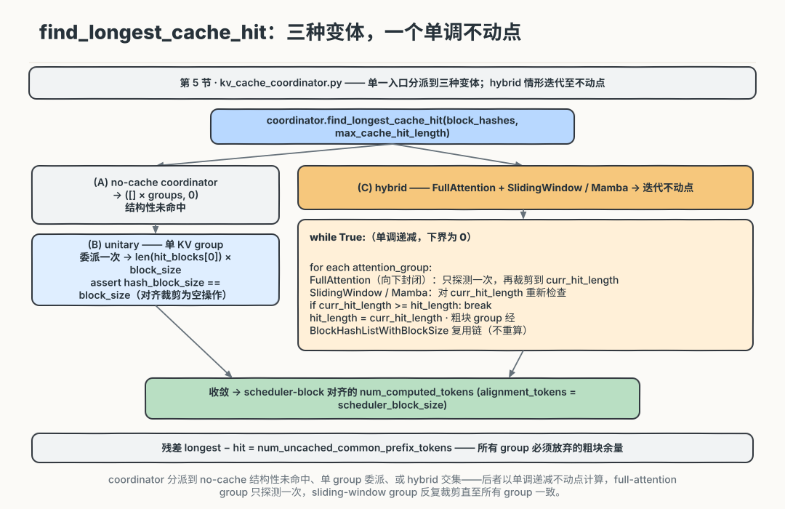</a>

<p class='figure-caption'>find_longest_cache_hit 的三种变体：no-cache 返回结构化 miss，unitary 委托给单个 group，hybrid 则通过单调递减不动点计算交集；其中 full-attention group 只探测一次，sliding-window group 会反复重新 trim，直到所有 group 达成一致。</p>

每个 attention group 要么接受当前候选值 `curr_hit_length`，要么将其缩短；只要发生缩短，就会触发新一轮扫描。该过程必然收敛，因为长度单调递减，且下界为 0（见 docstring `:636-642`）。full-attention group 会被排在最前面，并且向下闭合——它们只需探测一次，之后仅需裁剪到缩短后的长度（`:684-691`）；而 sliding-window group 可能需要重新检查，因为其驻留 window 会发生移动。`alignment_tokens=self.scheduler_block_size` 会将每个 group 给出的结果对齐到粗粒度 scheduler block，因此最终的 `hit_length` 是所有 group 都认可的值。剩余差值 `longest_hit_length - hit_length` 会记录为 `num_uncached_common_prefix_tokens`（`:738`）：如果某个 group 缓存的前缀比最终一致认可的交集更长，这段差值就是值得缓存的公共前缀，只是尚有 group 未将其物化。

当某个 group 的 `block_size` 超过 `hash_block_size` 时，`_get_block_hashes` 会用 `BlockHashListWithBlockSize` 包装同一条 hash chain（`:654-659`）。后者会返回每个粗粒度 block 内最后一个 `hash_block_size` 边界处的 hash——该 hash 已经串联了整个前缀，因此无需重新计算 hash；单一的 append-only `block_hashes` 即可服务所有 group。

对于 hybrid model，返回的前缀会**同时命中所有 spec group**，并按 scheduler block 对齐——它提供统一的 `num_computed_tokens` cursor，`allocate_slots` 可以在异构 KV layout 中将其视为有效。

## 6. 缓存已最终确认的 block

lookup 只能返回写入路径已经发布的 block。发布范围受已最终确认的 token 限制；在 P/D 接收场景下会延迟；仅限完整 block，并跳过 null 或 masked block。当一个 key 对应多个物理 block 时，`_insert_block_hash` 会指定 primary identity，并将后续 alias 记录到 `BlockHashToBlockMap` 中。

写入路径要保证的核心只有一点：**只有由已最终确认（非 draft）的 token 构成、已填入有效 KV、完整且边界确实可能被后续 lookup 命中的 block，才会被发布。**下面的每一层都会进一步收紧这一条件。

**第 1 层：哪些 token 已最终确认（排除 draft 的上限）**

如果为可能回滚的 token 发布 KV，就会在索引中遗留 stale alias。speculative draft token 正是这类 token。这个上限位于 `allocate_slots` 的末尾。

[`vllm/v1/core/kv_cache_manager.py:449-461`](https://github.com/vllm-project/vllm/blob/6cf7b26bd4bff60bf378e1af14044280ac0d214c/vllm/v1/core/kv_cache_manager.py#L449-L461)：

```python
        if not self.enable_caching or delay_cache_blocks:
            return self.create_kv_cache_blocks(new_blocks)

        # NOTE(woosuk): We want to commit (cache) up to num_local_computed_tokens
        # + num_external_computed_tokens + num_new_tokens, but must exclude
        # "non-committable" tokens (e.g., draft tokens that could be rejected).
        # Therefore, we cap the number at `request.num_tokens`, ensuring only
        # "finalized" tokens are cached.
        num_tokens_to_cache = min(
            total_computed_tokens + num_new_tokens,
            request.num_tokens,
        )
        self.coordinator.cache_blocks(request, num_tokens_to_cache)
```

`request.num_tokens` 就是 `len(self._all_token_ids)`（[`vllm/v1/request.py:251-253`](https://github.com/vllm-project/vllm/blob/6cf7b26bd4bff60bf378e1af14044280ac0d214c/vllm/v1/request.py#L251-L253)）——其中只包含 committed token。draft token 存放在 `spec_token_ids` 中，只会通过 `num_tokens_with_spec` 暴露（[`request.py:255-257`](https://github.com/vllm-project/vllm/blob/6cf7b26bd4bff60bf378e1af14044280ac0d214c/vllm/v1/request.py#L255-L257)）；它们绝不会进入 `_all_token_ids`。因此，`min(total_computed_tokens + num_new_tokens, request.num_tokens)` 会从结构上将计数限制回最终确认边界：左操作数可能已经进入 speculative 区域，而这个上限会将其拉回。上方的 `not self.enable_caching or delay_cache_blocks` early return 对应两项写入侧跳过逻辑（[第 10 节](#10-何时跳过-caching)）：一项是全局 gate；另一项是 P/D 的 `delay_cache_blocks` 场景，此时 block 的 KV 仍需从远端 worker 接收，因此还不能将其标记为已存在。这一层确保被拒绝的 draft 不会留下 cache alias，也确保 KV 尚未到达本地的 block 不会被发布。

### 第 3 层 — 向下取整到完整 block，并维护 high-water mark

已最终确认的 token 数仍只是 token 粒度的计数。`cache_blocks` 会按照该 group 自身的 `block_size` 将其转换为 *block 集合*；更关键的是，它会记住已经发布到哪里，从而让每个 decode step 的重复进入成本很低，并避免重复发布。

[`vllm/v1/core/single_type_kv_cache_manager.py:338-363`](https://github.com/vllm-project/vllm/blob/6cf7b26bd4bff60bf378e1af14044280ac0d214c/vllm/v1/core/single_type_kv_cache_manager.py#L338-L363)：

```python
        num_cached_blocks = self.num_cached_block.get(request.request_id, 0)
        num_full_blocks = num_tokens // self.block_size

        if num_cached_blocks >= num_full_blocks:
            return

        block_mask = self.reachable_block_mask(
            start_block=num_cached_blocks,
            end_block=num_full_blocks,
            ...
        )
        self.block_pool.cache_full_blocks(...)  # kwargs elided; funnel body is article 06's

        self.num_cached_block[request.request_id] = num_full_blocks
```

`num_full_blocks = num_tokens // self.block_size` 执行的是**整数向下取整**：尾部不完整的 block（含 `num_tokens % block_size` 个 token）不具备发布资格——这与 hasher 中“只为完整 block 计算 hash”的 break 逻辑在代码层面相互对应（[第 2 节](#2-block-hash将-token-串联成指纹)）。`num_cached_block[request_id]` 是每个 request 独立维护的 high-water mark；符合条件的区间恰好是 `blocks[num_cached_blocks : num_full_blocks]`。如果自上一个 decode step 以来没有新 block 填满，`if num_cached_blocks >= num_full_blocks: return` 会直接 short-circuit。pool 调用完成后，该标记会推进到 `num_full_blocks`。对于 full attention，`reachable_block_mask` 返回 `None`，即“缓存每个非 null 的 block”（[`single_type_kv_cache_manager.py:376-383`](https://github.com/vllm-project/vllm/blob/6cf7b26bd4bff60bf378e1af14044280ac0d214c/vllm/v1/core/single_type_kv_cache_manager.py#L376-L383)）；SWA/Mamba subclass 则会 override 该方法，丢弃 windowed、从右向左的 lookup 永远不会访问的内部 block。发布过程是单调且幂等的（每个 block 永远只处理一次），最终只有完整且可达的 block 才会进入 pool。

**第 4 层 — 发布操作：`cache_full_blocks`**

`cache_full_blocks` 不负责计算 hash。它直接使用 `request.block_hashes`，也就是 request hasher 预先生成的 append-only chain（[第 2 节](#2-block-hash将-token-串联成指纹)），并为每个符合条件的 block 登记一个 key。

[`vllm/v1/core/block_pool.py:280-306`](https://github.com/vllm-project/vllm/blob/6cf7b26bd4bff60bf378e1af14044280ac0d214c/vllm/v1/core/block_pool.py#L280-L306)：

```python
        for i, blk in enumerate(new_full_blocks):
            # Some blocks may be null or masked out when enabling sparse attention
            # like sliding window attention, or Mamba models with prefix-caching
            # in align mode. We skip null blocks here.
            if blk.is_null or (block_mask is not None and not block_mask[i]):
                continue
            block_hash = new_block_hashes[i]
            num_hash_tokens = (num_cached_blocks + i + 1) * block_size

            # Update and added the full block to the cache.
            block_hash_with_group_id = make_block_hash_with_group_id(
                block_hash, kv_cache_group_id
            )
            if blk.block_hash is not None:
                # The only valid case where a "new full block" already has a
                # hash is partial->full promotion of the same cache block.
                assert (
                    blk.block_hash_num_tokens is not None
                    and blk.block_hash_num_tokens < num_hash_tokens
                )
                removed_hashes = self._remove_cached_block_hashes(blk)
                self._emit_block_removed_events(removed_hashes)
            self._insert_block_hash(
                block_hash_with_group_id,
                blk,
                num_tokens=num_hash_tokens,
            )
```

<a href='images/vllm-07-20-write-funnel.svg' target='_blank'>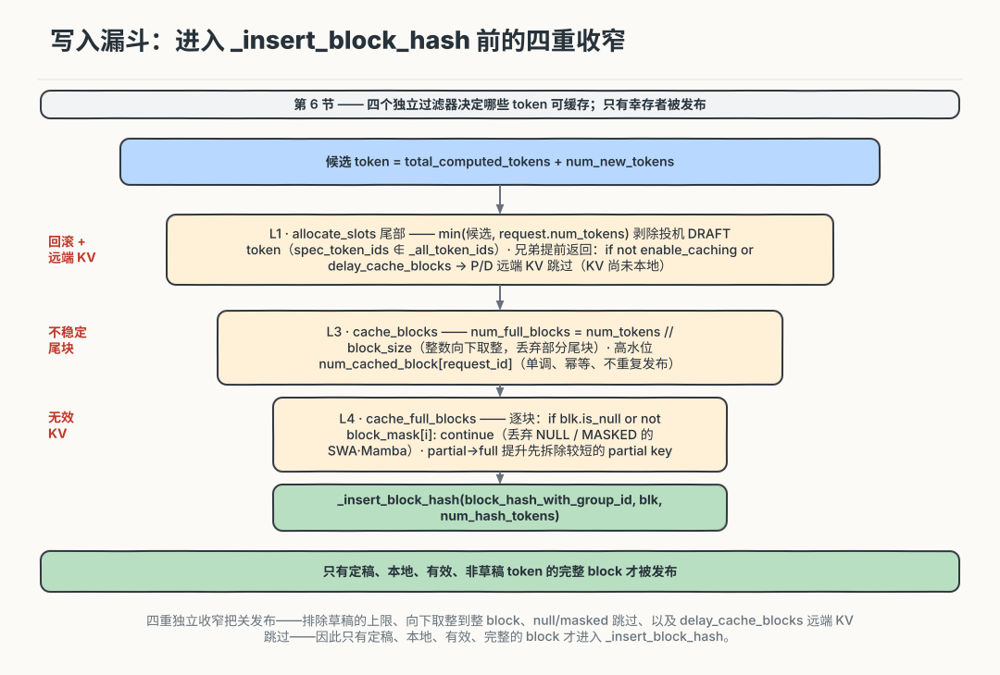</a>

<p class='figure-caption'>写入路径通过四种彼此独立的机制逐步收窄“哪些 token 可以进入 cache”：排除 draft 的上限（回滚）、向下取整到完整 block（不稳定的尾部）、跳过 null/masked block（无效 KV），以及 delay_cache_blocks 对远端 KV 的延迟跳过——只有通过全部筛选的 block 才会进入 _insert_block_hash。</p>

下面逐步解读第四重收窄与 promotion：

1. **Null/mask 跳过** (`:284`). `blk.is_null or (block_mask is not None and not block_mask[i])` — 带 mask 或为 null 的 block 会被视为空洞，不会进入 map。这是对“哪些 token”的最后一次收窄：Layer 1 剔除了 draft，Layer 3 剔除了不完整尾部，这一步则剔除无法产生有效 hit 的 attention 区域。若将这些区域写入 cache，就会凭空制造 hit，导致读取端读到无效 KV。
2. **`num_hash_tokens = (num_cached_blocks + i + 1) * block_size`** (`:287`)：该 block 的 KV 所覆盖的 prefix length，以 token 数表示。它与 key 一同存储，也是 promotion assertion 的比较对象。
3. **Group-id key** (`:290-292`). `make_block_hash_with_group_id` 将 4-byte big-endian group id 追加到 raw digest 后（[`kv_cache_utils.py:57-66`](https://github.com/vllm-project/vllm/blob/6cf7b26bd4bff60bf378e1af14044280ac0d214c/vllm/v1/core/kv_cache_utils.py#L57-L66)），这样，同一个 content hash 位于两个 KV-cache group 时，就会生成两个不同、带 group 限定的 byte key。[第 5 节](#5-查找最长-cache-命中)介绍了读取端的这个 helper；写入端必须采用完全相同的 packing，否则两端会悄然产生分歧。
4. **Partial→full 提升** (`:293-301`). eligible window 内的 block 不应已有 hash——Layer 3 的 high-water mark 已排除发布过的 block，而 eviction 会在重新分配时重置 hash（[第 7 节](#7-lru-eviction以-free-queue-表示-eviction-顺序)）。唯一合法的例外是：某个 block 之前注册为 *partial* alias（sub-`block_size` cache entry），现在恰好填满成为 full block。`assert blk.block_hash_num_tokens < num_hash_tokens` 强制保证已有 identity 覆盖的 token 严格更少；随后，`_remove_cached_block_hashes(blk)`（[`block_pool.py:484-503`](https://github.com/vllm-project/vllm/blob/6cf7b26bd4bff60bf378e1af14044280ac0d214c/vllm/v1/core/block_pool.py#L484-L503)）会移除该 block 上的所有旧 key——通过 `reset_hash()` 重置 primary hash，并从 index 中逐一移除每个 alias——然后才让覆盖范围更长的新 key 落位。eviction 时的 teardown 与此对称（[第 11 节](#11-面向外部-router-的-kv-cache-events)）。

最终规则很简单：每个已发布 block 恰好携带一个 full-block content hash，以 `(hash, group id)` 作为 key，覆盖一个长度已知、内容已 finalized 的 prefix；任何已有 identity 都只能是严格更短的 partial，并且必须先被 teardown——同一个 physical block 上绝不会同时存在两个 live full-block identity。

### block 如何进入 index：`_insert_block_hash`

这是 eviction 在 write-once 侧的镜像操作，也是第 06 篇只做了概述、却未展开阅读源码的部分。

[`vllm/v1/core/block_pool.py:520-540`](https://github.com/vllm-project/vllm/blob/6cf7b26bd4bff60bf378e1af14044280ac0d214c/vllm/v1/core/block_pool.py#L520-L540)：

```python
    def _insert_block_hash(
        self,
        block_hash_with_group_id: BlockHashWithGroupId,
        block: KVCacheBlock,
        num_tokens: int | None,
    ) -> None:
        if block.block_hash == block_hash_with_group_id:
            return

        if self.cached_block_hash_to_block.contain(
            block_hash_with_group_id, block.block_id
        ):
            return

        if block.block_hash is None:
            block.set_block_hash(block_hash_with_group_id, num_tokens=num_tokens)
        else:
            self.cached_block_hashes_by_block.setdefault(block.block_id, set()).add(
                block_hash_with_group_id
            )
        self.cached_block_hash_to_block.insert(block_hash_with_group_id, block)
```

首先有两个用于保证幂等性的 early-out：block 已经声明了完全相同的 key（`:526-527`），或者 forward index 已将该 key 解析到此 block id（`:529-532`）。任一条件满足，重复注册都是 no-op。然后才是关键分支：

- **尚无 primary hash** → `set_block_hash` 将此 key 设为该 block 的 write-once primary `_block_hash`，并写入 `_block_hash_num_tokens`（[`kv_cache_utils.py:148-157`](https://github.com/vllm-project/vllm/blob/6cf7b26bd4bff60bf378e1af14044280ac0d214c/vllm/v1/core/kv_cache_utils.py#L148-L157)）。`set_block_hash` 一上来就是 `assert self.block_hash is None and self._block_hash_num_tokens is None`——primary 是 write-once 的；唯一能合法回到 `None` 的路径，是 eviction 使用的 `reset_hash()`（`:159-162`），其他地方都不会调用它。因此，在两次 eviction 之间的生命周期内，一个 block 最多只有一个 primary identity。
- **已有 primary** → 新 key 会作为 *secondary alias* 记录到 `cached_block_hashes_by_block[block_id]`（`:536-539`）。这样，一个 physical block 就能通过多个 key 访问（例如跨不同 group id），同时仍然只拥有一个 canonical `_block_hash`。

无论走哪个分支，`cached_block_hash_to_block.insert(key, block)`（`:540`）都会添加反向边。因此，block 对外声明的 primary key 与 index 对该 key 的解析结果绝不会悄然分歧；又因为 eviction 会同时读取 `_block_hash` 和 `cached_block_hashes_by_block[block_id]`，`_remove_cached_block_hashes` 可以一次移除所有指向该 block 的 key：不会有孤立 alias 残留下来制造 phantom hit。

**index 类型：一种会在 collision 时改变形态的 map**

`cached_block_hash_to_block` 是一个 `BlockHashToBlockMap`（[`block_pool.py:185`](https://github.com/vllm-project/vllm/blob/6cf7b26bd4bff60bf378e1af14044280ac0d214c/vllm/v1/core/block_pool.py#L185)），而不是普通 dict。其存储结构是一个 union；当两个 block 首次落到同一个 key 上时，该 key 对应的形态就会切换。

[`vllm/v1/core/block_pool.py:89-105`](https://github.com/vllm-project/vllm/blob/6cf7b26bd4bff60bf378e1af14044280ac0d214c/vllm/v1/core/block_pool.py#L89-L105)：

```python
    def insert(self, key: BlockHashWithGroupId, block: KVCacheBlock) -> None:
        blocks = self._cache.get(key)
        if blocks is None:
            # When key is not found, attach a single block to the key
            self._cache[key] = block
        elif isinstance(blocks, KVCacheBlock):
            # If there's a block with the same key, merge the original block
            # and the new block into a dict
            self._cache[key] = {blocks.block_id: blocks, block.block_id: block}
        elif isinstance(blocks, dict):
            # If it's already a dict, simply insert the block
            blocks[block.block_id] = block
        ...
```

<a href='images/vllm-07-21-blockhash-map-shape.svg' target='_blank'>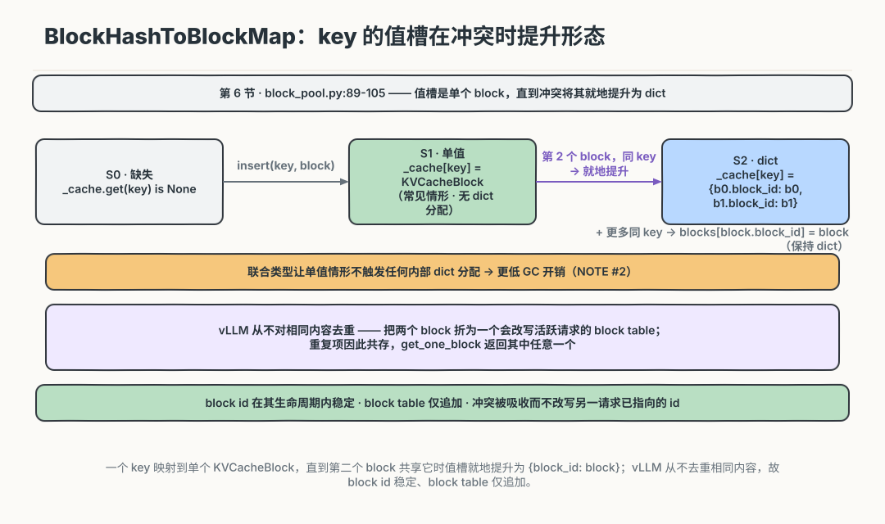</a>

<p class='figure-caption'>BlockHashToBlockMap 遇到 collision 时会改变形态：一个 key 起初映射到单个 KVCacheBlock；当第二个 block 共享该 key 时，映射会原地提升为 {block_id: block}——vLLM 从不对相同内容执行 de-duplicate，因此 block id 保持稳定，block table 也保持 append-only。</p>

一个 key 通常映射到单个 `KVCacheBlock`；第二个 block 与其共享同一 key 时，映射会立即原地提升为 `{block_id: KVCacheBlock}`。这样设计的动机写在 class docstring 中（[`block_pool.py:43-52`](https://github.com/vllm-project/vllm/blob/6cf7b26bd4bff60bf378e1af14044280ac0d214c/vllm/v1/core/block_pool.py#L43-L52)）：vLLM **不会对相同内容执行 de-duplicate**——如果某个 block 变为 full 时，cache 中已经存在相同 block，系统也不会将二者折叠为一个，“因为我们要确保已分配的 block ID 不会变化，从而让 block table 保持 append-only”。De-dup 会迫使正在执行的 request 在中途重写 block table；因此，两个相同 block 会共存于同一个 key 下，`get_one_block` 返回其中任意一个（[第 5 节](#5-查找最长-cache-命中)）。union type（docstring NOTE #2）还让常见的 single-block 情况无需分配 inner dict，从而降低 GC 开销。最终，block id 在 block 的生命周期内保持稳定，block table 始终 append-only，而 collision 则由 index 吸收，绝不会修改已被其他 request 引用的 id。

### 粗粒度 group：在更粗粒度的 boundary 上复用同一个 hash

当某个 KV-cache group 的 `block_size` 是 `hash_block_size` 的整数倍时（hybrid layout），写入端不会 re-hash。Layer 4 使用 `BlockHashListWithBlockSize`（[`kv_cache_utils.py:2164-2233`](https://github.com/vllm-project/vllm/blob/6cf7b26bd4bff60bf378e1af14044280ac0d214c/vllm/v1/core/kv_cache_utils.py#L2164-L2233)）包装这条 hash chain，将每个 coarse block 映射到其最后一个 sub-block boundary 上的 `hash_block_size` hash。根据[第 2 节](#2-block-hash将-token-串联成指纹)介绍的 Merkle 原理，这样做完全正确：位于 token `32` 的细粒度 hash 已经通过链式计算覆盖了 token `0–31`，因此它本身就是这个 coarse 32-token block 完整 prefix 的有效 fingerprint。读取端会重建相同的 coarse view，因此读写两端在 coarse boundary 上完全一致。

## 7. LRU Eviction：以 Free Queue 表示 Eviction 顺序

request 释放 cached block 后，该 block 仍可继续复用，直到分配压力迫使系统回收其 slot。vLLM 使用同一个管理空闲容量的 intrusive `FreeKVCacheBlockQueue` 来表示这套顺序；这里没有 timestamp 字段、sweeper 或 priority heap。靠近 queue 前端的 block 会优先回收，而被移向后端的 block 则能保留更久。第 06 篇介绍了 queue 操作；下方代码聚焦于 `free_blocks`、`touch` 和 allocation，说明它们如何在这套顺序中安排 cached entry 的位置。

**前置条件：`ref_cnt` 和 `_block_hash` 彼此正交**

任何淘汰顺序要成立，都必须先满足一个前提：一个 block 可以同时是*空闲容量*和*仍然有效的 cache hit*。这之所以可能，是因为一个 `KVCacheBlock` 对象上同时承载着两套彼此独立的生命周期。

来源：`vllm/v1/core/kv_cache_utils.py:L117-138`

```python
@dataclass(slots=True)
class KVCacheBlock:
    """KV-cache block metadata."""

    # Block ID, ranging from 0 to num_gpu_blocks - 1.
    block_id: int
    # Reference count.
    ref_cnt: int = 0
    # The hash key (block hash + group id) of the block, only available
    # when the block is full and cached.
    _block_hash: BlockHashWithGroupId | None = None
    ...
    # Whether the block is a null block that should never be cached.
    is_null: bool = False
```

<a href='images/vllm-07-22-block-lifecycle.svg' target='_blank'>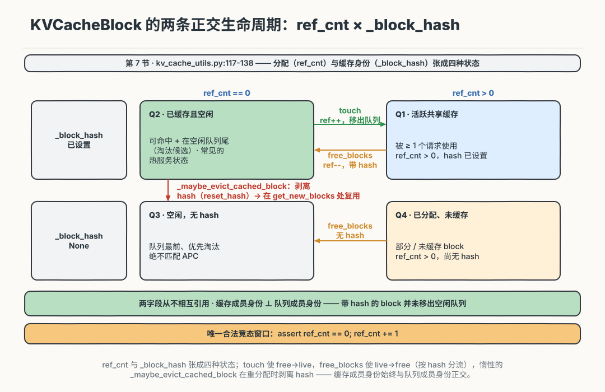</a>

<p class='figure-caption'>KVCacheBlock 的两套正交生命周期：ref_cnt（分配）与 _block_hash（cache identity）共同构成四种状态，touch（free→live）、free_blocks（live→free-but-cached）以及 lazy _maybe_evict_cached_block（重新分配时移除 hash）是仅有的状态转换。</p>

`ref_cnt` 处理的是*分配*语义——对于 non-null block，`ref_cnt == 0` 与“链接在 free queue 中，是淘汰候选项”完全等价（第 06 篇完整分析了这个双向条件）。`_block_hash` 处理的是 *cache* 语义——值只要不是 `None`，就意味着该 block 仍在 `cached_block_hash_to_block` 中登记了一个 prefix-cache key。两个字段彼此没有引用关系。因此，`ref_cnt == 0 ∧ _block_hash != None` 是合法状态，而且在预热后的 server 中很常见：这个 block 位于 free queue 中，既是一块可复用内存，同时对于任何 prefix chain 能接到该 hash 的 request，它仍是有效的 cache hit，直到自身被 pop 的瞬间。这种解耦也意味着，block 可以沿 `free → cached-and-free → reused` 流转而完全不改变 `block_id`——即使经过淘汰，worker block-tables 依然有效。

Cache membership（`_block_hash != None`）与 queue membership（`ref_cnt == 0`）彼此正交；带 hash 的 block *并没有*离开 queue。若把两者合并，allocator 就永远无法分配仍带 hash 的 block，prefix caching 也会和 allocation 争夺内存，而无法叠加在 allocation 之上。

<a href='images/vllm-07-06-lru-eviction.svg' target='_blank'>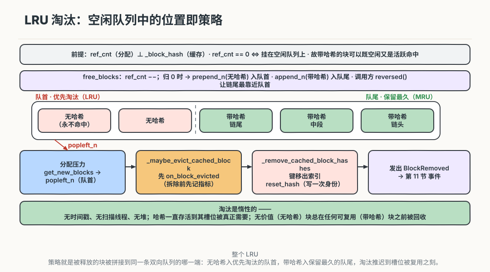</a>

<p class='figure-caption'>request 释放后，其 blocks 按 hash 分流：no-hash blocks 前插到优先淘汰的队首，带 hash 的 blocks 追加到保留最久的队尾；chain-tail 最靠近队首。</p>

### 两类优先级：`free_blocks` 用队列位置编码 cache 价值

request 的 blocks 被归还时，`free_blocks` 并不是简单地 append。它会按这些 blocks 是否带有 hash 进行分组，再把两组分别放到 queue 的*不同端*。

来源：`vllm/v1/core/block_pool.py:L614-635`

```python
    def free_blocks(self, ordered_blocks: Iterable[KVCacheBlock]) -> None:
        """Free a list of blocks. The blocks should be ordered by their
        eviction priority, where the first block will be evicted first.
        ...
        # Identify blocks with hash (LRU cache) and without it (will never match in APC)
        blocks_with_hash = []
        blocks_without_hash = []
        for block in ordered_blocks:
            block.ref_cnt -= 1
            if block.ref_cnt == 0 and not block.is_null:
                if block.block_hash is None:
                    blocks_without_hash.append(block)
                else:
                    blocks_with_hash.append(block)

        # Blocks without hash always get evicted first - prepend them last to the tail
        self.free_block_queue.prepend_n(blocks_without_hash)
        self.free_block_queue.append_n(blocks_with_hash)
```

`block.ref_cnt -= 1` 的递减和 `ref_cnt == 0` 的状态转换，属于第 06 篇讲解的 `free_blocks` 机制——第 06 篇已经逐行分析了这个 refcount 双向条件（共享 block 只有在最后一个共享方释放它时才会回到 pool），这里不再重复推导。新增的重点，是计数归零*之后*发生的一切。`and not block.is_null` guard 会彻底阻止 null sentinel 进入 queue。接下来的分流才是真正的关键。带有 `block_hash is None` 的 block（未填满的尾部 block，或从未发布 hash 的 block）“永远无法在 APC 中匹配”，所以 `prepend_n` 会把它放到 LRU **前端**，最先回收；继续保留它只会延误真正无效内存的回收。带 hash 的 block 仍连接着一条可达 prefix chain，之后仍有可能再次 hit，因此 `append_n` 会把它放到 MRU **尾端**，让其 KV 在内存压力迫使系统真正淘汰它之前，拥有尽可能长的时间获得 hit。这里没有任何数值化优先级：两个入队端点*就是*这套策略需要的两类优先级，block 在链表中的位置*就是*它的优先级。

**同优先级时的决胜规则：chain-tail 优先淘汰，由调用方保证**

同一个已释放 request 内，所有 blocks 的“最后访问时间”都相同，因此单纯的 LRU 无法为它们排序。queue 的契约规定了一个次级 key；值得注意的是，queue 本身并不负责实现这套排序。

来源：`vllm/v1/core/kv_cache_utils.py:L188-195`

```python
    The queue is ordered by block ID in the beginning. When a block is allocated
    and then freed, it will be appended back with the eviction order:
    1. The least recent used block is at the front (LRU).
    2. If two blocks have the same last accessed time (allocated by the
       same sequence), the one with more hash tokens (the tail of a block
       chain) is at the front.
    Note that we maintain this order by reversing the block order when free
    blocks of a request. This operation is outside of this class.
```

反转由调用方完成，而不是链表：

来源：`vllm/v1/core/single_type_kv_cache_manager.py:L410-411`

```python
        # Free blocks in reverse order so that the tail blocks are freed first.
        self.block_pool.free_blocks(reversed(self.pop_blocks_for_free(request_id)))
```

`pop_blocks_for_free` 按*分配*顺序返回 request 的 blocks（prefix head 在前）；`free()` 将它们包在 `reversed(...)` 中，因此 `free_blocks` 看到的顺序是 tail-first。这样一来，`append_n` batch 入队后，chain tail 就最靠近 LRU 前端。其依据是复用概率：block *i* 覆盖 prefix `[0, (i+1)·B)`，因此 *tail* block 对应最长的 prefix，未来能够完整共享这一 prefix 的 request *最少*。它的可复用性最低，所以在其他条件相同时应最先牺牲；chain head 对应的则是较短、被广泛共享的 prefix（例如 system prompt），因此保留时间最长。在 coordinator 的 free path 上，反转通过委托完成，无须重复实现：coordinator 的 `free` 把每个 request 交给 per-type managers，再由其 `free` 执行同样的 `reversed(...)`（`single_type_kv_cache_manager.py:L410-411`）；reverse-order contract 本身记录在 `pop_blocks_for_free` 的 docstring 中（`kv_cache_coordinator.py:L301-302`），所以该行没有调用 `reversed(...)`。

这是刻意采用的 policy/mechanism 分离：`FreeKVCacheBlockQueue` 只负责链表拼接；*排序语义*由调用方的 `reversed` 决定，而第 06 篇也正是在这里分析 free-path 机制。

### lazy eviction：cache identity 只在重新分配时失效

cached-but-free block 在释放时*不会*被清除。它会保留 hash，并无限期维持为有效 cache hit。只有在 allocator 为满足新的分配需求而从 queue 前端将它 pop 出来时，它的 cache identity 才会被销毁。

来源：`vllm/v1/core/block_pool.py:L559-565`

```python
        if self.enable_caching:
            for block in ret:
                self._maybe_evict_cached_block(block)
                assert block.ref_cnt == 0
                block.ref_cnt += 1
```

`get_new_blocks` 先通过 `free_block_queue.popleft_n` 从 LRU 前端取出 `num_blocks`——也就是上述策略特意放在这里、可复用性最低的 cached-but-free blocks——随后对每个 block 调用 `_maybe_evict_cached_block`，在复用前拆除其 hash。

来源：`vllm/v1/core/block_pool.py:L574-595`

```python
    def _maybe_evict_cached_block(self, block: KVCacheBlock) -> bool:
        """
        If a block is cached in `cached_block_hash_to_block`, we reset its hash
        metadata and evict it from the cache.
        ...
        # Clean up metrics tracking first to prevent leaks
        if self.metrics_collector:
            self.metrics_collector.on_block_evicted(block)

        evicted_hashes = self._remove_cached_block_hashes(block)
        if not evicted_hashes:
            # The block doesn't have hash, eviction is not needed
            return False

        self._emit_block_removed_events(evicted_hashes)
        return True
```

`on_block_evicted` 会*最先*执行，也就是先于 hash 的移除。这样，residency metrics 就能在 block 的 identity 仍然存在时完成归因；注释明确说明，这种执行顺序是为了防止泄漏。随后，`_remove_cached_block_hashes`（`block_pool.py:L484-503`）会移除 primary `_block_hash`，*以及*记录在 `cached_block_hashes_by_block` 中的所有 secondary aliases：它会从 `cached_block_hash_to_block` 中逐个 pop 这些 key，最后调用 `block.reset_hash()`——由 `set_block_hash` 设置的 write-once identity（第 06 篇已分析）会在这里被拆除；在 reallocation path 上，也只有这里会执行这一操作。返回值可以区分真正的 eviction（`True`，即 block 原本带有 hash）与 no-hash block 的回收（`False`，没有内容需要移除）；真正的 eviction 还会通过唯一的 choke point 发出 `BlockRemoved` event（参见 KV-events 小节）。lazy 的核心正在于此：系统从不扫描 queue 寻找 victim；hash 会一直存活到其 block slot 在物理上确实需要使用的那一刻。这正是 prefix caching 在 miss 场景下仍能保持近乎零 overhead 的原因（V1 alpha 发布博客，[vLLM 博客](https://vllm.ai/blog/2025-01-27-v1-alpha-release)）。

**唯一合法的 race 窗口。** `assert block.ref_cnt == 0` 与紧随其后的 `block.ref_cnt += 1` 前后夹住了 `ref_cnt == 0 ⇔ on-queue` 这一双向等价关系被打破的唯一瞬间：block 已被 `popleft_n` 从 queue 中摘除，但 ref count 尚未递增。这个窗口会在同一次同步调用内关闭，因此其他代码无法观察到这种不一致。

**hit path 上的镜像操作**

与 eviction 对称的是 `touch`，第 06 篇已经逐行解析过它；这里需要关注的只是，它构成了同一 invariant 的另一半。当 lookup 命中一个位于 queue 中部、已 cache 但处于 free 状态的 block 时，`touch` 会将它从 queue 中摘除（`if block.ref_cnt == 0 and not block.is_null: self.free_block_queue.remove(block)`）并递增 `ref_cnt`——以原子方式把 eviction candidate 重新转换为活跃的共享 block。由于 block 采用 intrusive 结构，自身携带 `prev_free_block`/`next_free_block`（`kv_cache_utils.py:L301-319`），因此 splice 操作是 O(1)；一次 hit 绝不会让 allocation 退化为线性扫描。关键在于，read side（`get_cached_block` 和 `find_longest_cache_hit`）只是一次*纯 probe*：它只解析 hit 对象及长度，既不触碰 `ref_cnt`，也不修改 queue。因此，block 位于 hash map 中，绝不意味着它已经离开 free queue。lookup（[第 5 节](#5-查找最长-cache-命中)）与 commit（`touch`）是两个独立步骤；eviction（`_maybe_evict_cached_block`）则是延迟到 allocation 时执行的*第三个*步骤。这三步是让 block 在"可命中"与"已消失"之间转换的仅有路径。

## 8. 命中率与统计信息

APC 以 token 而不是 request 或 block 为单位报告复用情况，这与被跳过的 prefill 工作量使用同一单位。它还会将 fresh request 的 hit 与重新准入的 preempted request 的 hit 分开统计，避免后者自身尚存的 KV 抬高 fresh-request 命中率。下面这条路径把 `PrefixCacheStats.record` 与近期 console 窗口及累计 Prometheus counter 串联起来。

**`PrefixCacheStats` 统计的是 token，而不是 block 或 request**

发送到 console 的统计指标是命中*率*，第一个设计决策就是确定分子和分母按什么单位计数。vLLM 选择按 **token** 计数。

来源：[`vllm/v1/metrics/stats.py:114-142`](https://github.com/vllm-project/vllm/blob/6cf7b26bd4bff60bf378e1af14044280ac0d214c/vllm/v1/metrics/stats.py#L114-L142)

```python
@dataclass
class PrefixCacheStats(BaseCacheStats):
    """
    Stores prefix cache hit statistics.
    - `reset`: Whether `reset_prefix_cache` was invoked.
    - `queries`: Refers to the number of tokens that were queried.
    """

    preempted_requests: int = 0
    ...
    def record(self, num_tokens: int, num_hits: int, preempted: bool) -> None:
        """Aggregate request information into the stats."""
        if preempted:
            # Previously preempted request
            self.preempted_requests += 1
            self.preempted_queries += num_tokens
            self.preempted_hits += num_hits
        else:
            # New request
            self.requests += 1
            self.queries += num_tokens
            self.hits += num_hits
```

<a href='images/vllm-07-23-stats-buckets.svg' target='_blank'>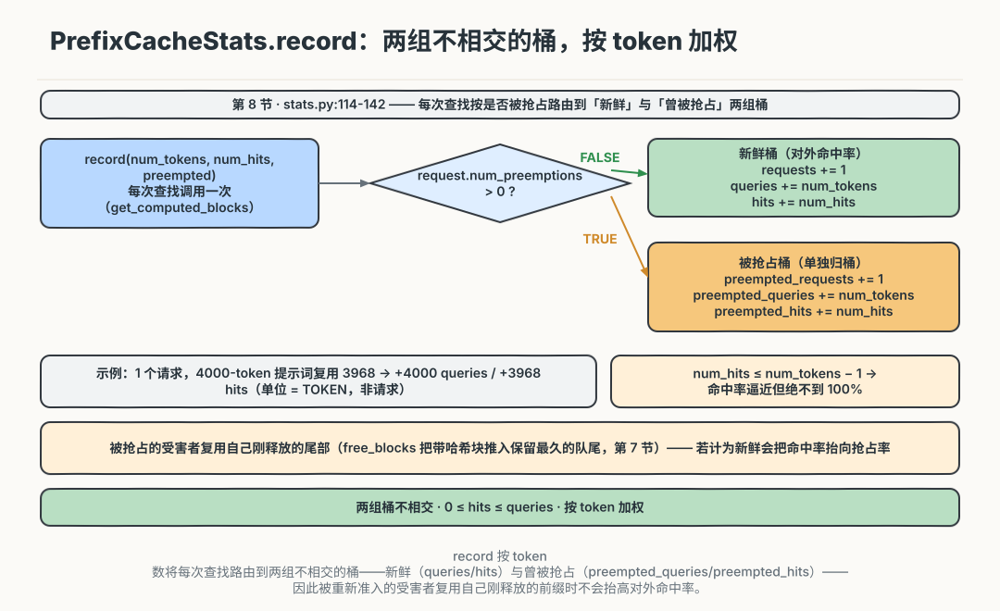</a>

<p class='figure-caption'>PrefixCacheStats.record 按 token 数量将每次 lookup 路由到两套互不重叠的 bucket pair——fresh（queries/hits）与 previously-preempted（preempted_queries/preempted_hits）。这样一来，被重新准入的 preempted request 即使再次命中自身刚释放的 prefix，也不会抬高主命中率。</p>

`PrefixCacheStats` 继承自 `BaseCacheStats`，后者包含 `reset`、`requests`、`queries`、`hits` 这几个 field（[`stats.py:19-32`](https://github.com/vllm-project/vllm/blob/6cf7b26bd4bff60bf378e1af14044280ac0d214c/vllm/v1/metrics/stats.py#L19-L32)）。可以把 `record` 看作一个双路 router：每个 request 要么落入 `queries`/`hits`，要么落入 `preempted_queries`/`preempted_hits`；其中 `num_tokens` 会累加到 *query* counter，`num_hits` 则累加到 *hit* counter。docstring 明确了计量单位："`queries`：指被查询的 token 数量。"因此，`queries` 是所有参与 lookup 的 prompt 长度之和，`hits` 则是所有匹配 prefix 的长度之和。一个包含 4000 个 token、其中复用 3968 个 token 的 prompt，会给 `queries` 贡献 `+4000`，给 `hits` 贡献 `+3968`：它只算一个 request，但分母有 4000 个单位。之所以选择这个单位，正是因为复用节省的是*计算量*，而计算量随 token 数增长，不随 request 数增长。按 request 计算命中率，会让完全命中 cache 的 8-token 续写与完全命中 cache 的 8000-token 文档拥有相同权重。

对每个 request 都有 `0 ≤ num_hits ≤ num_tokens`，因此任意累计区间内都满足 `0 ≤ hits ≤ queries`；这个比率表示按 token 加权后，被跳过的 prefill 工作所占的比例，绝不是 request 计数。

### 数值来自哪里：pure probe 与 hybrid path

`record` 恰好来自两个 producer，二者都写入同一个 accumulator。主要 producer 位于 `get_computed_blocks` 内部——这正是[第 5 节](#5-查找最长-cache-命中)确认不会向 `Request` 写回任何内容的同一次 lookup。

来源：[`vllm/v1/core/kv_cache_manager.py:234-240`](https://github.com/vllm-project/vllm/blob/6cf7b26bd4bff60bf378e1af14044280ac0d214c/vllm/v1/core/kv_cache_manager.py#L234-L240)

```python
        if self.log_stats:
            assert self.prefix_cache_stats is not None
            self.prefix_cache_stats.record(
                num_tokens=request.num_tokens,
                num_hits=num_new_computed_tokens,
                preempted=request.num_preemptions > 0,
            )
```

`num_tokens=request.num_tokens` 是 prompt 的完整长度；`num_hits=num_new_computed_tokens` 是 `coordinator.find_longest_cache_hit` 返回的已解析 prefix-match 长度（[第 5 节](#5-查找最长-cache-命中)），并且按照 recompute-last-token 规则（[第 5 节](#5-查找最长-cache-命中)、[第 10 节](#10-何时跳过-caching)），其上限已经设为 `num_tokens - 1`。因此，即使某个 prompt 完整匹配了 cache 中的 prefix，最多也只会上报 `num_tokens - 1` 个 hit——对于重复 prompt，命中率可以无限接近 100%，但永远无法真正达到 100%。这是该指标由代码直接决定的真实属性，并非舍入误差。记录逻辑位于 `if self.log_stats` 分支内，因此关闭 stats 时，probe 仍不会触发任何 allocation。

第二个 producer 来自 scheduler 中的 hybrid / KV-connector path；当 full-attention group 与 Mamba group 混合存在，或由 disaggregated D-side 逐 group 解析 hit 时，就会走这条 path：

来源：[`vllm/v1/core/sched/scheduler.py:715-722`](https://github.com/vllm-project/vllm/blob/6cf7b26bd4bff60bf378e1af14044280ac0d214c/vllm/v1/core/sched/scheduler.py#L715-L722)

```python
                        num_new_local_computed_tokens = max(per_group_hits)
                        if self.kv_cache_manager.log_stats:
                            assert self.kv_cache_manager.prefix_cache_stats is not None
                            self.kv_cache_manager.prefix_cache_stats.record(
                                num_tokens=request.num_tokens,
                                num_hits=num_new_local_computed_tokens,
                                preempted=request.num_preemptions > 0,
                            )
```

这里，`num_hits = max(per_group_hits)`（本地 hit 长度）会汇入 manager 持有的同一个 `prefix_cache_stats` object。因此，两个 producer 分属互斥分支（[`scheduler.py:723`](https://github.com/vllm-project/vllm/blob/6cf7b26bd4bff60bf378e1af14044280ac0d214c/vllm/v1/core/sched/scheduler.py#L723) 会继续进入普通的 `get_computed_blocks`），绝不会对同一个 request 重复计数。

**preemption 专用 bucket。** 两个调用点都根据 `request.num_preemptions > 0` 分流。一个曾被抢占（其 block 因内存压力而被释放，[第 7 节](#7-lru-eviction以-free-queue-表示-eviction-顺序)）、随后又重新准入的 request，往往会再次命中*自身*刚释放的 prefix。原因是 `free_blocks` 会把带 hash 的 block 推到 queue 中能够保留最久的 tail，而 eviction 又是延迟执行的（[第 7 节](#7-lru-eviction以-free-queue-表示-eviction-顺序)）。如果把这种几乎必然发生的 self-hit 计作 fresh query，上报的命中率就会向 preemption rate 靠拢，运维人员也无法从中了解跨 request 共享的真实情况。将这部分计数单独放入 `preempted_queries`/`preempted_hits`，可以让主指标 `queries`/`hits` 继续衡量真正来自首次访问的复用。

**清空 accumulator：每个 step 对应一个互不重叠的窗口**

`PrefixCacheStats` 是每个 step 独立的 accumulator，而不是持续累计的总量。每个 scheduler step 都会将它取出、读取，并以原子方式替换一次。

来源：[`vllm/v1/core/kv_cache_manager.py:196-200`](https://github.com/vllm-project/vllm/blob/6cf7b26bd4bff60bf378e1af14044280ac0d214c/vllm/v1/core/kv_cache_manager.py#L196-L200)

```python
        if not self.log_stats:
            return None
        stats = self.prefix_cache_stats
        self.prefix_cache_stats = PrefixCacheStats()
        return stats
```

`make_prefix_cache_stats` 把当前 object 保存到局部变量中，安装一个全新且为空的 `PrefixCacheStats()`，然后返回刚才保存的 object。在单线程 scheduler loop 中，Python 赋值具有原子性，因此任何 `record` 调用都不可能插入读取与 swap 之间。这样，每个 step 拿到的窗口都与其他 step 的窗口互不重叠：任何 `record` 都不会被重复计数，也不会被遗漏。调用方是正在组装 `SchedulerStats` 的 scheduler（[`scheduler.py:2293`](https://github.com/vllm-project/vllm/blob/6cf7b26bd4bff60bf378e1af14044280ac0d214c/vllm/v1/core/sched/scheduler.py#L2293)）；它还会以相同方式换出单独的 `connector_prefix_cache_stats` object（[`scheduler.py:2296-2298`](https://github.com/vllm-project/vllm/blob/6cf7b26bd4bff60bf378e1af14044280ac0d214c/vllm/v1/core/sched/scheduler.py#L2296-L2298)）。跨窗口的聚合由下游 metric layer 完成，而不是在这里进行。

### reset flag：发出 invalidation 信号，但不修改 counter

`reset_prefix_cache` 用于 RLHF weight 更新和 benchmark——在这些场景下，cache 中的所有 KV block 都已失效，未来任何 hit 都会是*错误的*，而不只是 cold miss。它是唯一能让整个 cache 失效的操作；它必须通知 metric layer 丢弃历史数据，而不能把 reset 前后的 rate 混在一起。

来源：[`vllm/v1/core/block_pool.py:665-672`](https://github.com/vllm-project/vllm/blob/6cf7b26bd4bff60bf378e1af14044280ac0d214c/vllm/v1/core/block_pool.py#L665-L672)

```python
        num_used_blocks = self.num_gpu_blocks - self.get_num_free_blocks()
        if num_used_blocks != 1:  # The null block is always marked as used
            logger.warning(
                "Failed to reset prefix cache because some "
                "blocks (%d) are not freed yet",
                num_used_blocks - 1,
            )
            return False
```

只有当前恰好有一个 block 正在使用时（即 null sentinel；也就是说，没有任何 live request 引用 cache 中的 block），reset 才会继续执行。成功后，它会重建 `cached_block_hash_to_block`，清空 alias map，对每个 block 调用 `block.reset_hash()`（[`block_pool.py:674-681`](https://github.com/vllm-project/vllm/blob/6cf7b26bd4bff60bf378e1af14044280ac0d214c/vllm/v1/core/block_pool.py#L674-L681)），并在 events 已开启时追加一个 `AllBlocksCleared` event（[`block_pool.py:687-688`](https://github.com/vllm-project/vllm/blob/6cf7b26bd4bff60bf378e1af14044280ac0d214c/vllm/v1/core/block_pool.py#L687-L688)，[第 11 节](#11-面向外部-router-的-kv-cache-events)中的 clear message 会将其同步到 wire 上）。manager 随后将此事记录为 flag，而不是改动 counter：

来源：[`vllm/v1/core/kv_cache_manager.py:524-528`](https://github.com/vllm-project/vllm/blob/6cf7b26bd4bff60bf378e1af14044280ac0d214c/vllm/v1/core/kv_cache_manager.py#L524-L528)

```python
        if not self.block_pool.reset_prefix_cache():
            return False
        if self.log_stats:
            assert self.prefix_cache_stats is not None
            self.prefix_cache_stats.reset = True
```

设置 `stats.reset = True` 不会改动 `queries`/`hits`；它只是一个 one-bit signal，会随下一个 drain 出的 window 一起进入 metric layer，再由 sliding-window consumer 处理。

<a href='images/vllm-07-07-hit-rate.svg' target='_blank'>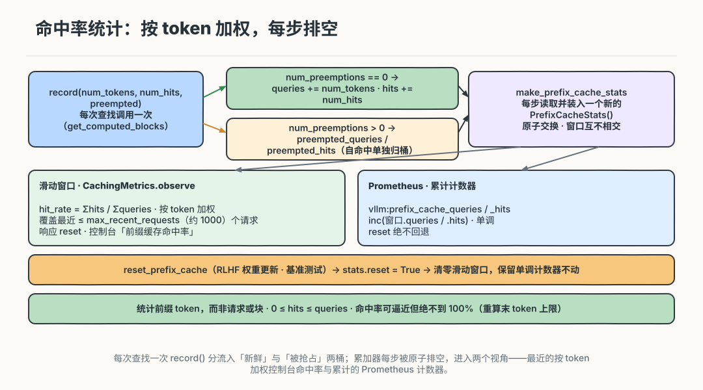</a>

<p class='figure-caption'>每次 lookup 调用 record()，每个 step 执行 atomic drain，然后交给两个 consumer：按 token 加权的 sliding window 和累计 Prometheus counters。</p>

**窗口 hit rate：在最近约 1000 个 request 上滑动**

上报的 "Prefix cache hit rate" 有意不使用累计值。它是最近一个 request window 内按 token 加权的 rate，由 `CachingMetrics.observe` 维护；每个 drain 出的 window 都会在 [`loggers.py:175`](https://github.com/vllm-project/vllm/blob/6cf7b26bd4bff60bf378e1af14044280ac0d214c/vllm/v1/metrics/loggers.py#L175) 处送入其中。

来源：[`vllm/v1/metrics/stats.py:76-92`](https://github.com/vllm-project/vllm/blob/6cf7b26bd4bff60bf378e1af14044280ac0d214c/vllm/v1/metrics/stats.py#L76-L92)

```python
        # Update the metrics.
        self.query_queue.append((stats.requests, stats.queries, stats.hits))
        self.aggregated_requests += stats.requests
        self.aggregated_query_total += stats.queries
        self.aggregated_query_hit += stats.hits

        # Remove the oldest stats until number of requests does not exceed
        # the limit.
        # NOTE: We preserve the latest added stats regardless.
        while (
            len(self.query_queue) > 1
            and self.aggregated_requests > self.max_recent_requests
        ):
            old_requests, old_queries, old_hits = self.query_queue.popleft()
            self.aggregated_requests -= old_requests
            self.aggregated_query_total -= old_queries
            self.aggregated_query_hit -= old_hits
```

三项行为至关重要，每一项都在防范一种特定问题。首先，`observe` 会优先处理 reset flag——`if stats.reset: self.reset()`（[`stats.py:68-69`](https://github.com/vllm-project/vllm/blob/6cf7b26bd4bff60bf378e1af14044280ac0d214c/vllm/v1/metrics/stats.py#L68-L69)）会将 aggregates 归零并清空 deque，确保 weight update 前的 stale rate 不会混入更新后的新 rate。其次，它会在空 window 上提前 return——`if stats.requests == 0: return`（[`stats.py:73-74`](https://github.com/vllm-project/vllm/blob/6cf7b26bd4bff60bf378e1af14044280ac0d214c/vllm/v1/metrics/stats.py#L73-L74)）——因此，空闲的 scheduler step（会产生 request 数为零的 window）不会 enqueue 空 entry，也就不会把真实历史从 fixed-length deque 中挤出去。

第三，trim loop 会持续 pop 最旧的 `(requests, queries, hits)` triple，直到 `aggregated_requests > max_recent_requests` 不再成立（默认值为 **1000**，[`stats.py:42-45`](https://github.com/vllm-project/vllm/blob/6cf7b26bd4bff60bf378e1af14044280ac0d214c/vllm/v1/metrics/stats.py#L42-L45)）；但 `len(self.query_queue) > 1` guard 会确保至少保留最新 entry——因此，即使单个 request 的 prompt 就已超过 window，依然能得到有定义的 rate，而不是空结果。rate 本身的计算如下：

来源：[`vllm/v1/metrics/stats.py:106-111`](https://github.com/vllm-project/vllm/blob/6cf7b26bd4bff60bf378e1af14044280ac0d214c/vllm/v1/metrics/stats.py#L106-L111)

```python
    @property
    def hit_rate(self) -> float:
        """Calculate the hit rate for the past N requests."""
        if self.aggregated_query_total == 0:
            return 0.0
        return self.aggregated_query_hit / self.aggregated_query_total
```

这是一个 *token-weighted* ratio：用该 window 内汇总后的 hit token 数除以汇总后的 query token 数。因此，一篇 8000-token 文档对 rate 的影响，恰好与它在总工作量中的占比一致，而不是让每个 request 各算一票。除数为零时，guard 会将结果设为 `0.0`。

### 同一份数据的两种视图：滑动 console rate 与累计 Prometheus counters

这个 window 是两个 consumer 之一。console logger 会直接读取它：

来源：[`vllm/v1/metrics/loggers.py:252-259`](https://github.com/vllm-project/vllm/blob/6cf7b26bd4bff60bf378e1af14044280ac0d214c/vllm/v1/metrics/loggers.py#L252-L259)

```python
                "GPU KV cache usage: %.1f%%",
                "Prefix cache hit rate: %.1f%%",
            ]
        )
        log_args.extend(
            [
                self.last_scheduler_stats.kv_cache_usage * 100,
                self.prefix_caching_metrics.hit_rate * 100,
            ]
        )
```

相比之下，Prometheus logger 不会滑动 window，而是直接根据每个 window 的 raw field 递增 monotonic counters：

来源：[`vllm/v1/metrics/loggers.py:1088-1093`](https://github.com/vllm-project/vllm/blob/6cf7b26bd4bff60bf378e1af14044280ac0d214c/vllm/v1/metrics/loggers.py#L1088-L1093)

```python
            self.counter_prefix_cache_queries[engine_idx].inc(
                scheduler_stats.prefix_cache_stats.queries
            )
            self.counter_prefix_cache_hits[engine_idx].inc(
                scheduler_stats.prefix_cache_stats.hits
            )
```

这两个 counter 分别是 `vllm:prefix_cache_queries`（“以查询的 token 数计”）和 `vllm:prefix_cache_hits`（“以 cache 的 token 数计”），定义见 [`loggers.py:547-565`](https://github.com/vllm-project/vllm/blob/6cf7b26bd4bff60bf378e1af14044280ac0d214c/vllm/v1/metrics/loggers.py#L547-L565)；它们都是累计、无上限且以 token 为单位的 counter。因此，同一个 `PrefixCacheStats` 会提供两种视角：console 显示 operator 一眼就能读懂的*近期* token-weighted rate，而 Prometheus 保留*全生命周期*总量，供 dashboard 在任意 window 上进行积分或 rate 差分。关键是，`reset_prefix_cache` 会将 sliding window 清零（通过 `reset` flag），但不会改动 monotonic counters——它们是 counter，若让数值回退，就会违反 Prometheus semantics。

KV-connector / external-prefix path 的计量方式完全相同，但单独统计：它有自己的 `connector_prefix_cache_stats`、自己的 `CachingMetrics`（[`loggers.py:177-180`](https://github.com/vllm-project/vllm/blob/6cf7b26bd4bff60bf378e1af14044280ac0d214c/vllm/v1/metrics/loggers.py#L177-L180)），以及自己的 `vllm:external_prefix_cache_{queries,hits}` counters（[`loggers.py:1095-1101`](https://github.com/vllm-project/vllm/blob/6cf7b26bd4bff60bf378e1af14044280ac0d214c/vllm/v1/metrics/loggers.py#L1095-L1101)），因此 local GPU reuse 与 remote/offloaded reuse 永远不会交叉污染同一个 rate。

Console 与 Prometheus 是同一个 accumulator 的两种投影——有界的 token-weighted rate 与无界的 token counters；cache reset 会将前者清零，却绝不会回退后者。

由此得到的 metric 回答了一个运维问题：*近期 prefill 的 token 计算量中，有多大比例因 reuse 而被省去？* token 数与节省的 compute 使用同一计量单位；独立的 preemption bucket 会将 self-hit 排除在 fresh-request rate 之外；per-step drain 则避免同一个 interval 被重复计数。console window 始终聚焦近期数据，而 Prometheus 保留 lifetime counters。第 05 篇展示 scheduler 如何消费 `num_new_computed_tokens`；第 06 篇介绍这个 rate 所反映的 allocator 决策。

## 9. 跨 tenant 隔离与 cache salt

共享 prefix reuse 会产生 timing signal：某个 tenant 猜中 prompt `P` 后，可能会观察到 `P` 是否已驻留。`cache_salt` 通过向 block-0 hash 加入 tenant-specific value 来削弱这种 signal，该值随后会沿 chain 传播。只要 salt 保密且不可预测、extra-key source 不发生 alias、digest 不发生 collision，相同 token 在不同 salt 下就应当 miss。下文会追踪 salt 从 request API 进入 hashing 和 lookup 的完整路径，然后讨论 KV-cache events 带来的另一处独立暴露面。

<a href='images/vllm-07-08-cache-salt.svg' target='_blank'>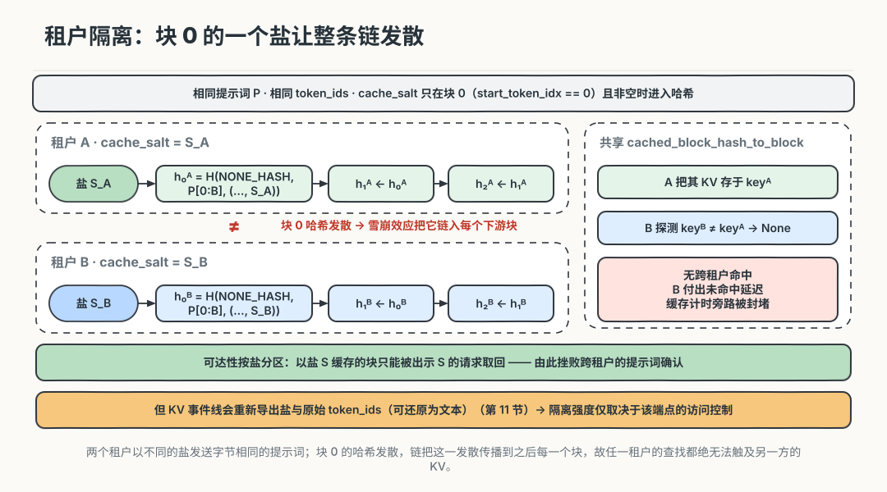</a>

<p class='figure-caption'>两个 tenant 使用不同的高熵 salt 发送相同 prompt。只要不发生 extra-key alias 或 hash collision，block 0 就会不同，这一差异还会沿 chain 传递到下游的每个 key，因此每个 tenant 的 prefix-cache lookup 都会 miss 对方的 entry。</p>

**API surface 及其声明的设计目的**

salt 是一等 request field，并附有明确的安全性设计说明。

来源：[`vllm/entrypoints/openai/chat_completion/protocol.py:425-435`](https://github.com/vllm-project/vllm/blob/6cf7b26bd4bff60bf378e1af14044280ac0d214c/vllm/entrypoints/openai/chat_completion/protocol.py#L425-L435)

```python
    cache_salt: str | None = Field(
        default=None,
        description=(
            "If specified, the prefix cache will be salted with the provided "
            "string to prevent an attacker to guess prompts in multi-user "
            "environments. The salt should be random, protected from "
            "access by 3rd parties, and long enough to be "
            "unpredictable (e.g., 43 characters base64-encoded, corresponding "
            "to 256 bit)."
        ),
    )
```

"43 个 base64 编码字符，对应 256 bit" 这一数值只是*建议*，并非强制要求。唯一的 validation 只是检查 type 和是否非空。

来源：[`vllm/entrypoints/openai/chat_completion/protocol.py:913-921`](https://github.com/vllm-project/vllm/blob/6cf7b26bd4bff60bf378e1af14044280ac0d214c/vllm/entrypoints/openai/chat_completion/protocol.py#L913-L921)

```python
    def check_cache_salt_support(cls, data):
        if data.get("cache_salt") is not None and (
            not isinstance(data["cache_salt"], str) or not data["cache_salt"]
        ):
            raise VLLMValidationError(
                "Parameter 'cache_salt' must be a non-empty string if provided.",
                parameter="cache_salt",
            )
        return data
```

调用方可以省略 salt（`None`，也是默认值），此时 request 会进入常规共享池。若提供 salt，则它必须是非空字符串；除此之外不做任何校验——engine 不会校验其长度、熵或租户级唯一性。salt 是否*确实*随机、保密且 ≥256-bit，完全由调用方负责。因此，该字段的 docstring 只是明确说明调用方必须遵守的使用约定，而不是由代码强制执行。随后，salt 会随 request 原样传入 engine：`EngineCoreRequest.cache_salt`（[`vllm/v1/engine/__init__.py:101`](https://github.com/vllm-project/vllm/blob/6cf7b26bd4bff60bf378e1af14044280ac0d214c/vllm/v1/engine/__init__.py#L101)）→ 存储在 `Request.cache_salt` 上（[`vllm/v1/request.py:159`](https://github.com/vllm-project/vllm/blob/6cf7b26bd4bff60bf378e1af14044280ac0d214c/vllm/v1/request.py#L159)）→ 构造 engine-core request 时复制过去（[`vllm/v1/request.py:219`](https://github.com/vllm-project/vllm/blob/6cf7b26bd4bff60bf378e1af14044280ac0d214c/vllm/v1/request.py#L219)、`cache_salt=request.cache_salt`）。

### 唯一插入点：block 0 的 extra keys

源码：[`vllm/v1/core/kv_cache_utils.py:559-568`](https://github.com/vllm-project/vllm/blob/6cf7b26bd4bff60bf378e1af14044280ac0d214c/vllm/v1/core/kv_cache_utils.py#L559-L568)

```python
    lora_extra_keys: list[str] = _gen_lora_extra_hash_keys(request)
    cache_salt_keys: list[str] = (
        [request.cache_salt] if (start_token_idx == 0 and request.cache_salt) else []
    )
    prompt_embeds_keys = _gen_prompt_embeds_extra_hash_keys(
        request, start_token_idx, end_token_idx
    )

    extra_keys: list[Any] = (
        lora_extra_keys + mm_extra_keys + cache_salt_keys + prompt_embeds_keys
    )
```

仅当 `start_token_idx == 0` *且* `request.cache_salt` 为 truthy 时，`cache_salt_keys` 才非空。第一个 block 之后的所有 block 都无法通过该 guard，salt 不会产生任何影响——在 block 1、2、3……中都不会再次参与 hash。salt 会被放入 block 0 的 extra-key tuple，位置在 LoRA key 和 multimodal key 之后、prompt-embeds 之前（[第 3 节](#3-extra-keysmultimodalcache-salt-与-lora)依赖这一固定拼接顺序来保证 hash 稳定）。另有一个配套 predicate，确保代码确实会走 extra-key 路径：

源码：[`vllm/v1/core/kv_cache_utils.py:424-428`](https://github.com/vllm-project/vllm/blob/6cf7b26bd4bff60bf378e1af14044280ac0d214c/vllm/v1/core/kv_cache_utils.py#L424-L428)

```python
    return (
        bool(request.mm_features)
        or (request.lora_request is not None)
        or (request.cache_salt is not None)
    )
```

带 salt 的 request 绝不可能基于 `(parent, tokens, None)` 计算 hash：每个完整 block 都会无条件调用 `generate_block_hash_extra_keys`，只要 salt 存在，其中的 `cache_salt` 分支就会在 block 0 加入 salt，因此 salt 必然参与 block 0 的 hash。（声明式 `need_extra_keys` predicate 表达了相同的触发条件，但在当前 commit 的源码树中没有调用点，参见[第 3 节](#3-extra-keysmultimodalcache-salt-与-lora)；它记录的是设计意图，而非真正生效的因果路径。）

带 salt 的 request，其 block 0 原像包含 salt；不带 salt 的 request 则不包含。这会使预期原像不同，但要让 cache-key 真正实现分区，仍需假设不存在跨来源的 extra-key alias，也不会发生 digest collision（[第 3 节](#3-extra-keysmultimodalcache-salt-与-lora)）。

**为什么只在 block 0 插入一次就足够**

一个自然的疑问是：如果 salt 只影响 block 0，不同租户岂不是仍会共享 block 1..N？并不会——原因在于 hash *chain*（[第 2 节](#2-block-hash将-token-串联成指纹)），而不是靠逐 block 加 salt。[第 2 节](#2-block-hash将-token-串联成指纹)完整解析了每个 link 的递推关系（[`kv_cache_utils.py:598-604`](https://github.com/vllm-project/vllm/blob/6cf7b26bd4bff60bf378e1af14044280ac0d214c/vllm/v1/core/kv_cache_utils.py#L598-L604)）：在 block 0 的基例中，`NONE_HASH` 和带 salt 的 `extra_keys` 会一并折叠进 `H(NONE_HASH, tokens[0:B], (…, salt))`。对隔离而言，真正关键的是 driver 随后如何处理这个 digest：

源码：[`vllm/v1/core/kv_cache_utils.py:718-726`](https://github.com/vllm-project/vllm/blob/6cf7b26bd4bff60bf378e1af14044280ac0d214c/vllm/v1/core/kv_cache_utils.py#L718-L726)

```python
            # Compute the hash of the current block
            block_tokens = request.all_token_ids[start_token_idx:end_token_idx]
            block_hash = hash_block_tokens(
                caching_hash_fn, prev_block_hash_value, block_tokens, extra_keys
            )

            new_block_hashes.append(block_hash)
            start_token_idx += hash_block_size
            prev_block_hash_value = block_hash
```

block 0 对 `H(NONE_HASH, tokens[0:B], (…, salt))` 执行 hash。driver 随后将该值向后传递：`prev_block_hash_value = block_hash`（`:726`），因此 block 1 会对 `H(block_0_hash, tokens[B:2B], …)` 执行 hash，block 2 又会折叠进 block 1 的 hash，依此类推。salt 已固化在 block 0 的 digest 中；该 digest 又会作为 parent 传入 block 1（它会被折叠进待 hash 的 tuple *内部*，而不是作为并列项追加在一旁），因此 salt 的影响会借助雪崩效应逐级传遍整条 chain。root 一旦被扰动，下游每个 link 都会分叉。这就是代码只需承担一次 salt 开销的原因：在每个 block 上重新对 salt 执行 hash 完全多余，因为 chain 已让每个 hash 成为对整个带 salt prefix 的承诺。

如果两个 request 仅在不会发生 alias 的 `cache_salt` 取值上不同，那么它们的 block 0 原像也会不同；只要不发生 digest collision，后续 block hash 同样会不同。这是由 chain 推导出的性质，并不是针对每个 block 独立提供的保证——如果 chain 机制日后被分段或移除，只给 block 0 加 salt 将无法继续隔离后续 block。之所以只处理 block 0 就足够，是因为当前采用了这种 chain 设计。

### 隔离如何真正成立：lookup 侧

只扰动 write 侧的 hash，隔离只完成了一半。只有 lookup 也使用同一个带 salt 的 hash 作为 key，隔离才真正成立；否则，不一致的 read path 仍可能暴露其他租户的 block。lookup 由 `get_cached_block` 完成，[第 5 节](#5-查找最长-cache-命中)对其进行了完整解析（[`block_pool.py:213-224`](https://github.com/vllm-project/vllm/blob/6cf7b26bd4bff60bf378e1af14044280ac0d214c/vllm/v1/core/block_pool.py#L213-L224)）：它会将待 probe 的 `block_hash` 分别与各个 group id 重新打包，再到共享的 `cached_block_hash_to_block` index 中查找；任何一次 miss 都会返回 `None`。

它所 probe 的 `block_hash` 来自 `request.block_hashes`，后者由同一个带 salt 的 `request_block_hasher` 计算得出（[第 2 节](#2-block-hash将-token-串联成指纹)）；lookup 面向共享的 `cached_block_hash_to_block` index 进行解析——并不存在按租户单独划分的 map，隔离完全由 key 决定。下面沿具体的攻击过程推演：

- 租户 A 发送 prompt `P`，并使用 salt `S_A`。block 0 的 hash 为 `H(NONE_HASH, tokens(P0), (…, "S_A"))`，A 的 KV 会以该 key 存储（第 06 篇介绍了 write/`touch`/refcount 机制；[第 6 节](#6-缓存已最终确认的-block)详细说明了如何插入该 index）。
- 租户 B 发送*相同*的 prompt `P`，但使用 salt `S_B`（或不使用 salt）。如果二者的 extra-key 编码不同，且未发生 digest collision，B 就会得到不同的 block 0 key。
- B 的 `get_cached_block` 会用 B 的 key 进行 probe，无法命中 A 的 block，并返回 `None`。在这条 prefix-cache 路径上，B 会重新计算，而不是复用 A 的 KV，因此 cache-hit 时序信号无法确认 A 是否缓存了 `P`。这一结论并不排除其他时序侧信道或系统侧信道。

scheduler 对该结果的处理方式与其他 prefix hit 相同（第 05 篇介绍了 prefix-aware scheduling）：带 salt 的 miss 对该 prefix 只会产生 `num_computed_tokens = 0`，随后 request 会作为完整 prefill 调度。

在使用高熵且保密的 salt、extra-key value 之间不会 alias，并且不存在 digest collision 的前提下，prefix-cache 可达性会按 salt 分区。在这些假设下，攻击者无法利用这种 cache-hit 时序信号探测其他租户的 prefix。该结论仅适用于 prefix-cache 复用，并不涵盖所有可观测的 latency 来源。

**纵深防御：随机化的 chain root**

即使完全不使用 salt，vLLM 的 block hash 也无法在离线环境中复现。chain root 本身会在每个进程中随机生成。

源码：[`vllm/v1/core/kv_cache_utils.py:111-114`](https://github.com/vllm-project/vllm/blob/6cf7b26bd4bff60bf378e1af14044280ac0d214c/vllm/v1/core/kv_cache_utils.py#L111-L114)

```python
    if hash_seed is None:
        NONE_HASH = BlockHash(os.urandom(32))
    else:
        NONE_HASH = BlockHash(hash_fn(hash_seed))
```

当 `PYTHONHASHSEED` 未设置时（默认行为），每个 engine 进程都会为 `NONE_HASH` 生成一个全新的 32 字节随机值。由于 block 0 使用 `NONE_HASH` 作为 seed，无法读取该根值的观察者，即使猜中了 prompt `P`，实际上也无法预先计算出 `H(NONE_HASH, tokens(P0), …)`，哪怕此时*没有*使用 salt。因此，在所选 digest 的碰撞特性范围内，独立初始化的 engine 理应生成不同的 hash 链。设置 `PYTHONHASHSEED`（跨进程共享 cache 时必须如此，包括 P/D 解耦、KV offload、warm restart，参见[第 4 节](#4-hash-算法sha256-与-builtin碰撞及-pythonhashseed)）会牺牲这种随机化，以换取可复现性。salt 与此机制相互正交，并叠加在其上：`NONE_HASH` 在不同进程之间随机化*根值*，而 salt 则在进程内部按租户进行隔离。

[第 4 节](#4-hash-算法sha256-与-builtin碰撞及-pythonhashseed)详细说明了 `NONE_HASH` / `PYTHONHASHSEED` 的完整确定性边界，以及关于抗碰撞性的论证（配置 docstring 警告称，非加密 hash“甚至会在多租户环境中泄露隐私信息”；这是从碰撞角度对本文 timing 侧问题的补充）。

### 信任边界：event wire 上的 salt

有一处会刻意让 salt 和原始 token ID 离开 engine：KV-cache event stream（event 子系统详见[第 11 节](#11-面向外部-router-的-kv-cache-events)）。只要使用匹配的 tokenizer，这些 ID 通常都能还原成 prompt 文本或非常接近的内容。外部 router 需要重建 block key，因此 `BlockStored` 会携带 extra key，其中也包括 salt。

来源：[`vllm/distributed/kv_events.py:63-68`](https://github.com/vllm-project/vllm/blob/6cf7b26bd4bff60bf378e1af14044280ac0d214c/vllm/distributed/kv_events.py#L63-L68)

```python
    extra_keys: list[tuple[Any, ...] | None] | None = None
    """Extra keys used in block hash computation, one entry per block in
    block_hashes. Each entry contains MM identifiers, LoRA name, cache_salt,
    prompt embedding hashes, etc. for that specific block. Exposed for external
    KV cache consumers to reconstruct block hashes.
    """
```

<a href='images/vllm-07-24-salt-trust-boundary.svg' target='_blank'>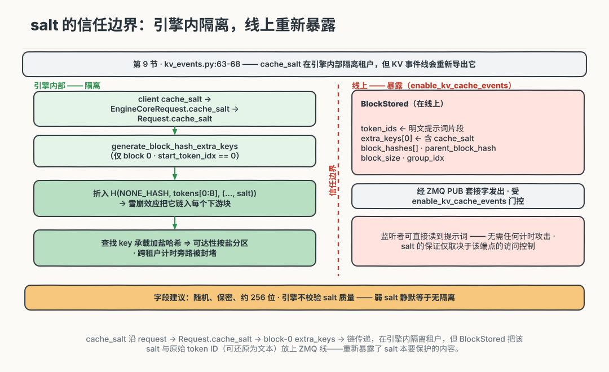</a>

<p class='figure-caption'>salt 的信任边界：cache_salt 沿 request→Request.cache_salt→block-0 extra_keys→chain 传递，用于在 engine 内隔离 prefix-cache key；与此同时，BlockStored 会将该 salt 和原始 token_ids 放到 ZMQ wire 上。借助 tokenizer，token ID 通常可以还原，因此必须将 event stream 视为敏感信息。</p>

router 对 `(parent_block_hash, token_ids_of_block_i, extra_keys[i])` 重新执行 hash，即可复现 `block_hashes[i]`，也就是 engine 进行 hash 时使用的同一个三元组（[第 2 节](#2-block-hash将-token-串联成指纹)、[第 11 节](#11-面向外部-router-的-kv-cache-events)）。为了让重建结果得到*租户专属*的 key，`extra_keys[0]` 必须包含 salt，因此系统会按设计将 salt 一并发出。但同一个 `BlockStored` 还携带原始 `token_ids`。它们并非明文字节，但对于常见的 tokenizer 词表，通常都能还原成 prompt 文本或非常接近的内容。因此，该 endpoint 既能看到敏感的 prompt 内容，也能看到用于生成其 key 的逐租户 salt。由此可见，ZMQ events endpoint 是一条信任边界，应像 cache 本身一样实施访问控制；字段 docstring 中“防止第三方访问”的要求，也会传递到这一 channel。是否发出这些内容由 `enable_kv_cache_events` 控制（[第 11 节](#11-面向外部-router-的-kv-cache-events)），因此禁用该 publisher 后，这些 event payload 就不会通过该 channel 发出。

## 10. 何时跳过 Caching

有些 request 无法安全复用已 cache 的 prefix，还有一些新分配的 block 尚不具备发布条件。下面的分支分为这两类：读取侧检查会在复用可能跳过必要模型计算时返回空的 computed prefix；写入侧检查则会阻止 draft、partial、invalid 或尚未位于本地的 KV 进入 hash index。第 06 篇会介绍这些检查周边的 allocator 机制。

**读取侧：全局 gate 与逐 request skip flag**

读取侧最外层的 skip 条件是 engine 级开关，并且由两个彼此独立的位置共同保证。首先，只有启用了 prefix caching，或者存在 KV connector 时，才会构造 hasher：engine 级 gate 的完整读取逻辑见[第 1 节](#1-prefix-caching-是什么以及复用带来的收益)（[`vllm/v1/engine/core.py:210-219`](https://github.com/vllm-project/vllm/blob/6cf7b26bd4bff60bf378e1af14044280ac0d214c/vllm/v1/engine/core.py#L210-L219)）；当 `enable_prefix_caching or kv_connector is not None` guard 为 false 时，`self.request_block_hasher = None` 会保持不变。当 `request_block_hasher` `None` 时，`Request.update_block_hashes`（[第 2 节](#2-block-hash将-token-串联成指纹)）不会执行任何操作，因为 `self._block_hasher is None`，所以 `request.block_hashes` 永远不会增长，自然也就没有可供查找的内容。

需要注意的是，caching flag 也可能在下游被*强制*关闭：如果任何 layer 将其 KV spec 标记为 `non_causal=True`，engine 就会记录日志 "Disabling prefix caching"，并在 [`core.py:265-269`](https://github.com/vllm-project/vllm/blob/6cf7b26bd4bff60bf378e1af14044280ac0d214c/vllm/v1/engine/core.py#L265-L269) 处清除 `enable_prefix_caching`，因为整个 chain-hash 论证都建立在 causal attention 的假设之上。

其次，即使已经有了 hasher，manager 仍会在每次 lookup 时重新检查 runtime flag：

[`vllm/v1/core/kv_cache_manager.py:214-219`](https://github.com/vllm-project/vllm/blob/6cf7b26bd4bff60bf378e1af14044280ac0d214c/vllm/v1/core/kv_cache_manager.py#L214-L219)

```python
        # We skip finding the prefix cache hit when prefix caching is
        # disabled or the request is marked as skipping kv cache read
        # (which happens when the request requires prompt logprobs
        # or calls a pooling model with all pooling).
        if not self.enable_caching or request.skip_reading_prefix_cache:
            return self.empty_kv_cache_blocks, 0
```

`self.enable_caching` 是 engine gate 在 manager 中的镜像。更值得关注的是第二项：逐 request 的 opt-out 标记 `request.skip_reading_prefix_cache`。它会返回预先构建且不可变的 `empty_kv_cache_blocks`，其中包含 `0` 个 computed token，从而迫使 scheduler 将整个 prompt 都视为尚未计算（第 05 篇会使用这个 `num_computed_tokens`）。该 flag 仅在构造 request 时计算一次（[`request.py:191`](https://github.com/vllm-project/vllm/blob/6cf7b26bd4bff60bf378e1af14044280ac0d214c/vllm/v1/request.py#L191)），之后不再重新计算，因此 lookup 的分支开销很低。

request 为什么要拒绝使用自己的 cache？因为有两种输出模式必须对 prompt 的*每个*位置执行真正的 forward pass，而 prefix hit 会悄无声息地丢掉模型本应评分的位置。该 flag 根据 sampling 或 pooling params 确定：

[`vllm/v1/request.py:271-282`](https://github.com/vllm-project/vllm/blob/6cf7b26bd4bff60bf378e1af14044280ac0d214c/vllm/v1/request.py#L271-L282)

```python
    def get_skip_reading_prefix_cache(self) -> bool:
        if (
            self.sampling_params is not None
            and self.sampling_params.skip_reading_prefix_cache is not None
        ):
            return self.sampling_params.skip_reading_prefix_cache
        elif (
            self.pooling_params is not None
            and self.pooling_params.skip_reading_prefix_cache is not None
        ):
            return self.pooling_params.skip_reading_prefix_cache
        return False
```

这两个来源都会设置该 flag，并附带明确记录的原因。对于生成任务，它与 prompt logprobs 相关：

[`vllm/sampling_params.py:500-504`](https://github.com/vllm-project/vllm/blob/6cf7b26bd4bff60bf378e1af14044280ac0d214c/vllm/sampling_params.py#L500-L504)

```python
        if self.skip_reading_prefix_cache is None:
            # If prefix caching is enabled,
            # the output of prompt logprobs may less than n_prompt_tokens,
            # we need to skip reading cache at this request.
            self.skip_reading_prefix_cache = self.prompt_logprobs is not None
```

如果调用方请求了 `prompt_logprobs`，就表示它需要每个 prompt token 的 logprob；只有该 token 真正流经模型时，才能得到对应结果。prefix hit 会复用已 cache 的 *KV*，但不会为复用的位置生成 logits，因此返回的 prompt-logprob array 长度会不足。正确的修复方式不是强行补齐输出 shape，而是拒绝采用这条捷径。对于 pooling model，whole-sequence task 的逻辑完全相同：

[`vllm/pooling_params.py:124-131`](https://github.com/vllm-project/vllm/blob/6cf7b26bd4bff60bf378e1af14044280ac0d214c/vllm/pooling_params.py#L124-L131)

```python
        if self.skip_reading_prefix_cache is None:
            # If prefix caching is enabled,
            # the output of all pooling may less than n_prompt_tokens,
            # we need to skip reading cache at this request.
            if self.task in ["token_embed", "token_classify"]:
                self.skip_reading_prefix_cache = True
            else:
                self.skip_reading_prefix_cache = False
```

`token_embed` / `token_classify` request 会为*每个 token*输出一个 vector。因此，它们与 prompt logprobs 一样：如果 cache hit 跳过部分位置，输出就会被截断。这类 "all-pooling" task 会设置该 flag；而 pooled-to-one task 只需要最终状态，因此仍会启用 caching。（`plugin` task 也会在 [`pooling_params.py:92-94`](https://github.com/vllm-project/vllm/blob/6cf7b26bd4bff60bf378e1af14044280ac0d214c/vllm/pooling_params.py#L92-L94) 处选择退出。）offload path 同样遵循这个 flag：设置该 flag 后，CPU-offloading connector 的 lookup 会直接返回 `num_hit_tokens = 0`（[`offloading/scheduler.py:729-730`](https://github.com/vllm-project/vllm/blob/6cf7b26bd4bff60bf378e1af14044280ac0d214c/vllm/distributed/kv_transfer/kv_connector/v1/offloading/scheduler.py#L729-L730)），因此被跳过的 request 也不会通过 connector 的后门重新进入 cache。

### 读取侧：重算最后一个 token 的上限

即使 request 会读取 cache，也绝不可能获得 100% hit。[第 5 节](#5-查找最长-cache-命中)将这一行视为 lookup 的入口；这里则将其归入 skip 逻辑，因为它会有意且无条件地截断 hit 结果。

[`vllm/v1/core/kv_cache_manager.py:227`](https://github.com/vllm-project/vllm/blob/6cf7b26bd4bff60bf378e1af14044280ac0d214c/vllm/v1/core/kv_cache_manager.py#L227)（[第 5 节](#5-查找最长-cache-命中)引用了完整的 recompute-last-token NOTE 注释）：

```python
        max_cache_hit_length = request.num_tokens - 1
```

`- 1` 确保 forward pass 始终至少有一个 position 可供计算，从而让第一个 decode step 拥有可用于采样的 logits。由于 hit 按 block 对齐（[第 5 节](#5-查找最长-cache-命中)），其代价可能不止一个 token：对于一个恰好包含 `2 * block_size` 个 token 且已完全 cache 的 prompt，最多只能 hit 一个 block（`(2·bs − 1) // bs = 1`），因此必须重新计算整个尾部 block。注释明确指出，这是已知且可接受的代价，根源在于 `allocate_slots` 的 block 对齐要求（第 06 篇）。`num_new_computed_tokens < num_tokens` 始终成立，因此 scheduler 绝不可能为一个新 prompt 调度零个 new token——必定会留下一个 token，用于生成下一个 logit。

**写入侧：绝不发布尚未 finalized 或并非本地计算得到的 KV**

写入侧的 skip 逻辑位于 `allocate_slots` 和 `cache_full_blocks`。它们守护的不变量与读取侧不同：*hash index 中只会插入这样的 block：它必须完整，且其中的 token 已 finalized、由本地计算并且未被 masked。* 如果说 lookup 的原则是“不要复用任何会改变答案的内容”，那么 write path 的原则就是“不要发布未来 request 不应复用的内容”。这里共有四道 gate。

**(1) P/D remote KV — `delay_cache_blocks`。** 当某个 block 的 KV 要到后续 step 才会从 remote worker 传来时（即 prefill/decode 分离），该 block 的 tensor 尚未有效；此时如果发布其 hash，另一个 request 就可能 hit 到空 block。

[`vllm/v1/core/kv_cache_manager.py:449-461`](https://github.com/vllm-project/vllm/blob/6cf7b26bd4bff60bf378e1af14044280ac0d214c/vllm/v1/core/kv_cache_manager.py#L449-L461)（[第 6 节](#6-缓存已最终确认的-block)详细说明了这段逻辑，并引用了完整的 NOTE 注释）：

```python
        if not self.enable_caching or delay_cache_blocks:
            return self.create_kv_cache_blocks(new_blocks)
        ...
        num_tokens_to_cache = min(
            total_computed_tokens + num_new_tokens,
            request.num_tokens,
        )
```

当 `delay_cache_blocks` 已设置（或 caching 已关闭）时，`:449` 处的提前 `return` 会完全跳过 `cache_blocks`：这些 block 会被分配并交给 request，但不会被发布。调用方会在传输完成的 step 再次尝试 caching。

**(2) Speculative draft — finalized 上限。** 紧随其后的 `:457-460` 几行代码构成第二道 gate。`num_tokens_to_cache` 的上限为 `request.num_tokens`，也就是 `len(self._all_token_ids)`（[`request.py:251-253`](https://github.com/vllm-project/vllm/blob/6cf7b26bd4bff60bf378e1af14044280ac0d214c/vllm/v1/request.py#L251-L253)），其中不包含 `spec_token_ids`（[第 6 节](#6-缓存已最终确认的-block)）。EAGLE/MTP 提议的 draft token 可能会在下一次 verification step 中被拒绝。`min` 将发布范围限制在 finalized prefix 内，因此被拒绝的 draft 从未进入 cache，也就无需 rollback。由此可见，已发布的 block hash 只覆盖已提交的 sequence token。

**(3) Null / masked block — sliding window 和 Mamba。** 即使 request 已完全 finalized，write 逻辑内部仍可能丢弃个别 block。

[`vllm/v1/core/block_pool.py:280-285`](https://github.com/vllm-project/vllm/blob/6cf7b26bd4bff60bf378e1af14044280ac0d214c/vllm/v1/core/block_pool.py#L280-L285)

```python
        for i, blk in enumerate(new_full_blocks):
            # Some blocks may be null or masked out when enabling sparse attention
            # like sliding window attention, or Mamba models with prefix-caching
            # in align mode. We skip null blocks here.
            if blk.is_null or (block_mask is not None and not block_mask[i]):
                continue
```

对于 sliding-window attention，一个已经滑出所有未来 query window 的 block，其 KV 无法再参与后续 query 的 attention。对于 Mamba 风格的 state layer，align mode mask 会标记那些无法独立复用的内部 block。这些 block 会被跳过，而其前后仍 reachable 的 block 依然可以 cache；第 06 篇介绍了 reachability 的计算过程。

**(4) 尾部 partial block — 从不进行 hash。** 最后一道 gate 完全位于 write path 的上游：只有具备 hash 的 block 才可能成为 caching 候选，而 hasher 会拒绝 partial block。

[`vllm/v1/core/kv_cache_utils.py:707-711`](https://github.com/vllm-project/vllm/blob/6cf7b26bd4bff60bf378e1af14044280ac0d214c/vllm/v1/core/kv_cache_utils.py#L707-L711)

```python
        while True:
            end_token_idx = start_token_idx + hash_block_size
            if end_token_idx > num_tokens:
                # We only hash full blocks
                break
```

<a href='images/vllm-07-25-skip-taxonomy.svg' target='_blank'>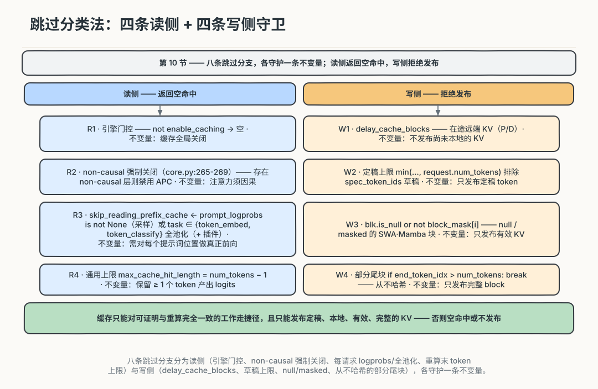</a>

<p class='figure-caption'>skip 分类体系：八条分支分为 read 侧（engine gate、non-causal 强制关闭、per-request logprobs/all-pooling flag、recompute-last-token 上限）和 write 侧（delay_cache_blocks、draft 上限、null/masked、从不 hash 的 partial tail），每条分支各守护一项不变量。</p>

宽度尚未达到 `hash_block_size` 个 token 的 block 不会生成 `BlockHash`，因此不会进入 `request.block_hashes`；`cache_full_blocks` 也就看不到它，任何 lookup 都无法命中它（[第 2 节](#2-block-hash将-token-串联成指纹)）。因此，prefix reuse 始终以完整 block 为单位，并且按 block 对齐：任何 prompt 尾部的少量 token 在填满一个 block 前，从结构上就无法 cache。hash index 中只包含完整 block 的指纹，这正是遇到首个 miss 即停止的 lookup（[第 5 节](#5-查找最长-cache-命中)）和单 block hash 重建（[第 11 节](#11-面向外部-router-的-kv-cache-events)）能够保证正确性的基础。

## 11. 面向外部 Router 的 KV Cache Events

KV-cache event 会将 local prefix cache 的变更暴露给外部使用方。P/D router、remote offload 层或 shared KV store 可以利用这些 event 追踪哪个 engine 持有某个 prefix，而无需共享 engine 的内存。因此，该 stream 必须同时描述 cache 的 identity 和 lifecycle：已存储的 block、已移除的 block，以及全量 reset。

该 stream 与 store、eviction 和 clear 一一对应。`BlockStored` 携带重建 engine block key 所需的输入，使外部使用方无需访问 engine 内存也能维护一致的 index。

### Wire 协议词汇：三个 struct

外部 router 仅凭三个 `msgspec` struct 就能获取全部信息。它们构成了该协议的完整词汇。

来源：[`vllm/distributed/kv_events.py:49-113`](https://github.com/vllm-project/vllm/blob/6cf7b26bd4bff60bf378e1af14044280ac0d214c/vllm/distributed/kv_events.py#L49-L113)

```python
# kv_events.py:49-113
class BlockStored(KVCacheEvent):
    block_hashes: list[ExternalBlockHash]
    parent_block_hash: ExternalBlockHash | None
    token_ids: list[int]
    block_size: int

    lora_id: int | None
    ...
    medium: str | None
    lora_name: str | None

    extra_keys: list[tuple[Any, ...] | None] | None = None
    ...
    group_idx: int | None = None
    # Store events carry cache-spec metadata so consumers can classify and
    # filter groups as they are learned. Remove events only need group_idx+hash.
    kv_cache_spec_kind: str | None = None
    kv_cache_spec_sliding_window: int | None = None
    ...

class BlockRemoved(KVCacheEvent):
    block_hashes: list[ExternalBlockHash]
    medium: str | None
    group_idx: int | None = None
    ...

class AllBlocksCleared(KVCacheEvent):
    pass


class KVEventBatch(EventBatch):
    events: list[BlockStored | BlockRemoved | AllBlocksCleared]
```

<a href='images/vllm-07-26-kv-event-vocab.svg' target='_blank'>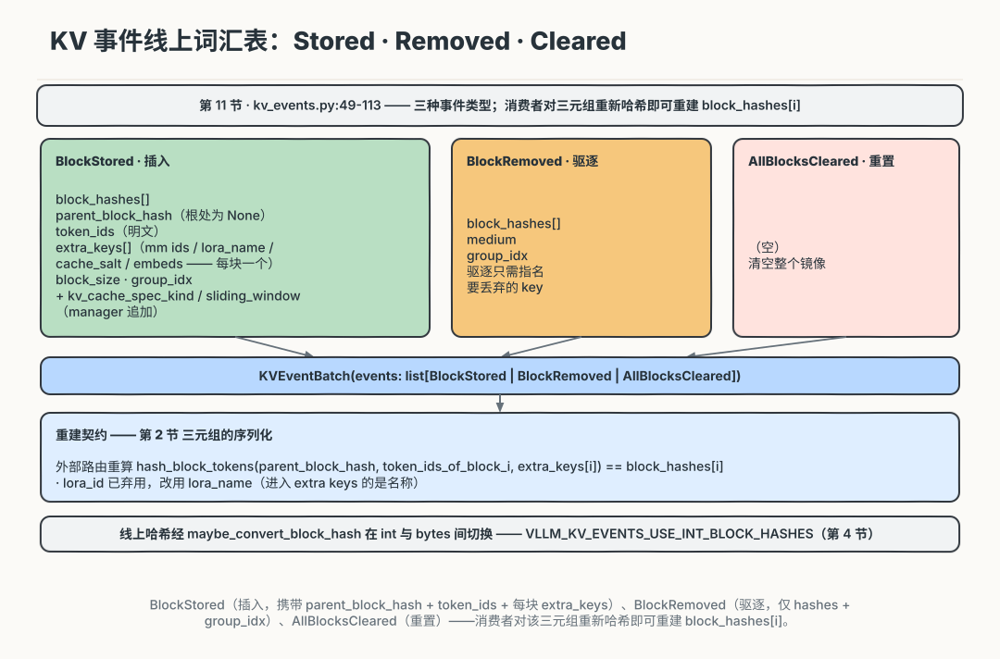</a>

<p class='figure-caption'>KV-event 的 wire 协议词汇：BlockStored（insert，携带 parent_block_hash、token_ids 和每个 block 对应的 extra_keys）、BlockRemoved（evict，仅包含 hash 和 group_idx）以及 AllBlocksCleared（reset）——consumer 对该三元组重新 hash，即可重建 block_hashes[i]。</p>

可将它们分别理解为 insert / evict / reset。`BlockStored` 是一批新 cache block 的 *insert* 记录：其中包含现已驻留的 `block_hashes` 链、对应的 `parent_block_hash`（即 prefix predecessor，链根处为 `None`）、原始 `token_ids`，以及（正是这一部分让 event 不再 opaque、真正具备实用价值）`extra_keys`；每个 block 对应一项，记录该 block 的 multimodal identifier、LoRA name、`cache_salt` 和 prompt-embed hash（[第 3 节](#3-extra-keysmultimodalcache-salt-与-lora)）。`BlockRemoved` 是 *evict* 记录，刻意保持最简形式：只包含即将离开 cache 的 hash 和 `group_idx`。`:71-73` 处的注释直接说明了这种不对称：store 会携带 cache-spec metadata，让 consumer 在发现 group 时即可完成分类；remove 只需给出要删除的 key。`AllBlocksCleared` 是空的 *reset* 记录：使整个镜像失效。`ExternalBlockHash` 是 `bytes | int` 的 alias（[`kv_cache_utils.py:54`](https://github.com/vllm-project/vllm/blob/6cf7b26bd4bff60bf378e1af14044280ac0d214c/vllm/v1/core/kv_cache_utils.py#L54)），这一点在下文中会变得很重要。

为什么还要把 `parent_block_hash`、`token_ids` 和 `extra_keys` 放到 wire 上，明明已经有 `block_hashes` 了？因为 consumer 对三元组 `(parent_block_hash, token_ids_of_block_i, extra_keys[i])` 重新执行 hash 后，就能复现 `block_hashes[i]`——该三元组 *恰好* 就是 engine 传给 `hash_block_tokens` 的内容（[第 2 节](#2-block-hash将-token-串联成指纹)、[`kv_cache_utils.py:598-604`](https://github.com/vllm-project/vllm/blob/6cf7b26bd4bff60bf378e1af14044280ac0d214c/vllm/v1/core/kv_cache_utils.py#L598-L604)）。这些 event 就是序列化后的 hash chain。正因如此，router 才能让自己的 store 也以相同 hash 为 key，而无需信任 engine 给出的 opaque digest；这也解释了为什么 `lora_id` 字段被标记为 *已弃用，应改用 `lora_name`*（`:56-58`）：真正进入 extra keys、进而进入可重建 hash 的是 *name*，而不是 numeric adapter id。

这三个 struct 构成了完整的 protocol，而 event stream 则是 engine 的 prefix-cache 变更记录的忠实有序副本——block pool 每执行一次 store、evict 或 reset，都会发出且只发出一个对应 event，因此 router 对“已 cache 内容”的镜像会始终与 engine 的 `cached_block_hash_to_block` 保持一致。

### Emission 受 gate 控制，store event 由 hash 使用的同一组 key 组装而成

Emission 逻辑位于 `BlockPool` 中，由构造时安装的单一 gate 控制。

来源：[`vllm/v1/core/block_pool.py:194-195`](https://github.com/vllm-project/vllm/blob/6cf7b26bd4bff60bf378e1af14044280ac0d214c/vllm/v1/core/block_pool.py#L194-L195)

```python
        self.enable_kv_cache_events = enable_kv_cache_events
        self.kv_event_queue: list[KVCacheEvent] = []
```

所有 emission site 都受 `if self.enable_kv_cache_events` 保护。event emission 关闭时，queue 会一直为空，而 `take_events()` 会直接 short-circuit：任何 hash 或 `token_ids` 都不会离开当前 process。store event 在 `cache_full_blocks` 内部构建，走的正是将已 finalize 的 block 发布到 index 的同一条 write path（[第 6 节](#6-缓存已最终确认的-block)）：

来源：[`vllm/v1/core/block_pool.py:340-356`](https://github.com/vllm-project/vllm/blob/6cf7b26bd4bff60bf378e1af14044280ac0d214c/vllm/v1/core/block_pool.py#L340-L356)

```python
            self.kv_event_queue.append(
                BlockStored(
                    block_hashes=new_hashes,
                    parent_block_hash=parent_block_hash,
                    token_ids=request.all_token_ids[start_token_idx:end_token_idx],
                    block_size=block_size,
                    lora_id=request.lora_request.adapter_id
                    if request.lora_request
                    else None,
                    medium=MEDIUM_GPU,
                    lora_name=request.lora_request.name
                    if request.lora_request
                    else None,
                    extra_keys=extra_keys_list if extra_keys_list else None,
                    group_idx=kv_cache_group_id,
                )
            )
```

有两个细节确保这项重建约定成立。首先，`parent_block_hash` 在 `:311-316` 处计算：当本轮 run 从头开始 prefix chain 时，取 `None`（`num_cached_blocks == 0`）；否则取最后一个已 cache block 的 hash——这样 router 就能把这段 run 接入自己已有的 prefix tree。其次，`extra_keys_list` 会在 `:326-338` 处重建，方式是 *对每个 block* 调用 `generate_block_hash_extra_keys`——这正是 hasher 在 hash 时调用的同一个函数（[第 3 节](#3-extra-keysmultimodalcache-salt-与-lora)）——循环还会通过 `continue` 跳过 null 和被 mask 掉的 block（`:329-332`），目的正是让 list 长度与 `new_hashes` 一致，从而使逐 block 的对应关系 `extra_keys[i] ↔ block_hashes[i]` 保持完全准确。`token_ids` 字段是 `request.all_token_ids` 的 raw slice：发送到 wire 上的是 prompt 的原始 token ID——它们是 integer ID，而不是 literal text；但匹配的 tokenizer 通常可以直接将其 decode 回 prompt。这正是 endpoint 构成 trust boundary 的根本原因（见下文及[第 9 节](#9-跨-tenant-隔离与-cache-salt)）。

**wire 上的 hash：默认使用 64-bit int，也可按需传输 bytes**

digest 的表示形式要么是 raw bytes，要么是折叠后的 integer，具体由一个 helper 决定。

来源：[`vllm/v1/core/kv_cache_utils.py:79-82`](https://github.com/vllm-project/vllm/blob/6cf7b26bd4bff60bf378e1af14044280ac0d214c/vllm/v1/core/kv_cache_utils.py#L79-L82)

```python
def maybe_convert_block_hash(hash_bytes: BlockHash) -> ExternalBlockHash:
    if not envs.VLLM_KV_EVENTS_USE_INT_BLOCK_HASHES:
        return hash_bytes
    return int.from_bytes(hash_bytes, byteorder="big") & ((1 << 64) - 1)
```

`VLLM_KV_EVENTS_USE_INT_BLOCK_HASHES` 默认为 `True`（[`vllm/envs.py:249`](https://github.com/vllm-project/vllm/blob/6cf7b26bd4bff60bf378e1af14044280ac0d214c/vllm/envs.py#L249)），因此默认情况下，32-byte SHA-256（或 16-byte xxh3-128）的 chain digest 会通过 mask 仅保留低 64 bits，再放到 wire 上；将该 env var 设为 false 即可发送完整 bytes。这种折叠 *仅作用于 wire*：截断后的 integer 绝不会被送回 hash chain，因此不会削弱[第 4 节](#4-hash-算法sha256-与-builtin碰撞及-pythonhashseed)中讨论的 engine 内部 collision resistance——不要把 128-/256-bit chain digest 与这个 64-bit event id 混为一谈。当然，consumer 在重建时也必须采用同一约定，否则重新计算出的 hash 将无法与收到的 id 匹配。

### Eviction 全部经由单一收口点，不会发生静默移除

从 cache 中单独移除任何一个 hash，都会且只会发出一个 `BlockRemoved`（清空整个 cache 的 reset 是唯一例外，下文会说明），因为每次这类移除都经由同一个 method。

来源：[`vllm/v1/core/block_pool.py:505-518`](https://github.com/vllm-project/vllm/blob/6cf7b26bd4bff60bf378e1af14044280ac0d214c/vllm/v1/core/block_pool.py#L505-L518)

```python
    def _emit_block_removed_events(
        self,
        block_hashes: list[BlockHashWithGroupId],
    ) -> None:
        if not self.enable_kv_cache_events:
            return
        for block_hash in block_hashes:
            self.kv_event_queue.append(
                BlockRemoved(
                    block_hashes=[maybe_convert_block_hash(get_block_hash(block_hash))],
                    medium=MEDIUM_GPU,
                    group_idx=get_group_id(block_hash),
                )
            )
```

输入是一个由 `BlockHashWithGroupId` 构成的 list——也就是来自 index 的 packed `hash + group_id` key（[第 5 节](#5-查找最长-cache-命中)）——随后通过 `get_block_hash`/`get_group_id` 将其拆回两个 component，使 remove event 使用的 group identity 与 store 时完全一致。*teardown* 的唯一 caller 是 `_remove_cached_block_hashes`（[`block_pool.py:484-503`](https://github.com/vllm-project/vllm/blob/6cf7b26bd4bff60bf378e1af14044280ac0d214c/vllm/v1/core/block_pool.py#L484-L503)），其调用路径恰好来自三个 call site：allocator 在 `_maybe_evict_cached_block` 中 pop 一个已 cache 但处于 free 状态的 block 以进行 LRU 复用时（[`block_pool.py:589`](https://github.com/vllm-project/vllm/blob/6cf7b26bd4bff60bf378e1af14044280ac0d214c/vllm/v1/core/block_pool.py#L589)、[第 7 节](#7-lru-eviction以-free-queue-表示-eviction-顺序)），以及分别在 `cache_full_blocks`（[`block_pool.py:300`](https://github.com/vllm-project/vllm/blob/6cf7b26bd4bff60bf378e1af14044280ac0d214c/vllm/v1/core/block_pool.py#L300)）和 `cache_partial_block`（[`block_pool.py:419`](https://github.com/vllm-project/vllm/blob/6cf7b26bd4bff60bf378e1af14044280ac0d214c/vllm/v1/core/block_pool.py#L419)）中执行 partial→full promotion 时。后两处都会先删除 coarse-grained partial key，再插入 finer-grained full key，因此 router 永远不会看到仍 alias 到 full block 的 stale partial key。由于 block pool 除了下文的 whole-cache reset 外，不会通过任何其他路径删除 hash，event stream 不可能落后于实际状态。

不会发生静默 eviction：除 full reset 外，每个离开 `cached_block_hash_to_block` 的 hash 都会且只会生成一个 `BlockRemoved`，因此 router 的镜像永远不会保留已被 engine 回收复用的 key。

reset path 与之对应。`reset_prefix_cache`（[第 8 节](#8-命中率与统计信息)）会 append `AllBlocksCleared()`，代码位置在 [`block_pool.py:687-688`](https://github.com/vllm-project/vllm/blob/6cf7b26bd4bff60bf378e1af14044280ac0d214c/vllm/v1/core/block_pool.py#L687-L688)，但 *只有在* 它确认所有 block 都处于 free 状态并真正清空所有 hash map 之后才会这样做——如果仍有 block 被引用，reset 会失败并提前 return，不发出任何 event。因此，只有 engine 真正清空 cache 时才会发布 clear event；router 也绝不会因为 no-op reset 而过度 invalidate。

**Drain、补充 metadata、发布**

Drain 在 single-threaded scheduler loop 中通过 atomic swap 完成：`take_events` 会交出累积的 list，并换上一个全新的 empty list（[`block_pool.py:713-723`](https://github.com/vllm-project/vllm/blob/6cf7b26bd4bff60bf378e1af14044280ac0d214c/vllm/v1/core/block_pool.py#L713-L723)），因此每个 event 在本地都会且只会被 drain 一次。block pool 与 wire 之间还有一道 enrichment step，由 manager 而不是 pool 执行：

来源：[`vllm/v1/core/kv_cache_manager.py:571-589`](https://github.com/vllm-project/vllm/blob/6cf7b26bd4bff60bf378e1af14044280ac0d214c/vllm/v1/core/kv_cache_manager.py#L571-L589)

```python
        events = self.block_pool.take_events()
        for event in events:
            if not isinstance(event, BlockStored):
                continue
            if event.group_idx is None:
                continue
            if event.group_idx < 0 or event.group_idx >= len(
                self.kv_cache_event_metadata
            ):
                logger.warning(
                    "Group index `%s` not in KV cache metadata", event.group_idx
                )
                continue
            # Annotate here so BlockPool can keep emitting structural cache
            # events without owning semantic KV cache spec metadata.
            kind, sliding_window = self.kv_cache_event_metadata[event.group_idx]
            event.kv_cache_spec_kind = kind
            event.kv_cache_spec_sliding_window = sliding_window
        return events
```

block pool 发出的是 *结构性* event（hash、token 和 `group_idx`），自身不包含任何 KV-spec 知识；manager 只会将 *语义性* group metadata（`kv_cache_spec_kind`、`sliding_window`）叠加到 `BlockStored` event 上，并且会先对 `group_idx` 做 bounds check。这就是 store struct 携带这类 metadata 而 remove struct 不携带的原因：consumer 需要用它区分内容相同的 full-attention block 与 sliding-window block（它们位于不同 group，对应不同 key），而且只有在获知一个 key 时才需要这些信息，删除 key 时并不需要。随后由 scheduler 收集并发送：

来源：[`vllm/v1/core/sched/scheduler.py:1809-1824`](https://github.com/vllm-project/vllm/blob/6cf7b26bd4bff60bf378e1af14044280ac0d214c/vllm/v1/core/sched/scheduler.py#L1809-L1824)

```python
        # collect KV cache events from KV cache manager
        events = self.kv_cache_manager.take_events()

        # collect KV cache events from connector
        if self.connector is not None:
            connector_events = self.connector.take_events()
            if connector_events:
                if events is None:
                    events = list(connector_events)
                else:
                    events.extend(connector_events)

        # publish collected KV cache events
        if events:
            batch = KVEventBatch(ts=time.time(), events=events)
            self.kv_event_publisher.publish(batch)
```

每个 scheduler step 都会取出 manager 中的全部 block-pool event，以及所有 connector event（offloading、LMCache 和 multi-connector 都会暴露 `take_events`），将它们封装为一个带 timestamp 的 `KVEventBatch` 并发布。因此，发送粒度是每个 step 一个 batch，并附带 timestamp；该 timestamp 对应的正是 prefix cache 实际发生变化的同一个 tick。

<a href='images/vllm-07-09-kv-events.svg' target='_blank'>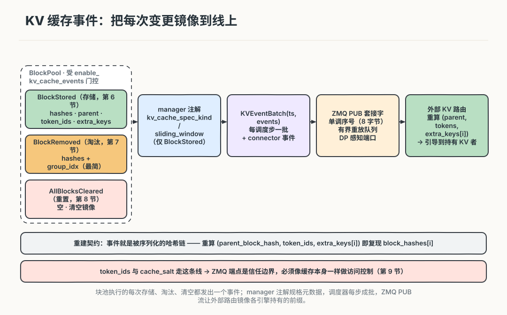</a>

<p class='figure-caption'>从 BlockPool queue 到 manager 的 spec-annotation，再到每个 step 的 KVEventBatch，最后进入带单调序列号和有界 replay buffer 的 ZMQ PUB socket，并由此为外部 router 的镜像提供数据。</p>

### Transport：ZMQ PUB、单调序列号、有界 replay、DP-aware

`publish` 不会直接访问网络——它只是把 batch 放入一个有界的内存 queue（`max_queue_size`，默认 100 000），再由 background thread 处理，因此 scheduler 无需接触网络；只有该 queue 完全积压满时，enqueue 本身才会等待。具体的网络 I/O 由这个 thread 完成：

来源：[`vllm/distributed/kv_events.py:435-442`](https://github.com/vllm-project/vllm/blob/6cf7b26bd4bff60bf378e1af14044280ac0d214c/vllm/distributed/kv_events.py#L435-L442)

```python
                seq = next(self._seq_gen)

                payload = self._pack.encode(event)
                seq_bytes = seq.to_bytes(8, "big")
                self._pub.send_multipart((self._topic_bytes, seq_bytes, payload))

                self._buffer.append((seq, payload))
                self._event_queue.task_done()
```

每个 batch 都会用 msgpack 编码，打上单调递增的 8-byte 序列号，以 `(topic, seq, payload)` 的形式通过 `PUB` socket 发送，并保留在有界 replay `deque`（`buffer_steps`，默认 10 000）中。subscriber 如果发现序列号出现缺口，就会把最后见到的 `seq` 发送到 `ROUTER` replay socket；`_service_replay`（`:449-467`）会重发所有 buffered batch，每个 batch 都带有 `seq >= start_seq`，最后再发送一个 `END_SEQ` sentinel。`:256-262` 明确规定了抽象契约：实现“应保证至少一次交付和单调有序（例如通过序列号）”。Data Parallelism 在 transport edge 处理，而不是在 scheduler 中处理：每个 DP rank 都运行自己的 publisher，`publish` 会用 `data_parallel_rank`（`:350-351`）标记 batch，而 `offset_endpoint_port`（`:469-500`）会根据 rank 偏移各自的 port，确保 stream 绝不冲突。除非通过非 null publisher 启用 event（`:515-535`），否则 factory 会返回 no-op `NullEventPublisher`；这个 gate 与 block-pool queue 使用的是同一条件，只是位于外一层。

单调序列号加有界 replay buffer，使 subscriber 能够检测并恢复缺口——只要缺口仍落在 `buffer_steps` replay window 内，就能以 at-least-once 且有序的方式恢复；如果 subscriber 落后得更多，它仍能检测到数据丢失，但无法通过该 transport replay。每个 rank 独立的 port 和 tag，使每个 event 都能明确归属于唯一的 DP rank，因此 consumer 不会混淆不同 rank，也不会重复计数。

### events endpoint 是一道信任边界

这个重建契约会带来安全层面的影响。为使 router 能够重建 key，`BlockStored` 会把原始 `token_ids` 和每个 block 对应的 `extra_keys` 放到网络上传输；而 `extra_keys[0]` 中还包含租户的 `cache_salt`（[第 3 节](#3-extra-keysmultimodalcache-salt-与-lora)、[第 9 节](#9-跨-tenant-隔离与-cache-salt)）。struct docstring 对此直言不讳（[`kv_events.py:63-68`](https://github.com/vllm-project/vllm/blob/6cf7b26bd4bff60bf378e1af14044280ac0d214c/vllm/distributed/kv_events.py#L63-L68)）：这些额外 key“会暴露给外部 KV cache consumer，用于重建 block hash”。原始 token ID 通常可以借助 tokenizer 还原，因此敏感的 prompt 内容和每个租户的 salt 都会经过 ZMQ channel。无论[第 9 节](#9-跨-tenant-隔离与-cache-salt)通过给 hash chain 加 salt 获得了怎样的隔离效果，其强度最终都取决于该 endpoint 的访问控制：event stream 上的 listener 可以直接检查 payload，根本不需要依赖 cache-timing signal。因此，salt 本身“须防止第三方访问”的使用要求，也同样适用于 event transport。

## 12. 一个 request 经由 warm prefix cache 的完整流程

下面按执行顺序追踪一个 request 命中 warm cache 的完整过程。APC 涉及两个不同层面：hash chain 用于识别可复用的 prefix，而 reference count 与 free queue 则决定对应的物理 block 是否仍然可用。第 06 篇介绍这段 trace 底层的 allocator 机制；第 05 篇解释 scheduler 如何使用 hit length。

<a href='images/vllm-07-10-prefix-trace.svg' target='_blank'>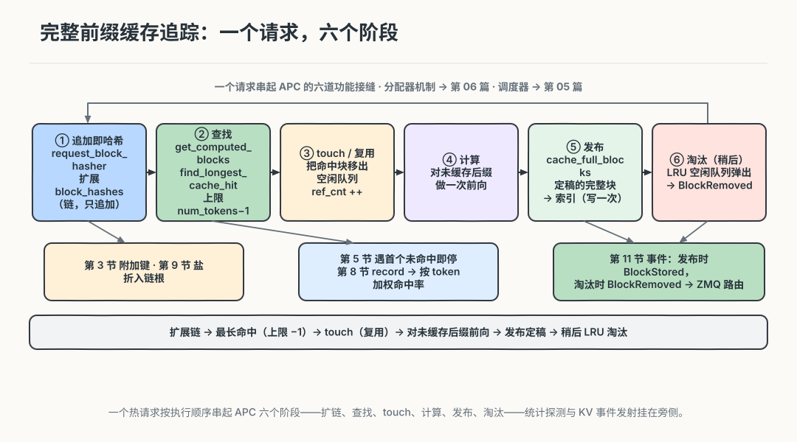</a>

<p class='figure-caption'>一个 request 依次穿过 APC 的六个阶段：chain extension、lookup、touch、stats、publish 和 eviction。</p>

### 阶段 1——append 时计算 hash：chain driver

这段 trace 始于任何 lookup 之前：token 被 append 后，request 会扩展自身的 hash chain。driver 是 `request_block_hasher`，也就是 `get_request_block_hasher` 返回的闭包（[第 2 节](#2-block-hash将-token-串联成指纹) 已逐个链节解析过它；下面的摘录只是对 trace 的回顾）。

来源：[`vllm/v1/core/kv_cache_utils.py:687-728`](https://github.com/vllm-project/vllm/blob/6cf7b26bd4bff60bf378e1af14044280ac0d214c/vllm/v1/core/kv_cache_utils.py#L687-L728)

```python
    def request_block_hasher(request: Request) -> list[BlockHash]:
        start_token_idx = len(request.block_hashes) * hash_block_size
        num_tokens = request.num_tokens
        ...
        prev_block_hash_value = (
            request.block_hashes[-1] if request.block_hashes else None
        )
        new_block_hashes: list[BlockHash] = []
        while True:
            end_token_idx = start_token_idx + hash_block_size
            if end_token_idx > num_tokens:
                # We only hash full blocks
                break
            ...
            block_hash = hash_block_tokens(
                caching_hash_fn, prev_block_hash_value, block_tokens, extra_keys
            )
            new_block_hashes.append(block_hash)
            start_token_idx += hash_block_size
            prev_block_hash_value = block_hash
        return new_block_hashes
```

这是 hash chain 的写入端。`start_token_idx` 会从 `len(block_hashes) * hash_block_size` 处继续，因此 loop 只会扩展现有 chain，而不会再次计算旧链节的 hash。`prev_block_hash_value` 从最后一个已有 hash 开始（若不存在则使用 `None`，而 `hash_block_tokens` 会将其提升为当前进程的 `NONE_HASH` root，参见[第 2 节](#2-block-hash将-token-串联成指纹)/[第 4 节](#4-hash-算法sha256-与-builtin碰撞及-pythonhashseed)），并在第 726 行继续向后传递。`end_token_idx > num_tokens` 分支会让末尾尚未填满的 block 保持未计算 hash 的状态，直到它被填满；这样的 block 暂时既不能发布，也无法被 prefix lookup 找到（[第 6 节](#6-缓存已最终确认的-block)、[第 10 节](#10-何时跳过-caching)）。

只有启用 prefix caching 或存在 KV connector 时，这个闭包才会接入执行路径（[`vllm/v1/engine/core.py:210-219`](https://github.com/vllm-project/vllm/blob/6cf7b26bd4bff60bf378e1af14044280ac0d214c/vllm/v1/engine/core.py#L210-L219)）；否则 `request.block_hashes` 会保持为空，下面的整段 trace 都会直接短路。`block_hashes[i]` 是对完整 prefix `[0, (i+1)·hash_block_size)` 的滚动承诺值，它只会单调扩展，即使发生 preemption 或 speculative rejection 也绝不会截断（第 06 篇，`block_hashes` 的 append-only 单调性）。

### 阶段 2——lookup 与 stats probe

scheduler 准备 request 时，会向 manager 查询已计算的 prefix。`get_computed_blocks` 既是读取侧入口，也是主要 hit-rate signal 的唯一生产者。

来源：[`vllm/v1/core/kv_cache_manager.py:218-242`](https://github.com/vllm-project/vllm/blob/6cf7b26bd4bff60bf378e1af14044280ac0d214c/vllm/v1/core/kv_cache_manager.py#L218-L242)

```python
        if not self.enable_caching or request.skip_reading_prefix_cache:
            return self.empty_kv_cache_blocks, 0
        ...
        max_cache_hit_length = request.num_tokens - 1
        computed_blocks, num_new_computed_tokens = (
            self.coordinator.find_longest_cache_hit(
                request.block_hashes, max_cache_hit_length
            )
        )
        if self.log_stats:
            assert self.prefix_cache_stats is not None
            self.prefix_cache_stats.record(
                num_tokens=request.num_tokens,
                num_hits=num_new_computed_tokens,
                preempted=request.num_preemptions > 0,
            )
        return self.create_kv_cache_blocks(computed_blocks), num_new_computed_tokens
```

这几行代码汇集了三个功能边界。第一处是两道 skip guard（[第 10 节](#10-何时跳过-caching)）：需要 prompt logprobs 的 request，或者 all-pooling model 的 request，会设置 `skip_reading_prefix_cache` 并返回空结果，因为 cache hit 会跳过这些语义所必需的 forward pass。第二处是 `max_cache_hit_length = request.num_tokens - 1`，即 recompute-last-token cap。即使 prompt 100% 命中 cache，也至少会保留一个 token 交给 forward pass 生成 logits；由于 hit 必须按 block 对齐，这可能迫使整个末尾 block 重新计算。第三处是 `find_longest_cache_hit`，它按照 first miss 即停止、所有 group 必须一致的规则遍历 chain（[第 5 节](#5-查找最长-cache-命中)）；其正确性完全依赖阶段 1 中的 chain 具有向下闭合性质——block *k* 一旦 miss，就足以证明之后的每个 block `≥ k` 都不同，因此可以停止扫描。

`record` 调用统计的是 prefix *tokens* 数量，而不是 request 或 block 数量（[第 8 节](#8-命中率与统计信息)）。对于重新接纳的 preempted request，它会将该 request 对自身的命中计入 `preempted_*` bucket（[`stats.py:131-142`](https://github.com/vllm-project/vllm/blob/6cf7b26bd4bff60bf378e1af14044280ac0d214c/vllm/v1/metrics/stats.py#L131-L142)），避免将其纳入 fresh-request 窗口。该方法不会回写 `Request`；它只读取 request，并更新 manager 的统计信息。在 cache key 正确且不存在 hash collision 的前提下，命中可以省去计算，同时不改变模型语义。lookup 还会至少保留一个 token 重新计算。

### 阶段 3——touch 与复用

阶段 2 返回的命中 block 可能仍位于 free queue 中，且 `ref_cnt == 0`：它们属于可用容量，但在被复用或 eviction 之前仍是 cache entry。因此，manager 会在分配新 block 前调用 `touch`。`touch` 会从 queue 中移除每个命中 block，并递增其 reference count（[`block_pool.py:597-612`](https://github.com/vllm-project/vllm/blob/6cf7b26bd4bff60bf378e1af14044280ac0d214c/vllm/v1/core/block_pool.py#L597-L612)）。由于这一操作发生在同一条 allocation path 中的 `get_new_blocks` 之前，allocator 无法立即回收已选中复用的 block。

### 阶段 4——发布已 finalized 的 block

forward pass 结束后，新 finalized 的完整 block 会通过 write path 发布到 `hash → block` index 中（[第 6 节](#6-缓存已最终确认的-block)）：finalized-token 上限不包含 speculative draft（[`kv_cache_manager.py:452-461`](https://github.com/vllm-project/vllm/blob/6cf7b26bd4bff60bf378e1af14044280ac0d214c/vllm/v1/core/kv_cache_manager.py#L452-L461)），整数向下取整会丢弃不完整的 tail，null/masked block 会被跳过，而 `_insert_block_hash` 则设置只写一次的 primary hash，或记录 secondary alias（[`block_pool.py:520-540`](https://github.com/vllm-project/vllm/blob/6cf7b26bd4bff60bf378e1af14044280ac0d214c/vllm/v1/core/block_pool.py#L520-L540)）。第 06 篇的 write funnel 小节详细介绍了这些机制；从 feature 层面看，block 只有通过这条路径才能在全局范围内复用。如果启用了 KV-cache events，也正是在这里，携带 parent hash、block 的 token ids 及其每个 block 的 `extra_keys` 的 `BlockStored` message 会离开当前 process，发往外部 router（[第 11 节](#11-面向外部-router-的-kv-cache-events)）。任何不完整、仍是 draft 或尚未完成计算的内容，都绝不会进入 index。

### 阶段 5——free 与 eviction 顺序

当 request 完成或被 preempt 时，其 block 会重新进入 free queue。LRU *策略*正是在这里编码的——它不依赖 timestamp 或 sweep，而是由位置决定（[第 7 节](#7-lru-eviction以-free-queue-表示-eviction-顺序)完整解读了这一策略；下方摘录仅用于回顾执行轨迹）。

来源：[`vllm/v1/core/block_pool.py:622-635`](https://github.com/vllm-project/vllm/blob/6cf7b26bd4bff60bf378e1af14044280ac0d214c/vllm/v1/core/block_pool.py#L622-L635)

```python
        # Identify blocks with hash (LRU cache) and without it (will never match in APC)
        blocks_with_hash = []
        blocks_without_hash = []
        for block in ordered_blocks:
            block.ref_cnt -= 1
            if block.ref_cnt == 0 and not block.is_null:
                if block.block_hash is None:
                    blocks_without_hash.append(block)
                else:
                    blocks_with_hash.append(block)

        # Blocks without hash always get evicted first - prepend them last to the tail
        self.free_block_queue.prepend_n(blocks_without_hash)
        self.free_block_queue.append_n(blocks_with_hash)
```

重排操作会根据 cache 价值，将释放的 block 分为两个优先级类别。没有 hash 的 block 对 APC 毫无价值，因为它永远无法匹配，所以会被放到 LRU front，优先回收。带 hash 的 block 仍有可能命中，因此会被追加到 MRU tail，尽可能长时间保留。`ordered_blocks` 参数传入时已经由 caller 排好序，caller 传入的是 `reversed(...)`（[`single_type_kv_cache_manager.py:410-411`](https://github.com/vllm-project/vllm/blob/6cf7b26bd4bff60bf378e1af14044280ac0d214c/vllm/v1/core/single_type_kv_cache_manager.py#L410-L411)）。这样一来，在同一批释放的 block 中，chain tail（对应最长 prefix，因此是复用价值最低的 link）会落在更靠近 front 的位置。关键在于，free 并不会触发 eviction：block 会保留其 hash，并继续作为有效的命中目标；直到 allocator 随后在 `get_new_blocks` 中从 front 弹出该 block 并调用 `_maybe_evict_cached_block` 时，hash 才会被移除。该调用会先触发 `on_block_evicted`，以避免 metrics 泄漏；如果启用了 events，还会发出 `BlockRemoved`。

`ref_cnt == 0 ⇔ on the free queue`，而 queue 中的位置*就是* eviction 优先级（无 hash 优先于有 hash，chain tail 优先于 chain root）；eviction 会延后到真正需要内存时才发生。正是这种 lazy 机制，让 APC 在 miss 时的成本接近于零（[第 1 节](#1-prefix-caching-是什么以及复用带来的收益)）：cold request 只需从 front 弹出 block，而 hash map 与 free queue 本就是普通 allocation 已经会访问的一体化结构。

### 要点

- block hash 绑定了完整的对齐 prefix、root 以及 non-token context；因此，lookup 遇到第一个 miss 即可停止。
- 只有完整、已 finalized、位于本地且有效的 block 才会发布；即使整个 prefix 命中，仍会重新计算最后一个 token。
- hash function 的可复现性要求序列化方式、digest 选择和 root seed 彼此兼容；extra key 隔离还假设源值不会发生 alias。
- reference count 决定 physical block 是否处于 live 状态，而 free queue 中的位置则提供 lazy eviction 优先级。
- cache salt 可以隔离不同 tenant 的可达范围，但 KV-cache events 会暴露 token ID 和 extra key，必须将其作为敏感数据加以保护。

## 13. 参考资料

- https://docs.vllm.ai/en/stable/features/automatic_prefix_caching/
- https://vllm.ai/blog/2025-01-27-v1-alpha-release
- https://vllm.ai/blog/2025-09-05-anatomy-of-vllm

*所有代码层面的结论均以 [`vllm-project/vllm@6cf7b26bd`](https://github.com/vllm-project/vllm/tree/6cf7b26bd4bff60bf378e1af14044280ac0d214c) 为依据。*